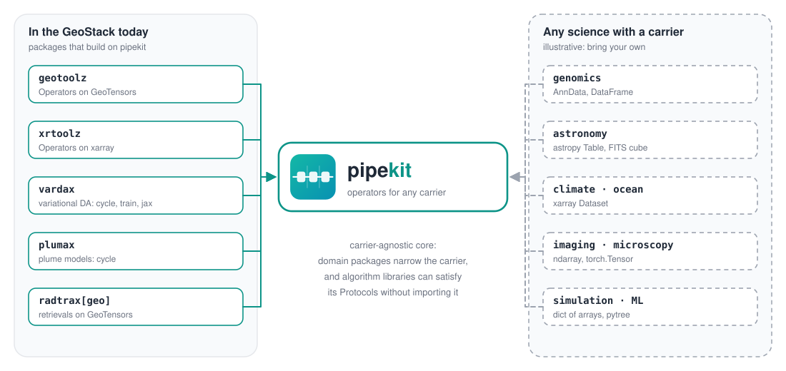

<p align="center">
  <picture>
    <source media="(prefers-color-scheme: dark)" srcset="docs/assets/logo-dark.svg">
    
  </picture>
</p>

<p align="center">
  <a href="https://github.com/jejjohnson/pipekit/actions/workflows/ci.yml"></a>
  <a href="https://github.com/jejjohnson/pipekit/actions/workflows/typecheck.yml"></a>
  
  <a href="https://opensource.org/licenses/MIT"></a>
</p>

<p align="center">
  <a href="https://jejjohnson.github.io/pipekit/"><b>Docs</b></a> ·
  <a href="docs/concepts.md"><b>Concepts</b></a> ·
  <a href="docs/protocols.md"><b>Protocols</b></a> ·
  <a href="docs/tutorials/train-emulator.md"><b>Tutorials</b></a>
</p>

**A family of Python packages for composable scientific pipelines, built on two foundations you can use on their own: pipekit-ops for operators and pipekit-array for named-dim arrays.**

Every step of a scientific workflow (reading a scene, a QC check, a composite, a model, a forecast step, a training loop) becomes an `Operator` that takes a carrier and returns one.
Operators chain with `|`, wire into graphs, wrap in retries, caches and observers, map over many inputs, and save to JSON, and each of those is itself an Operator.
We built pipekit for the [GeoStack](https://github.com/jejjohnson/geostack), but nothing in the two foundations is about geoscience.
Install only what you need: each package is its own distribution, and the `pipekit` umbrella is there for when you want all of them.

## The layering

```
              your pipeline
                    │
   pipekit-cycle       time steps, DA cycles
   pipekit-train       training loops
   pipekit-experiment  registry, trackers
   pipekit-evaluate    benchmarks, scorers
   pipekit-jax         JAX / Equinox models
                    │
                    ▼  build on
   ┌─────────────────────────────────┐
   │ pipekit-array                   │
   │ named dims, any Array API       │
   │ backend                         │
   ├─────────────────────────────────┤
   │ pipekit-ops                     │
   │ Operator, Sequential, Graph;    │
   │ pure Python, no dependencies    │
   └─────────────────────────────────┘
     two foundations, each usable
     on its own
```

The two foundations are libraries in their own right, not the base layer of an umbrella.

- **[pipekit-ops](packages/pipekit-ops/README.md)** is a zero-dependency operator graph for any carrier: `Operator`, `|` and `Graph`, control flow, caching and stores, parallel `Map`, observers, QC and a JSON round-trip with a content hash.
- **[pipekit-array](packages/pipekit-array/README.md)** is named-dim array operators on any Array API backend: one operator runs on NumPy, JAX, CuPy, PyTorch or dask, and on a `DimArray`, an `xr.DataArray` or any carrier that registers an adapter.

The rest of the family builds on them.
The hard dependencies are small: pipekit-ops depends on nothing, and pipekit-array, pipekit-cycle, pipekit-experiment and pipekit-train depend on pipekit-ops only.
pipekit-evaluate adds NumPy and SciPy, and pipekit-jax adds pipekit-cycle, JAX, Equinox and jaxtyping.
pipekit-array is opt-in elsewhere, through the `[array]` extras of pipekit-cycle and pipekit-jax.

## The packages

| | Package | What it gives you | Status | Version |
|---|---|---|---|---|
|  | [pipekit-ops](packages/pipekit-ops/README.md) | **Foundation.** The operator core: `Operator`, `Sequential`, `Graph`, wrappers, `Map`, stores, QC, `dumps` / `loads`, `pipeline_hash` | implemented | 0.2.1 |
|  | [pipekit-array](packages/pipekit-array/README.md) | **Foundation.** Array API dispatch, `DimArray`, dim functions and their operators, `ApplyAlong`, `BatchAlong`, `KernelOp`, `Estimator` | partial | 0.1.1 |
|  | [pipekit-cycle](packages/pipekit-cycle/README.md) | Time stepping and data assimilation: `Cycle`, `DACycle`, `EnsembleDACycle`, `SmootherCycle` and their protocols | implemented | 0.1.0 |
|  | [pipekit-train](packages/pipekit-train/README.md) | Training as an operator: `TrainingLoop`, datasets, losses, callbacks, `HyperSweep`; Equinox, NumPyro and BlackJAX backends | implemented | 0.2.0 |
|  | [pipekit-experiment](packages/pipekit-experiment/README.md) | A content-addressed model registry and tracker protocols, with DVC, Hydra and Metaflow adapters | implemented | 0.1.0 |
|  | [pipekit-evaluate](packages/pipekit-evaluate/README.md) | A benchmark ladder, the `Unit × Lens × Stage` scorers and `EvaluationReport` | partial | 0.2.0 |
|  | [pipekit-jax](packages/pipekit-jax/README.md) | `JaxOperator`, `JaxModelOp` with registry round-trip, `ScanCycle`, `DiffraxForwardModel`, adjoints | implemented | 0.1.0 |
|  | [pipekit](packages/pipekit/README.md) | The umbrella: installs all seven, holds no code | n/a | 0.2.0 |

Each README is that package's front door, with its install extras, a quickstart and its design notes.

## Both foundations in one example

A year of Sentinel-2 over one tile: twelve monthly scenes, four bands and 64 by 64 pixels.
pipekit-array gives the named cube and the steps by dim name; pipekit-ops gives the shape check, the `|`, the summary and the JSON round-trip.

```python
import numpy as np

import pipekit_array as pa
import pipekit_ops as pk

# Shapes: T = 12 monthly scenes; B = 4 bands; Y = X = 64 pixels; K = 3 months per season

rng = np.random.default_rng(0)
reflectance = rng.uniform(0.0, 0.4, size=(12, 4, 64, 64)).astype(np.float32)

# today (pipekit-array)
cube = pa.DimArray(
    reflectance,                                       # (T, B, Y, X)
    ("time", "band", "y", "x"),
    {"band": ("B02", "B03", "B04", "B08")},
)

# today (pipekit-ops)
check = pk.AssertSignature("time band y x", dtype="float32")
# today (pipekit-array)
# s_{q,b,i,j} = (1/K) ∑ₖ x_{Kq+k,b,i,j}
seasonal = pa.Coarsen("mean", time=3)
# today (pipekit-array)
# m_{q,b} = (1/(Y X)) ∑ᵢ ∑ⱼ s_{q,b,i,j}
scene_mean = pa.Reduce("mean", ("y", "x"))
# today (pipekit-ops)
pipeline = check | seasonal | scene_mean

table = pipeline(cube)                                 # (T, B, Y, X) → (T/K, B)
# every intermediate shape, before or after running
print(pipeline.summary(pk.signature_of(cube)))

# today (pipekit-ops)
again = pk.loads(pk.dumps(pipeline))
assert pk.pipeline_hash(again) == pk.pipeline_hash(pipeline)
# the same pipeline on an xarray carrier: band labels come back as a coordinate
table_xr = pipeline(cube.to_xarray())                  # (T, B, Y, X) → (T/K, B)
```

The summary prints the signature after each step, `(time=12, band=4, y=64, x=64)`, then `(time=4, band=4, y=64, x=64)`, then `(time=4, band=4)`.
The same `pipeline` runs on JAX data, under `jax.jit`, as the [pipekit-array README](packages/pipekit-array/README.md) shows.

More end-to-end examples, each with a script that runs as printed:
[build a bigger graph](docs/tutorials/anomaly-graph.md),
[train, register and forecast](docs/tutorials/train-register-forecast.md),
[inference](docs/tutorials/inference.md),
[ensemble data assimilation](docs/tutorials/ensemble-da.md) and
[ETL over many regions](docs/tutorials/etl-regions.md).

## Install

The packages are not on PyPI yet, so install one straight from the repository:

```bash
uv add "pipekit-ops @ git+https://github.com/jejjohnson/pipekit.git#subdirectory=packages/pipekit-ops"
uv add "pipekit-array[numpy] @ git+https://github.com/jejjohnson/pipekit.git#subdirectory=packages/pipekit-array"
```

Once they publish, you install only the ones you need, or the umbrella for all of them:

```bash
uv add pipekit-ops                  # the operator core, no dependencies
uv add "pipekit-array[numpy]"       # named-dim arrays, with the backends you use
uv add pipekit-cycle                # or any other package on its own
uv add pipekit                      # all seven, JAX included
```

A library should depend on the package it imports (usually `pipekit-ops`), never on the umbrella.
Every extra is listed in [docs/installation.md](docs/installation.md) and in each package's README.

## Who builds on it

<p align="center">
  <picture>
    <source media="(prefers-color-scheme: dark)" srcset="docs/assets/ecosystem-dark.svg">
    
  </picture>
</p>

In the GeoStack, [geotoolz](https://github.com/jejjohnson/geotoolz) and [xrtoolz](https://github.com/jejjohnson/xrtoolz) narrow the carrier to a `GeoTensor` and an xarray object.
[vardax](https://github.com/jejjohnson/vardax) and [plumax](https://github.com/jejjohnson/plumax) run their assimilation and models through `pipekit-cycle`, and [radtrax](https://github.com/jejjohnson/radtrax) ships its retrievals as operators behind its `[geo]` extra.

Nothing there is specific to the Earth.
A genomics pipeline on AnnData, an astronomy reduction on astropy tables, or a microscopy workflow on image arrays gets the same composition, observation, caching and serialisation by writing its own operators; the right-hand side of the figure is that invitation, not a list of integrations.
Libraries can also plug in without importing pipekit at all, by satisfying its runtime-checkable protocols (`ForwardModel`, `AnalysisStep`, `ObservationNoise`, `ModelRegistry`, …; see [docs/protocols.md](docs/protocols.md)).

## Where to start

| If you want to… | Read |
|---|---|
| Learn the operator core | [packages/pipekit-ops](packages/pipekit-ops/README.md) |
| Work with named-dim arrays on any backend | [packages/pipekit-array](packages/pipekit-array/README.md) |
| Understand the model in ten minutes | [docs/concepts.md](docs/concepts.md) |
| Plug a library in without depending on pipekit | [docs/protocols.md](docs/protocols.md) |
| Go from `git clone` to a running pipeline | [docs/getting-started.md](docs/getting-started.md) |
| Install only the parts you need | [docs/installation.md](docs/installation.md) |
| See every core operator, group by group | [docs/core-tour.md](docs/core-tour.md) |
| Pick a shape for a deployment (batch, service, orchestrator, audit) | [docs/patterns.md](docs/patterns.md) |
| Know why operators are classes, not functions | [docs/background/toolz.md](docs/background/toolz.md) |
| Train an emulator end to end | [docs/tutorials/train-emulator.md](docs/tutorials/train-emulator.md) |
| Run a data-assimilation cycle | [docs/tutorials/da-cycle.md](docs/tutorials/da-cycle.md) |
| Run pipelines under `jit` | [docs/tutorials/pipekit-under-jit.md](docs/tutorials/pipekit-under-jit.md) |
| Browse the API | [jejjohnson.github.io/pipekit](https://jejjohnson.github.io/pipekit/) |

## Develop

```bash
git clone https://github.com/jejjohnson/pipekit.git
cd pipekit
make install      # uv sync --all-groups except train-extras, + pre-commit hooks
make test         # every package's tests
make lint         # ruff check . (the whole repo)
make typecheck    # ty on every package
make docs-serve   # MkDocs preview
```

Conventional Commits drive releases (release-please, one version per package).
The rules for contributors and coding agents are in [`AGENTS.md`](AGENTS.md), review follows [`CODE_REVIEW.md`](CODE_REVIEW.md), and the local workflow is in [`CONTRIBUTING.md`](CONTRIBUTING.md).
The figures are generated: edit `scripts/make_readme_assets.py` and run it.

## License

MIT; see [LICENSE](LICENSE).
