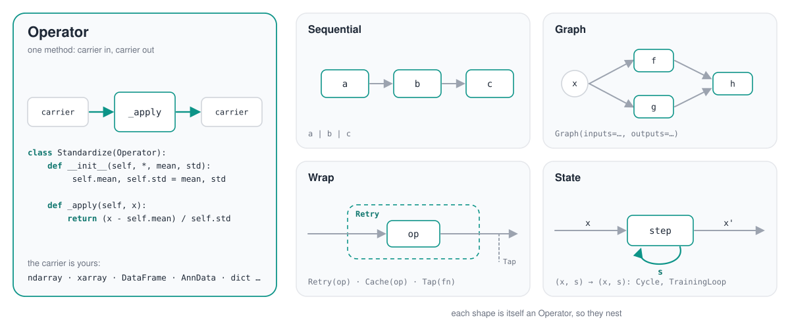
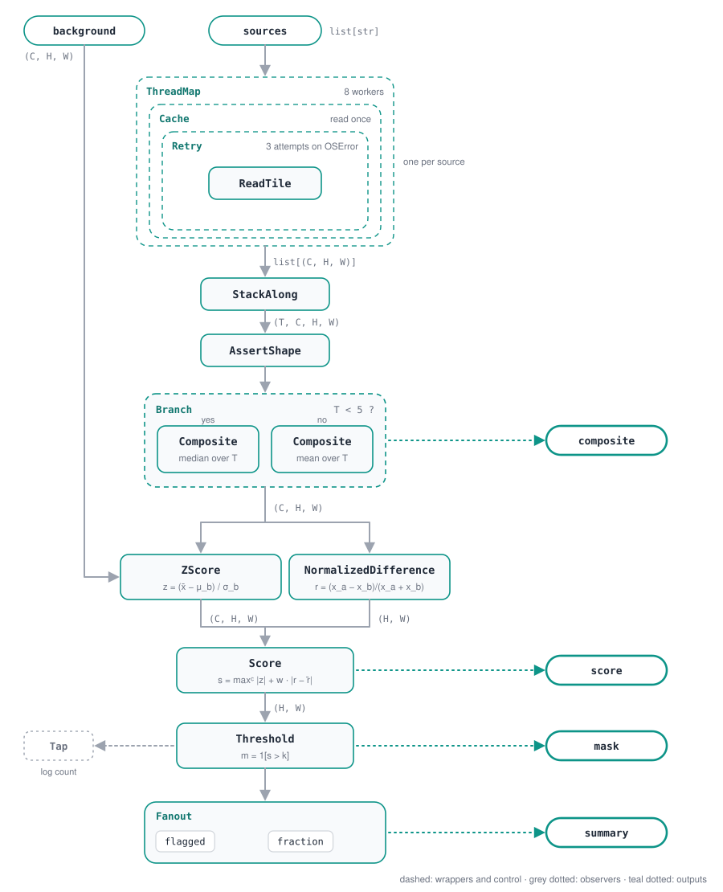
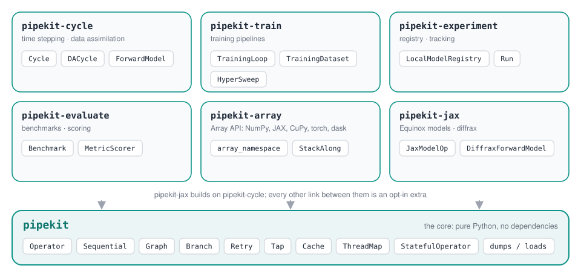
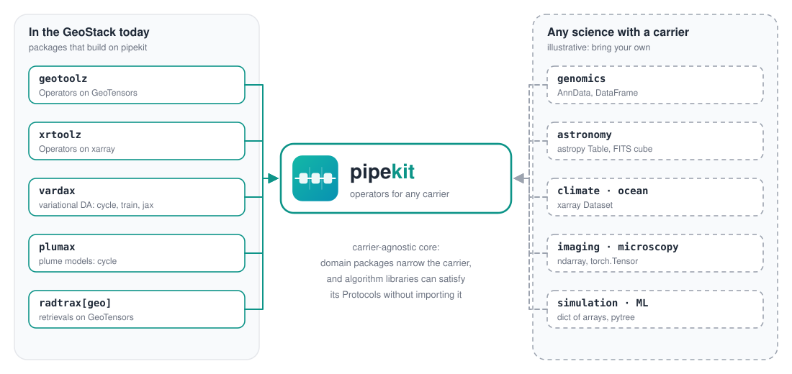

<p align="center">
  <picture>
    <source media="(prefers-color-scheme: dark)" srcset="docs/assets/logo-dark.svg">
    
  </picture>
</p>

<p align="center">
  <a href="https://github.com/jejjohnson/pipekit/actions/workflows/ci.yml"></a>
  <a href="https://github.com/jejjohnson/pipekit/actions/workflows/typecheck.yml"></a>
  
  <a href="https://opensource.org/licenses/MIT"></a>
</p>

<p align="center">
  <a href="https://jejjohnson.github.io/pipekit/"><b>Docs</b></a> ·
  <a href="docs/concepts.md"><b>Concepts</b></a> ·
  <a href="docs/protocols.md"><b>Protocols</b></a> ·
  <a href="docs/tutorials/train-emulator.md"><b>Tutorials</b></a>
</p>

**Composable scientific pipelines: one operator interface, from loading
data to training, assimilating and deploying.**

Every step of a scientific workflow becomes an `Operator`: one method,
`_apply`, that takes a carrier and returns one. The carrier is whatever
your science uses (a NumPy array, an xarray Dataset, a DataFrame, an
AnnData, a dict of arrays) and pipekit never looks inside it. Operators
compose with `|`, wire into graphs, wrap in retries, caches and
observers, and carry state through time steps and training loops, and
each of those is itself an Operator. pipekit was built for the
[GeoStack](https://github.com/jejjohnson/geostack), but the core is pure
Python with no dependencies and nothing in it is about geoscience.

<p align="center">
  <picture>
    <source media="(prefers-color-scheme: dark)" srcset="docs/assets/operator-dark.svg">
    
  </picture>
</p>

## Quick start

```bash
uv add "pipekit @ git+https://github.com/jejjohnson/pipekit.git#subdirectory=packages/pipekit"
```

```python
import numpy as np
from numpy.typing import NDArray

from pipekit import Graph, Input, Operator, Tap, dumps, loads


class Standardize(Operator):
    """x ↦ (x − μ) / σ."""

    def __init__(self, *, mean: float, std: float) -> None:
        self.mean = mean  # μ
        self.std = std  # σ

    def _apply(self, x: NDArray[np.float64]) -> NDArray[np.float64]:
        # z = (x − μ) / σ                                         (N,) → (N,)
        return (x - self.mean) / self.std


class Clip(Operator):
    """z ↦ min(max(z, lo), hi)."""

    def __init__(self, *, lo: float, hi: float) -> None:
        self.lo = lo
        self.hi = hi

    def _apply(self, z: NDArray[np.float64]) -> NDArray[np.float64]:
        # z̃ = min(max(z, lo), hi)                                 (N,) → (N,)
        return np.clip(z, self.lo, self.hi)


class Difference(Operator):
    """(a, b) ↦ a − b."""

    def _apply(
        self, a: NDArray[np.float64], b: NDArray[np.float64]
    ) -> NDArray[np.float64]:
        # d = a − b                                         (N,), (N,) → (N,)
        return a - b


# 1 · compose with |: a Sequential, itself an Operator
clean: Operator = Standardize(mean=10.0, std=2.0) | Clip(lo=-3.0, hi=3.0)
x: NDArray[np.float64] = np.array([4.0, 10.0, 30.0])  # (N,) = (3,)
z: NDArray[np.float64] = clean(x)  # (3,): [-3., 0., 3.]

# 2 · wire a Graph: named inputs, shared operators, named outputs
a, b = Input("a"), Input("b")
graph = Graph(
    inputs={"a": a, "b": b},
    outputs={"anomaly": Difference()(clean(a), clean(b))},
)
out: dict[str, NDArray[np.float64]] = graph(a=x, b=x + 2.0)  # {"anomaly": (3,)}

# 3 · observe without changing the flow
traced: Operator = clean | Tap(lambda v: print("clean:", v))

# 4 · configuration is data: an operator round-trips through JSON
text: str = dumps(Standardize(mean=10.0, std=2.0))
same: Operator = loads(text)  # Standardize(mean=10.0, std=2.0)
```

The same interface steps through time. With `pipekit-cycle`, a forward
model is an operator and a `Cycle` runs it:

```python
import numpy as np
from numpy.typing import NDArray

import pipekit_cycle as pc


# dx/dt = −k x, one explicit Euler step: x_{t+1} = x_t − Δt · k · x_t
def decay(x: NDArray[np.float64], dt: float) -> NDArray[np.float64]:
    return x - dt * 0.1 * x  # (N,) → (N,)


forecast = pc.Cycle(step_op=pc.CallableForward(decay, dt=1.0), n_steps=24)
x24, _ = forecast(np.ones(3), None)  # x₂₄ = (1 − 0.1)²⁴ ≈ 0.080   (3,)
```

Swap `CallableForward` for `NeuralForward` around a trained model from
the registry and the same `Cycle` forecasts with an emulator; add an
observation operator and an analysis step and it assimilates
(`DACycle`, `EnsembleDACycle`).

## A bigger graph

Everything above composes. This is an anomaly detector for a stack of
multi-channel images: satellite scenes, microscope fields or telescope
exposures read the same way. Six small domain operators do the science;
pipekit does the rest: reading in parallel with retries and a cache,
stacking and checking shapes, choosing a composite by the size of the
stack, joining a second input, observing, and summarising, with four
named outputs.

<p align="center">
  <picture>
    <source media="(prefers-color-scheme: dark)" srcset="docs/assets/graph-dark.svg">
    
  </picture>
</p>

The wiring, once the six domain operators are written:

```python
# ReadTile … Threshold are the six domain operators; log_count, count and
# fraction are one-line functions. All of them are in the tutorial.
sources, background = Input("sources"), Input("background")

read = ThreadMap(Cache(Retry(ReadTile(), attempts=3, base_delay=0.5, on=(OSError,))))
stack = (read | StackAlong(axis=0) | AssertShape((None, C, H, W)))(sources)
composite = Branch(
    lambda s: s.shape[0] < 5,
    if_true=Composite(how="median"),
    if_false=Composite(how="mean"),
)(stack)  # (T, C, H, W) → (C, H, W)

z = ZScore(sigma=1.0)(composite, background)  # (C, H, W)
ratio = NormalizedDifference(a=0, b=1)(composite)  # (H, W)
score = Score(weight=10.0)(z, ratio)  # (H, W)
mask = (Threshold(k=3.0) | Tap(log_count))(score)  # (H, W)
summary = Fanout({"flagged": Lambda(count), "fraction": Lambda(fraction)})(mask)

detector = Graph(
    inputs={"sources": sources, "background": background},
    outputs={"composite": composite, "score": score, "mask": mask, "summary": summary},
)
```

The full, runnable version, with the six operators and each step
explained, is the tutorial
[Build a bigger graph](docs/tutorials/anomaly-graph.md).

## The packages

<p align="center">
  <picture>
    <source media="(prefers-color-scheme: dark)" srcset="docs/assets/packages-dark.svg">
    
  </picture>
</p>

A uv workspace of seven packages. Install only what you need: each one
builds on the core and on none of the others, except `pipekit-jax` on
`pipekit-cycle`; tool integrations are opt-in extras.

| Package | Status | What it gives you |
|---|---|---|
| `pipekit` | implemented | The core: `Operator`, `Sequential`, `Graph`; control flow (`Branch`, `Switch`, `Try`, `Retry`, `Coalesce`), observers (`Tap`, `Snapshot`, `Profile`), `Cache`, QC asserts, parallel maps, JSON `dumps` / `loads`, `StatefulOperator` |
| `pipekit-cycle` | implemented | Time stepping and data assimilation: `Cycle`, `DACycle`, `EnsembleDACycle`, `SmootherCycle`, and the `ForwardModel`, `ObservationOperator` and `AnalysisStep` protocols |
| `pipekit-train` | implemented | Training as an operator: `TrainingLoop`, datasets, losses, callbacks, `HyperSweep`; Equinox, NumPyro and BlackJAX backends behind extras |
| `pipekit-experiment` | implemented | A content-addressed model registry (`LocalModelRegistry`, `S3ModelRegistry`, keyed by a hash of config and weights) and tracker protocols, with DVC, Hydra, Metaflow and MLflow adapters |
| `pipekit-jax` | implemented | `JaxModelOp` (an `eqx.Module` with registry round-trip), `DiffraxForwardModel`, adjoints; builds on `pipekit-cycle` |
| `pipekit-array` | partial | Array API dispatch: one operator on NumPy, JAX, CuPy, PyTorch or dask (`array_namespace`, `StackAlong`, `ConcatenateAlong`) |
| `pipekit-evaluate` | partial | A benchmark ladder: `Benchmark`, `MetricScorer`, `EvaluationReport` |

Each package has its own README under [`packages/`](packages/) and,
for the larger ones, design notes under `packages/<pkg>/docs/design/`.

## Who builds on it

<p align="center">
  <picture>
    <source media="(prefers-color-scheme: dark)" srcset="docs/assets/ecosystem-dark.svg">
    
  </picture>
</p>

In the GeoStack, [geotoolz](https://github.com/jejjohnson/geotoolz) and
[xrtoolz](https://github.com/jejjohnson/xrtoolz) narrow the carrier to a
`GeoTensor` and an xarray object;
[vardax](https://github.com/jejjohnson/vardax) and
[plumax](https://github.com/jejjohnson/plumax) run their assimilation and
models through `pipekit-cycle`; [radtrax](https://github.com/jejjohnson/radtrax)
ships its retrievals as operators behind its `[geo]` extra.

Nothing there is specific to the Earth. A genomics pipeline on AnnData,
an astronomy reduction on astropy tables, or a microscopy workflow on
image arrays gets the same composition, observation, caching and
serialisation by writing its own operators; the right-hand side of the
figure is that invitation, not a list of integrations. Libraries can
also plug in without importing pipekit at all, by satisfying its
runtime-checkable protocols (`ForwardModel`, `AnalysisStep`,
`ObservationNoise`, `ModelRegistry`, …; see
[docs/protocols.md](docs/protocols.md)).

## The six things to know

1. **An `Operator` has one method**, `_apply(self, carrier) -> carrier`.
   pipekit never inspects the carrier; domain packages narrow it.
2. **Composition is `|`.** `a | b | c` is a `Sequential`; branching and
   merging flows are a `Graph` built by calling operators on `Input`s.
3. **Wrappers are operators too.** `Retry`, `Try`, `Cache`, `Tap`,
   `ThreadMap` and the QC asserts take an operator and return one, so
   they nest anywhere.
4. **State is explicit.** A `StatefulOperator` maps
   `(carrier, state) → (carrier, state)`; `Cycle`, `DACycle` and
   `TrainingLoop` are built on it.
5. **Configuration is data.** An operator's keyword-only constructor
   arguments are its config; `dumps` writes it as JSON and `loads`
   rebuilds the operator. The model registry hashes config and weights
   together, so the same model has the same key.
6. **Libraries plug in by protocol.** Algorithm libraries satisfy
   runtime-checkable protocols structurally and never have to import
   pipekit ([docs/protocols.md](docs/protocols.md)).

The long form is [docs/concepts.md](docs/concepts.md).

## Where to start

| If you want to… | Read |
|---|---|
| Understand the model in ten minutes | [docs/concepts.md](docs/concepts.md) |
| Plug a library in without depending on pipekit | [docs/protocols.md](docs/protocols.md) |
| Go from `git clone` to a running pipeline | [docs/getting-started.md](docs/getting-started.md) |
| Install only the parts you need | [docs/installation.md](docs/installation.md) |
| Train an emulator end to end | [docs/tutorials/train-emulator.md](docs/tutorials/train-emulator.md) |
| Run a data-assimilation cycle | [docs/tutorials/da-cycle.md](docs/tutorials/da-cycle.md) |
| Build a bigger graph, step by step | [docs/tutorials/anomaly-graph.md](docs/tutorials/anomaly-graph.md) |
| Browse the API | [jejjohnson.github.io/pipekit](https://jejjohnson.github.io/pipekit/) |

## Develop

```bash
git clone https://github.com/jejjohnson/pipekit.git
cd pipekit
make install      # uv sync --all-groups + pre-commit hooks
make test         # every package's tests
make lint         # ruff check . (the whole repo)
make typecheck    # ty on every package
make docs-serve   # MkDocs preview
```

Conventional Commits drive releases (release-please, one version per
package). The rules for contributors and coding agents are in
[`AGENTS.md`](AGENTS.md), review follows [`CODE_REVIEW.md`](CODE_REVIEW.md),
and the local workflow is in [`CONTRIBUTING.md`](CONTRIBUTING.md). The
figures are generated: edit `scripts/make_readme_assets.py` and run it.

## License

MIT; see [LICENSE](LICENSE).
