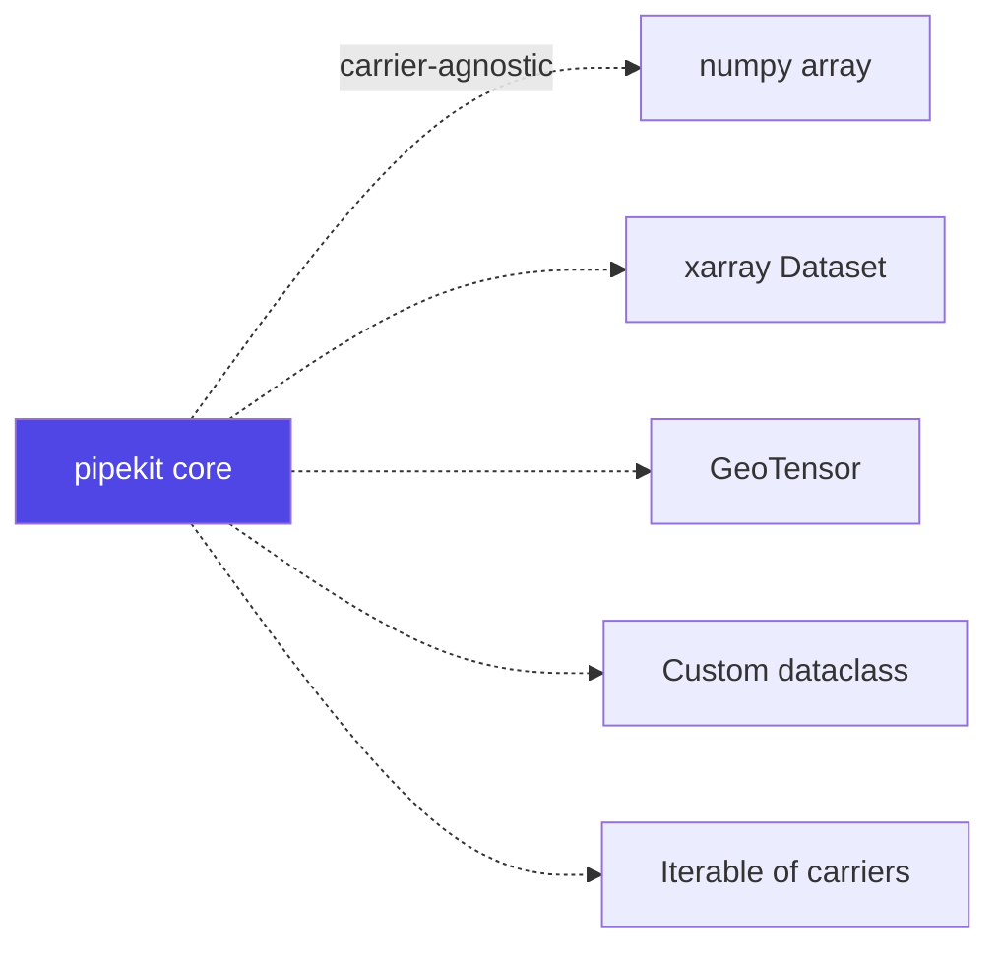
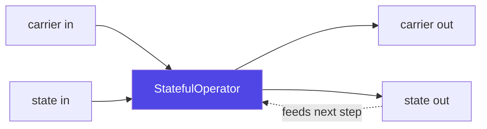

# Concepts

A 10-minute mental model of what `pipekit` is and how the pieces fit together.
If you've used scikit-learn pipelines or Keras's functional API the shapes will look familiar.
pipekit is the same idea generalised to arbitrary data carriers (arrays, `xr.Dataset`, `GeoTensor`, custom dataclasses) and extended to data assimilation, training and reproducibility.

## The one-paragraph version

You write a small `Operator` class for each piece of work (load, mask, diff, train, infer, …).
pipekit gives you the glue: composition with `|`, branching, retries, timeouts and quarantine, dict and list plumbing (`Get`, `Merge`, `Filter`, `GroupBy`, …), structured observation, mapping over many inputs on threads, processes or an event loop (`Map`), caching in memory or on disk, a JSON round-trip with content hashing, and a state substrate for time-stepping.
Sister packages add domain pieces on top (`pipekit-cycle` for data assimilation, `pipekit-train` for training, `pipekit-array` for Array-API-dispatched numerical operators and dim functions, `pipekit-experiment` for the registry / tracker boundary).

## The five things to know

### 1. Operators

An `Operator` is a class with one method: `_apply(self, carrier) -> carrier`.
The carrier can be anything: a numpy array, an xarray `Dataset`, a `GeoTensor`, a pandas DataFrame, a dataclass, even an iterable of carriers.
The carrier flows through; each operator does its work and returns the next carrier.

```python
from pipekit_ops import Operator


class Scale(Operator):
    def __init__(self, factor: float) -> None:
        self.factor = factor

    def _apply(self, x):
        # y = a x
        return x * self.factor


Scale(2.0)(5.0)  # → 10.0
```

The base class handles `__call__`, the configuration round-trip (via `get_config()`), graph node construction (when used inside a `Graph`) and content hashing.
You only implement `_apply`.

### 2. Composition with `|`

The pipe operator chains operators into a `Sequential`:

```python
from pipekit_ops import Sequential, Tap

# today (pipekit-ops)
pipe = Scale(2.0) | Tap(print, name="log") | Scale(3.0)
pipe(5.0)  # → 30.0; the Tap prints "10.0" between scales
```

`Sequential` is itself an `Operator`, so you can compose pipelines into bigger pipelines.

For non-linear flows (multiple inputs, fan-in, fan-out) use a `Graph`.
Calling an operator on an `Input` placeholder builds a node instead of running it, and the graph names its inputs and outputs:

```python
from pipekit_ops import Graph, Input


class Add(Operator):
    def _apply(self, a, b):
        # c = a + b
        return a + b


# today (pipekit-ops)
a = Input("a")
b = Input("b")
total = Add()(a, b)
g = Graph(inputs={"a": a, "b": b}, outputs={"total": total})
g(a=3.0, b=4.0)  # → {"total": 7.0}
```

### 3. Carrier-agnostic by design

The framework doesn't know what a "carrier" is.
The base `Operator` class makes no assumptions about shape, dtype, units or coordinate system.
That's why the same `Operator`, `Sequential` and `Graph` plumbing works across:



Sister packages specialise.
`pipekit-array` operators consume any Array API conformant array, and its dim functions consume any carrier with named dims; `pipekit-cycle` operators consume `(carrier, state)` pairs; domain libraries (`geotoolz`, `xr_toolz`) ship operators that consume their specific carrier types.
A library reaches named dims without knowing the carrier through a `NamedArrayAdapter`, which it registers once with `pipekit_ops.register_adapter`.

### 4. State carry: `StatefulOperator`

Most operators are stateless: they consume a carrier and emit a carrier.
But some need to track state across calls: a time-stepping forecast, a training loop, an online statistic.
For those, pipekit core ships `StatefulOperator` and a generic `CarryState` mechanism:



This is the substrate for:

- `pipekit-cycle.Cycle`: N steps of `(carrier, state) → (carrier, state)`
- `pipekit-train.TrainingLoop`: the optimizer state, step count and metrics flow as `CarryState` across batches
- `pipekit-cycle.DACycle`: a forecast cycle combined with an observation operator and an analysis step

### 5. Backend dispatch: `pipekit-array`

For numerical work, the same operator should run on numpy, JAX, PyTorch, CuPy or dask.
`pipekit-array` operators dispatch on the [Python Array API standard][api]:

```python
from pipekit_array import MeanScalar

# today (pipekit-array)
# Same operator, different backends, picked at call time:
MeanScalar()(numpy_array)  # uses numpy
MeanScalar()(jax_array)  # uses jax.numpy
MeanScalar()(torch_tensor)  # uses array_api_compat.torch
```

[api]: https://data-apis.org/array-api/

The mechanism is `array_namespace(x)`, which returns the module-like namespace shared by all input arrays.
Operators close over `xp = array_namespace(x)` and use `xp.mean`, `xp.concat`, `xp.stack`, etc. for the actual math.
The dim functions (`isel`, `reduce`, `window`, `quantile`, …, and their operators `ISel`, `Reduce`, `Window`, …) go one step further and address axes by name, on a `DimArray`, an `xr.DataArray` or any carrier with a registered adapter.

## Shape inference (where relevant)

Operators that reshape or reduce can opt into static shape inference via `compute_output_signature(input_sig) -> Signature | None`.
A pipeline's signature is its steps' signatures chained, computed without any data:

```python
from pipekit_array import ISel, Reduce
from pipekit_ops import Signature

# Shapes: band = 3; y = x = 256

sig = Signature(dims=(("band", 3), ("y", 256), ("x", 256)), dtype="float32")
# today (pipekit-array)
# mean over band, then every second row and column
every_second = slice(None, None, 2)
pipe = Reduce("mean", "band") | ISel("y", every_second) | ISel("x", every_second)
out_sig = pipe.compute_output_signature(sig)  # (band, y, x) → (y/2, x/2)
# Signature((y=128, x=128) float32)
```

`Sequential.summary(sig)` walks the pipeline and prints a Keras-style table:

```
Operator    Input sig                                  Output sig
----------------------------------------------------------------------------------------
[0] Reduce  Signature((band=3, y=256, x=256) float32)  Signature((y=256, x=256) float32)
[1] ISel    Signature((y=256, x=256) float32)          Signature((y=128, x=256) float32)
[2] ISel    Signature((y=128, x=256) float32)          Signature((y=128, x=128) float32)
```

The default `compute_output_signature` passes the signature through unchanged, since most operators preserve shape and dtype.
An operator that cannot track shape (raw numpy without named dims, a carrier with no adapter) returns `None`; the summary prints `?` for that step and every later one rather than crashing.
`AssertSignature("... y x")` checks a signature at build time as well as at run time.

## The JSON round-trip and content hashing

Every operator implements `get_config() -> dict[str, Any]`, often auto-derived from its `__init__` parameter names.
The framework uses this for:

- **Serialisation**: `pipekit_ops.dumps(op)` → `pipekit_ops.loads(json_text)` rebuilds a whole pipeline, nested operators and `Graph`s included; `pipekit-experiment`'s `HydraConfigLoader.to_yaml` / `from_yaml` do the same through `_target_` YAML. For pipelines you did not write, `loads_sandboxed` and `from_yaml_sandboxed` build only registered classes.
- **Content hashing**: `pipekit_ops.pipeline_hash(op)` is a stable hash of the whole configuration. Same pipeline + same config = same hash, deterministically. It is the identifier `pipekit-experiment`'s `ModelRegistry` stores models under, and part of the key a `Cache` stores entries under.

Operators that carry user closures (`Lambda`, `Tap`, custom callbacks) opt out with `forbid_in_yaml: ClassVar[bool] = True`.
They still work, but their config is a debug repr, not a faithful round-trip.
Most reshaping that used to need a `Lambda` now has an operator that round-trips (`Get`, `Pick`, `Merge`, `Filter`, `GroupBy`, `AssertThat`, `Log`, …); their predicates and keys are operators too, and a bare `lambda` is refused with a `TypeError` that names `Lambda`.

## Where to go next

- **[Getting Started](getting-started.md)**: install, your first pipeline, your first DA cycle, your first registry round-trip.
- **[Installation](installation.md)**: the per-package install matrix with every extras combination.
- **[Tutorials](tutorials/train-emulator.md)**: substantive walkthroughs; train an emulator, run a DA cycle.
- **[API reference](api/pipekit-ops.md)**: generated from docstrings.
