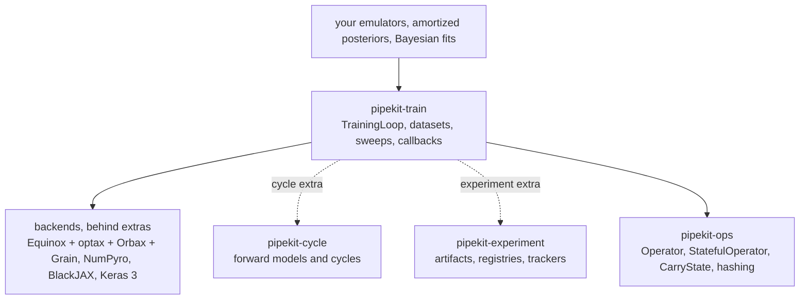

# Quickstart: pipekit-train

The [README](https://github.com/jejjohnson/pipekit/tree/main/packages/pipekit-train) trains one plume emulator. This page repeats that run with its notation in full, then sweeps it, fits a Bayesian model with two engines, and says how the loop, the datasets, the losses and the artifact work, what each backend does and what is not built yet. The blocks run in order on one interpreter, each using what the blocks before it defined.

A training run solves

$$\hat{\boldsymbol{\theta}} = \mathrm{argmin}_{\boldsymbol{\theta}} \ \mathcal{L}(\boldsymbol{\theta}; \mathcal{D})$$

with the loss

$$\mathcal{L}(\boldsymbol{\theta}; \mathcal{D}) = \frac{1}{N} \sum_{n=1}^{N} \ell\left(g(\mathbf{x}_n; \boldsymbol{\theta}), \mathbf{y}_n\right)$$

where $\mathcal{D} = \{(\mathbf{x}_n, \mathbf{y}_n)\}_{n=1}^{N}$ are the $N$ samples a `TrainingDataset` yields, each an input $\mathbf{x}_n \in \mathbb{R}^{D_x}$ and a target $\mathbf{y}_n \in \mathbb{R}^{D_y}$, $g(\cdot; \boldsymbol{\theta})$ is the model with weights $\boldsymbol{\theta} \in \mathbb{R}^{D_\theta}$, and $\ell$ is the `Loss` of one sample. The backend takes `max_steps` optimiser steps, step $i$ on a batch $\mathcal{D}^{(i)} \subset \mathcal{D}$ of $N_\text{batch}$ samples, and the Bayesian backends replace the minimum by the posterior $p(\boldsymbol{\theta} \mid \mathcal{D})$.

## Install

The README has the install commands. This is what each extra adds and when it is needed:

| Extra | What it adds | When you need it |
| --- | --- | --- |
| *(none)* | pipekit-ops | the protocols, datasets, losses, callbacks, writers and sweeps; no backend |
| `equinox` | equinox, optax, jax, grain, orbax-checkpoint, jaxtyping | `backend="equinox"`, the reference backend |
| `numpyro` | numpyro, optax | `backend="numpyro-svi"` and `backend="numpyro-mcmc"` |
| `blackjax` | blackjax, numpyro, optax | `backend="blackjax"`, with NumPyro as the bridge from a model to its log-density |
| `keras` | keras | nothing yet: `backend="keras"` raises `NotImplementedError` |
| `cycle` | pipekit-cycle | the forward models and cycles that `SimulationDataset` runs |
| `experiment` | pipekit-experiment | a real `TrainingArtifact` from `run()`, `Checkpoint(registry=...)` and `LogToExperiment` |
| `cache` | zarr | `CachedDataset` on a local directory |
| `s3` | zarr, fsspec, s3fs | `CachedDataset` on `s3://` |
| `gcs` | zarr, fsspec, gcsfs | `CachedDataset` on `gcs://` |

`SimulationDataset` itself only asks its forward model for a `step(state, dt)` method and a `dt`, so any object with both works without the `cycle` extra; the extra brings pipekit-cycle's `CallableForward`, `Cycle` and the rest. Without `experiment`, `run()` returns a local dataclass with the same field names as `TrainingArtifact`.

In the workspace, `make install` syncs every dependency group except `train-extras` (the `equinox`, `numpyro`, `blackjax` and `cache` extras), because ty reports new diagnostics once it can see those libraries. The backend tests skip without it, so install it to run them, as CI does:

```bash
uv sync --group dev --group train-extras
```

```bash
uv run --group train-extras pytest packages/pipekit-train/tests
```

## Where pipekit-train sits



- **pipekit-ops** is the one required dependency. `TrainingLoop` and `HyperSweep` are `StatefulOperator`s, datasets and losses are `Operator`s, and the content hashes use `pipekit_ops.saving`.
- **pipekit-array** is not a dependency and is not used; array carriers pass straight through to the backend.
- **pipekit-cycle** and **pipekit-experiment** are optional siblings, behind the `cycle` and `experiment` extras. [pipekit-jax](https://github.com/jejjohnson/pipekit/tree/main/packages/pipekit-jax) is not an extra, but its `JaxModelOp` is the model wrapper to use when you want to reload trained weights from a registry.

## Train an emulator

The toy plume model takes $\mathbf{x} = (Q, u) \in \mathbb{R}^{D_x}$, $D_x = 2$, with the emission rate $Q \sim \mathcal{U}(0.5, 2)$ (scaled units) and the wind speed $u \sim \mathcal{U}(1, 5)$ m/s, and returns the peak enhancement $\mathbf{y} = h(\mathbf{x}) \in \mathbb{R}^{D_y}$ at $D_y = 4$ distances $d = 0, \dots, 3$ downwind,

$$y_d = \frac{Q}{u (1 + d)}$$

`SimulationDataset` gives sample $n$ of a split the seed $s_0 + o + n$, where $s_0$ is the dataset's `seed` and $o$ the split's offset, draws $\mathbf{x}_n$ by calling the prior with that seed, and returns the pair $(\mathbf{x}_n, h(\mathbf{x}_n))$. With $N$ = `n_samples`, the training split is the samples $0 \le o + n < \lfloor 8N/10 \rfloor$, validation runs on to $\lfloor 9N/10 \rfloor$ and test to $N$, so the three never share a seed; for $N = 1{,}000$ that is 800, 100 and 100 samples. The emulator $g_\text{emu}(\mathbf{x}; \boldsymbol{\theta})$ is an MLP with weights $\boldsymbol{\theta}$, and `MSE` averages the squared error over the batch and the distances,

$$\mathcal{L}_\text{MSE}(\boldsymbol{\theta}) = \frac{1}{N_\text{batch} D_y} \sum_{n \in \mathcal{D}^{(i)}} \Vert g_\text{emu}(\mathbf{x}_n; \boldsymbol{\theta}) - \mathbf{y}_n \Vert_2^2$$

minimised here by 300 Adam steps on batches of $N_\text{batch} = 32$. The block ends by comparing the emulator with the simulator at a new input $\mathbf{x}_* = (1.2, 2.5)$.

```python
import equinox as eqx
import jax
import numpy as np
import pipekit_cycle as pc
from pipekit_ops import Lambda
from pipekit_train import MSE, SimulationDataset, TrainingLoop
from pipekit_train.backends.equinox import EquinoxModelOp


# Shapes: D_x = 2 inputs (Q, u); D_y = 4 distances; N = 1,000 simulations

# d = 0, 1, 2, 3, the distances downwind
# → (D_y,)
distances = np.arange(4, dtype=np.float32)


# user
# x ~ p(x), with Q ~ U(0.5, 2) and u ~ U(1, 5), one draw per seed
def prior(seed: int) -> np.ndarray:
    rng = np.random.default_rng(seed)
    return rng.uniform([0.5, 1.0], [2.0, 5.0]).astype(np.float32)


# user
# h(x) = Q / (u (1 + d)), the peak enhancement at each distance d
def plume_model(state: np.ndarray, dt: float) -> np.ndarray:
    emission_rate, wind_speed = state
    return emission_rate / (wind_speed * (1.0 + distances))


# today (pipekit-cycle)
# h as a forward model with step(x, dt)
simulator = pc.CallableForward(plume_model, dt=1.0)
# today (pipekit-ops)
# p(x) as an operator, called with seed=
prior_op = Lambda(prior)
# today (pipekit-train)
# 𝒟 = {(xₙ, h(xₙ))}, the training split: the first 80 % of N seeds
train_set = SimulationDataset(
    forward_model=simulator,
    prior=prior_op,
    n_samples=1_000,
    simulator_version="toy-plume-v1",
)
# today (pipekit-train)
# the validation split, the next 10 % of seeds
val_set = train_set.with_split("val")

# today (equinox)
# g_emu(x; θ), an MLP with two hidden layers of 32 units
mlp = eqx.nn.MLP(in_size=2, out_size=4, width_size=32, depth=2, key=jax.random.key(0))
# today (pipekit-train)
emulator = EquinoxModelOp(mlp)

# today (pipekit-train)
# θ̂ = argmin_θ ℒ_MSE(θ), by 300 Adam steps on batches of 32
loop = TrainingLoop(
    model_op=emulator,
    dataset=train_set,
    val_dataset=val_set,
    loss=MSE(),
    optimizer_config={"name": "adam", "lr": 3e-3},
    max_steps=300,
    batch_size=32,
    eval_every_n_steps=300,
)
# today (pipekit-train)
trained, artifact = loop.run()

# x_* = (Q, u) = (1.2, 2.5)
# → (D_x,)
test_state = np.array([1.2, 2.5], dtype=np.float32)
# h(x_*) and g_emu(x_*; θ̂)
# (D_x,) → (D_y,), (D_y,)
simulated = plume_model(test_state, dt=1.0)
emulated = np.asarray(trained(test_state))
# ℒ_MSE on the validation split, after the last step
# → ()
val_mse = artifact.backend_info["final_eval_metrics"]["mse"]
# the artifact records the content hash of 𝒟
same_data = artifact.dataset_hash == train_set.content_hash()
print(simulated.round(3), emulated.round(3), f"{val_mse:.1e}", same_data)
```

This prints `[0.48 0.24 0.16 0.12] [0.456 0.228 0.155 0.111] 7.0e-04 True`: the simulator's enhancement at $\mathbf{x}_*$ at the four distances, the emulator's, which is within 0.024 of it at every distance, a validation $\mathcal{L}_\text{MSE}$ of $7.0 \times 10^{-4}$, and `True` because the artifact holds the training set's content hash. `len(train_set)` and `len(val_set)` are 800 and 100.

Training an amortized posterior uses the same simulations read the other way round: `SimulationDataset(..., invert=True)` yields $(h(\mathbf{x}_n), \mathbf{x}_n)$, so the network $g_\text{post}(\mathbf{y}; \boldsymbol{\theta})$ maps an observation back to the input that made it. With `NLL` and a network that returns a distribution, that is neural posterior estimation. `invert` is part of the content hash, so the two orders never share a cache.

## Sweep the learning rate and the width

`HyperSweep` builds one `TrainingLoop` per point of a search space, runs them one after another and ranks them on a validation metric. Here the grid is the learning rate $\eta \in \{10^{-3}, 3 \cdot 10^{-3}\}$ and the hidden width, four trials, each stopped early by `EarlyStopping` once two evaluations in a row fail to lower the validation $\mathcal{L}_\text{MSE}$.

```python
from pipekit_train import EarlyStopping, HyperSweep, ParameterGrid


# Shapes: D_x = 2 inputs; D_y = 4 distances; N = 1,000 simulations (as above)


# user
# one loop per point (η, width) of the grid, stopped when ℒ_MSE stalls
def make_loop(params: dict) -> TrainingLoop:
    # today (equinox)
    # g_emu(x; θ) with the trial's hidden width
    mlp = eqx.nn.MLP(2, 4, width_size=params["width"], depth=2, key=jax.random.key(0))
    # today (pipekit-train)
    # stop after 2 evaluations without a lower validation ℒ_MSE
    stopping = EarlyStopping("mse", patience=2)
    # today (pipekit-train)
    return TrainingLoop(
        model_op=EquinoxModelOp(mlp),
        dataset=train_set,
        val_dataset=val_set,
        loss=MSE(),
        optimizer_config={"name": "adam", "lr": params["lr"]},
        max_steps=300,
        batch_size=32,
        eval_every_n_steps=100,
        callbacks=(stopping,),
    )


# today (pipekit-train)
# η ∈ {10⁻³, 3·10⁻³} and a width of 16 or 32: four trials
grid = ParameterGrid({"lr": [1e-3, 3e-3], "width": [16, 32]})
# today (pipekit-train)
sweep = HyperSweep(make_loop, grid, select_metric="mse")
# today (pipekit-train)
# the trials, best first by validation ℒ_MSE
results = sweep.run()
for result in results:
    print(result.params, f"{result.final_metric:.1e}")
```

This prints

```
{'lr': 0.003, 'width': 32} 7.0e-04
{'lr': 0.003, 'width': 16} 2.3e-03
{'lr': 0.001, 'width': 32} 2.8e-03
{'lr': 0.001, 'width': 16} 1.5e-02
```

that is, each trial's parameters and its final validation $\mathcal{L}_\text{MSE}$, best first. The best trial is the emulator above, with the same seed and settings, so it ends at the same $7.0 \times 10^{-4}$; the slower learning rate and the narrower network each cost a factor of three or more within 300 steps. Each `SweepResult` also holds the trial's trained operator and artifact. Any iterable of parameter dicts works in place of a `ParameterGrid`, and `select_mode="max"` ranks an accuracy instead of a loss. A trial without a `val_dataset` is ranked on its last training batch, with a warning, unless `select_split="train"` asks for that.

## Fit a Bayesian model

The Bayesian backends take a NumPyro model instead of a loss. Here we infer the emission rate $Q$ of one source from $N = 60$ passes, each with the wind speed $u_n \sim \mathcal{U}(1, 5)$ and a distance $d_n \in \{0, 1, 2, 3\}$, so that the plume's shape at pass $n$ is $s_n = 1 / (u_n (1 + d_n))$ and the observed enhancement is $y_n = Q s_n + \varepsilon_n$ with $\varepsilon_n \sim \mathcal{N}(0, \sigma^2)$. The data use $Q = 1.4$ and $\sigma = 0.02$. The parameters are $\boldsymbol{\theta} = (Q, \sigma)$, with priors $Q \sim \mathrm{LogNormal}(0, 1)$ and $\sigma \sim \mathrm{HalfNormal}(0.1)$, and the posterior is

$$p(\boldsymbol{\theta} \mid \mathcal{D}) \propto p(Q) \ p(\sigma) \prod_{n=1}^{N} \mathcal{N}(y_n; Q s_n, \sigma^2)$$

which `numpyro-mcmc` samples with NUTS (Hoffman and Gelman, 2014). `max_steps` and `optimizer_config` play no part in a NUTS run; the `NumpyroTask` sets the warm-up and the number of draws.

```python
import numpy as np
import numpyro
import numpyro.distributions as dist
from pipekit_ops import Identity
from pipekit_train import IterableDataset, TrainingLoop
from pipekit_train.backends.numpyro import NumpyroTask


# Shapes: N = 60 passes over one source; θ = (Q, σ), 2 parameters

rng = np.random.default_rng(0)
# uₙ ~ U(1, 5) and dₙ ∈ {0, 1, 2, 3}, the wind speed and the distance of pass n
# → (N,), (N,)
wind_speed = rng.uniform(1.0, 5.0, 60)
distance = rng.integers(0, 4, 60)
# sₙ = 1 / (uₙ (1 + dₙ)), the plume's shape at pass n
# → (N,)
plume_shape = (1.0 / (wind_speed * (1.0 + distance))).astype(np.float32)
# yₙ = Q sₙ + εₙ, with Q = 1.4 and εₙ ~ 𝒩(0, 0.02²)
# → (N,)
noise = rng.normal(0.0, 0.02, 60)
enhancement = (1.4 * plume_shape + noise).astype(np.float32)
# today (pipekit-train)
# 𝒟 = {(sₙ, yₙ)}, with a hash we name
passes = IterableDataset(
    list(zip(plume_shape, enhancement, strict=True)), content_hash="toy-passes-v1"
)


# user
# Q ~ LogNormal(0, 1), σ ~ HalfNormal(0.1) and yₙ ~ 𝒩(Q sₙ, σ²)
def model(plume_shape, enhancement=None):
    emission_rate = numpyro.sample("q", dist.LogNormal(0.0, 1.0))
    noise_std = numpyro.sample("sigma", dist.HalfNormal(0.1))
    mean = emission_rate * plume_shape
    numpyro.sample("obs", dist.Normal(mean, noise_std), obs=enhancement)


# today (pipekit-train)
# p(θ | 𝒟) by NUTS: 300 warm-up steps, then 300 draws
task = NumpyroTask(model, num_warmup=300, num_samples=300)
# today (pipekit-ops, pipekit-train)
# the Bayesian backends ignore model_op, so Identity stands in
loop = TrainingLoop(
    model_op=Identity(), dataset=passes, task=task, backend="numpyro-mcmc"
)
# today (pipekit-train)
posterior_op, artifact = loop.run()
# today (pipekit-train)
# Q⁽ˢ⁾ ~ p(Q | 𝒟), s = 1, …, 300
# → (300,)
q_draws = np.asarray(posterior_op.posterior_samples()["q"])
# today (pipekit-train)
# 𝔼[y_* | 𝒟] at s_* = 0.25, averaged over posterior-predictive draws
# (1,) → (1,)
predicted = posterior_op(np.float32([0.25]))
print(q_draws.mean().round(3), q_draws.std().round(3), predicted.round(3))
```

This prints `1.411 0.009 [0.354]`: the posterior mean of $Q$, within 0.011 of the true 1.4, its posterior standard deviation, and the posterior-predictive mean of the enhancement at $s_* = 0.25$, against $1.4 \times 0.25 = 0.35$ without noise. `posterior_op` is a `NumpyroPredictiveOp`: its call returns the posterior-predictive mean of the task's `predictive_site` (`"obs"` by default), and `predictive_draws(x)` returns the draws behind it, for credible intervals.

### Swap the engine, keep the model

The same `NumpyroTask` runs under `backend="numpyro-svi"`, which fits a guide (by default NumPyro's `AutoNormal`, from Kucukelbir et al., 2017) by stochastic variational inference (Hoffman et al., 2013) for `max_steps` full-batch steps of the optax optimiser that `optimizer_config` names. It also runs under `backend="blackjax"`, inside a `BlackjaxTask`, which turns the model into a log-density with NumPyro and samples it with BlackJAX's NUTS. For this backend `max_steps` is the number of draws.

```python
from pipekit_train.backends.blackjax import BlackjaxTask


# Shapes: N = 60 passes; θ = (Q, σ) (the data and the model as above)

# today (pipekit-train)
# the same NumPyro model, bridged to log p(θ | 𝒟) for BlackJAX's NUTS
blackjax_task = BlackjaxTask(numpyro_task=task, num_warmup=300)
# today (pipekit-ops, pipekit-train)
# max_steps is the number of draws for this backend
loop = TrainingLoop(
    model_op=Identity(),
    dataset=passes,
    task=blackjax_task,
    max_steps=300,
    backend="blackjax",
)
# today (pipekit-train)
posterior_op, artifact = loop.run()
# today (pipekit-train)
# Q⁽ˢ⁾ ~ p(Q | 𝒟), s = 1, …, 300
# → (300,)
q_draws = np.asarray(posterior_op.posterior_samples()["q"])
print(q_draws.mean().round(3), q_draws.std().round(3))
```

This prints `1.411 0.009`, the same posterior mean and standard deviation of $Q$ as NumPyro's NUTS to three decimals. With a `numpyro_task` the BlackJAX backend returns a `NumpyroPredictiveOp`, so the calls above work on it unchanged; a `BlackjaxTask` built on a bare `logdensity_fn` returns a `BlackjaxPredictiveOp` instead, which predicts only through the `predict_fn` you give it. The [NumPyro](../design-train/numpyro_adapter.md) and [BlackJAX](../design-train/blackjax_adapter.md) designs explain the shared seam.

## The backends

The `backend=` string of `TrainingLoop` names the area that trains, which the loop imports only when it runs.

| `backend=` | Objective | Trained operator | Status |
| --- | --- | --- | --- |
| `"equinox"` | a `Loss`, or a `TrainTask` | the model wrapper passed in (`EquinoxModelOp` or `pipekit_jax.JaxModelOp`) | the reference |
| `"numpyro-svi"` | a `NumpyroTask` (model, guide, ELBO) | `NumpyroPredictiveOp` | ships |
| `"numpyro-mcmc"` | a `NumpyroTask` (model, NUTS) | `NumpyroPredictiveOp` | ships |
| `"blackjax"` | a `BlackjaxTask` (a `NumpyroTask`, or a log-density) | `NumpyroPredictiveOp`, or `BlackjaxPredictiveOp` for a log-density | ships, NUTS only |
| `"keras"` | a `Loss` | none | raises `NotImplementedError` |

## How it works

### A thin loop over existing tools

`TrainingLoop` holds the model, the data, the loss and the settings, and delegates the training to the backend's area under `pipekit_train.backends`, which it imports only when called. The backend owns the update step and the validation pass; the loop owns the callbacks and the artifact. `max_steps` counts optimiser steps, not epochs (ADR D10), and `optimizer_config` is a flat dict such as `{"name": "adamw", "lr": 3e-4}`, which is also the default. The names are `adam`, `adamw`, `sgd` and `rmsprop`, `lr` and `learning_rate` both work, and the other keys go to the optax constructor. For anything a `Loss` cannot say, pass `task=` instead: a `TrainTask` for Equinox, a `NumpyroTask` or a `BlackjaxTask` for the Bayesian backends. The Equinox backend also takes a `ShardingSpec` (`sharding=`) for multi-device and multi-host data-parallel training (ADR D12).

### Datasets are hashed, not just iterated

A `TrainingDataset` yields `(input, target)` pairs and has a `content_hash()`, which goes into the training artifact. `IterableDataset` wraps any iterable with a hash you supply, because we cannot introspect an arbitrary source. `SimulationDataset` draws inputs from a prior operator, runs the forward model (one step, or a whole `Cycle` rollout), and can push the output through an observation operator. Each sample gets its own seed, and `with_split("val")` moves to a disjoint block of seeds (80/10/10), so splits never overlap. Its hash covers the class and config of the forward model, the cycle and the observation operator, the forward model's `state_signature` and `dt`, the prior's config, `n_samples`, the seed, the split, the cycle's initial state and `simulator_version`. A Python function cannot be hashed reliably, so pass `simulator_version=` and change it when the simulator changes; the hash warns once when the forward model wraps a function or has no `get_config`, and no version is set. `CachedDataset` writes the pairs to zarr on the first pass, keyed by the source's hash, so a second run, on this machine or another, reads the cache instead of simulating again. On the Equinox backend an indexable dataset is shuffled and batched by Grain, and a streaming one is read in order.

### Losses, callbacks and writers are protocols

`Loss` is any callable `(predicted, target) -> scalar` or `(scalar, aux_dict)`. `MSE` works on NumPy and JAX arrays by duck typing, `NLL` and `KL` take distribution-shaped predictions (`KL` uses the analytic divergence when the prediction has one, and a Monte Carlo estimate otherwise), and `Composite` sums weighted losses and reports each part. A loss that takes a `key` keyword gets a fresh PRNG key per batch, through `call_loss`. `Callback` has five optional hooks (`on_train_begin`, `on_step_end`, `on_eval_end`, `on_epoch_end`, `on_train_end`). `EarlyStopping` watches an eval metric, `Checkpoint` sets the Orbax cadence and, given a registry, stores the final model by hash, and `LogToExperiment` forwards to any `ExperimentTracker`. `MetricWriter` is one `write` call; `JSONLWriter` appends a line per step.

### What comes back

`run()` returns the trained model as an operator and an artifact with `training_pipeline_yaml`, `dataset_hash`, `trained_model_hash`, `tracker_run_id`, `model_registry_uri`, `backend_info` and `deps_lock`. `training_pipeline_yaml` holds the loop's pipeline as indented JSON, `trained_model_hash` is the registry's hash when a `Checkpoint` stored the model and the hash of its config and weights otherwise, and `deps_lock` is the output of `uv pip freeze`, or empty where uv is not installed. `backend_info` carries `final_step`, `final_metrics` and, with a validation set, `final_eval_metrics`, which is what `HyperSweep` ranks on. The Bayesian backends return a predictive operator: calling it gives the posterior-predictive mean of one site, and `posterior_samples()` and `predictive_draws(x)` give the full draws for credible intervals.

### Reloading trained weights

`EquinoxModelOp` writes its weights with `serialize_weights`, so a registry can store them and two trained models get different hashes, but it cannot read them back; that keeps pipekit-train free of a pipekit-jax dependency. To reload, train with `pipekit_jax.JaxModelOp` instead (same constructor), which the Equinox backend returns in the same wrapper, and use `JaxModelOp.from_registry`. Like every model wrapper, both are marked `forbid_in_yaml`, so `registry.load` refuses to rebuild them from JSON; the [pipekit-jax README](https://github.com/jejjohnson/pipekit/tree/main/packages/pipekit-jax) shows the pattern, and the [Train, register, forecast](../tutorials/train-register-forecast.md) tutorial runs it end to end.

## Not built yet

- **The Keras 3 backend.** The `keras` area is a stub whose `run` raises `NotImplementedError`; its planned design is in [the adapters page](../design-train/api/adapters.md).
- **`CatalogDataset`** and the `catalog` extra, once geocatalog is on PyPI; the design is in [the datasets page](../design-train/api/datasets.md).
- **More cache formats.** `CachedDataset` writes zarr only; `"parquet"` and `"tfrecord"` raise `NotImplementedError`.
- **More BlackJAX samplers.** MCLMC, HMC, SGLD and SGHMC are planned; NUTS is the one that runs.
- **Parallel sweeps** and Optuna or Ray Tune samplers; trials run one after another, and any iterable of parameter dicts works as a search space today.
- **Stage-to-stage hand-off.** `TrainingLoop` ignores the carrier and the state it is called with, so it does not yet take a model from an earlier stage of a `Sequential`.
- **Stateful layers, async logging and an online trainer**, listed in [the boundaries page](../design-train/boundaries.md).

## Names that moved

The package became five areas in ADR D17, without a deprecation window. `pipekit_train.adapters.equinox` is now `pipekit_train.backends.equinox`, and likewise for `numpyro` and `blackjax`, whose shared seam `pipekit_train.adapters.bayes` became `pipekit_train.backends._bayes` (its `NumpyroTask` and `NumpyroPredictiveOp` are exported from `pipekit_train.backends.numpyro`). The flat modules (`pipekit_train.loss`, `pipekit_train.dataset`, `pipekit_train.callbacks`, `pipekit_train.writer`) are the areas `losses`, `data` and `loop`; a pipeline state saved under an old module name still loads. `XarrayWindowDataset` moved to geotoolz-patcher, as `geopatcher.integrations.train.XarrayWindowDataset` behind its `train` extra, and asking `pipekit_train` for it raises an `ImportError` that says so.

## Further reading

- The [design overview](../design-train/README.md), then the [vision](../design-train/vision.md), the [architecture](../design-train/architecture.md) and the [decisions](../design-train/decisions.md) (ADRs D1 to D17).
- The backends: [the adapters page](../design-train/api/adapters.md), the [NumPyro adapters](../design-train/numpyro_adapter.md) and the [BlackJAX adapter](../design-train/blackjax_adapter.md).
- Worked examples of the three training shapes: [emulator](../design-train/examples/emulator.md), [direct supervised](../design-train/examples/direct.md) and [amortized inference](../design-train/examples/amortized.md), with [cross-package integration](../design-train/examples/integration.md).
- The notebooks: [quickstart](../notebooks/pipekit_train_quickstart.ipynb), [cycle hand-off](../notebooks/pipekit_train_cycle_handoff.ipynb), [NumPyro SVI](../notebooks/pipekit_train_numpyro_svi.ipynb), [NumPyro NUTS](../notebooks/pipekit_train_numpyro_mcmc.ipynb) and [BlackJAX NUTS](../notebooks/pipekit_train_blackjax.ipynb).
- The master plan: [Report 11](https://github.com/jejjohnson/research_journal_v2/blob/main/notes/geotoolz/master_plan/toolz_9_pipekit_train.md).
- The API reference: [pipekit-train](https://jejjohnson.github.io/pipekit/reference/pipekit-train/).

## References

- Hoffman and Gelman (2014). *The No-U-Turn Sampler*. *JMLR*.
- Hoffman et al. (2013). *Stochastic Variational Inference*. *JMLR*.
- Kucukelbir et al. (2017). *Automatic Differentiation Variational Inference*.
