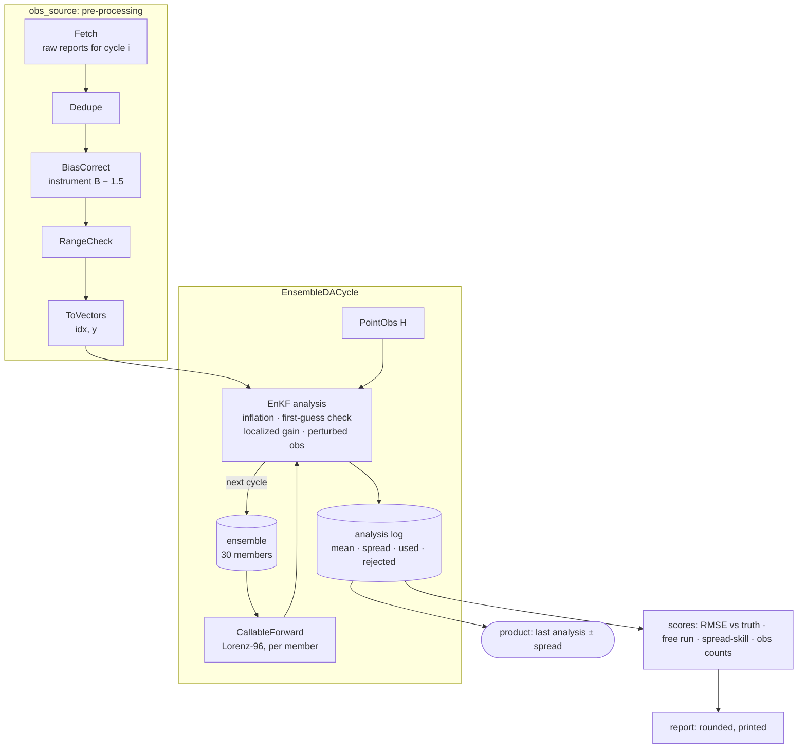

# Tutorial — Ensemble data assimilation

Runs an ensemble Kalman filter on a chaotic system for 200 cycles, with
the work real assimilation systems spend most of their code on: an
observation pre-processing chain (deduplication, bias correction, range
checks), quality control inside the analysis (a first-guess check), and
post-processing into verification scores and a product with its
uncertainty.

pipekit owns none of the science here. `EnsembleDACycle` runs the cycle;
the forward model, the observation operator and the analysis step are
plain classes that satisfy its protocols, so the same structure takes a
weather model, an ocean model or an epidemic model, and an analysis from
any library.

**Time:** ~15 minutes (the script runs in a few seconds).

**Prerequisites:**

```bash
uv add pipekit pipekit-cycle numpy jaxtyping
```



```python
from __future__ import annotations

import json
from dataclasses import dataclass
from typing import Any, NoReturn

import numpy as np
from jaxtyping import Bool, Float, Int
from pipekit import Operator, Sequential
from pipekit_cycle import CallableForward, DAState, EnsembleDACycle


# ── shapes ───────────────────────────────────────────────────────────────────
# N  state variables (40)
# E  ensemble members (30)
# T  time levels of a trajectory (201 for the truth, 200 for analysis and free run)
# M  observations that reach the analysis in one cycle (≤ 20)
# U  observations the analysis uses after its first-guess check (≤ M)
Report = dict[str, Any]
State = Float[np.ndarray, " N"]
Trajectory = Float[np.ndarray, "T N"]
Ensemble = Float[np.ndarray, "E N"]
Covariance = Float[np.ndarray, "N N"]
Distances = Int[np.ndarray, "N N"]
Sites = Int[np.ndarray, " M"]
Values = Float[np.ndarray, " M"]
Passed = Bool[np.ndarray, " M"]
UsedSites = Int[np.ndarray, " U"]
UsedValues = Float[np.ndarray, " U"]
Gain = Float[np.ndarray, "N U"]
ObsErrorCov = Float[np.ndarray, "U U"]
PerturbedObs = Float[np.ndarray, "E U"]

# N, the number of Lorenz-96 variables
N: int = 40
# F, the forcing
F: float = 8.0
# Δt, one model step
DT: float = 0.01
# one cycle = 5 model steps = 0.05 time units (~6 h)
SUBSTEPS: int = 5
CYCLES: int = 200
MEMBERS: int = 30
# σ_o, the observation-error standard deviation
SIGMA_O: float = 1.0
```

## Step 1 — The model, a truth run and its raw observations

Lorenz-96 with 40 variables stands in for the system; one cycle is five
model steps (about six hours in atmospheric terms). A truth run makes the
observations: every other variable, from two instruments. Instrument B
reads 1.5 too high, a report is now and then off by 25, and the first two
reports of every cycle arrive twice.

```python
def tendency(x: State) -> State:
    """dx_i/dt = (x_{i+1} − x_{i−2}) x_{i−1} − x_i + F."""
    # (x_{i+1} − x_{i−2}) x_{i−1} − x_i + F, indices periodic in i
    return (np.roll(x, -1) - np.roll(x, 2)) * np.roll(x, 1) - x + F


def cycle_step(x: State, dt: float) -> State:
    """Advance one cycle with ``SUBSTEPS`` RK4 steps of ``DT``."""
    for _ in range(SUBSTEPS):
        k1 = tendency(x)
        k2 = tendency(x + 0.5 * DT * k1)
        k3 = tendency(x + 0.5 * DT * k2)
        k4 = tendency(x + DT * k3)
        # x ↦ x + Δt (k₁ + 2k₂ + 2k₃ + k₄) / 6
        x = x + DT * (k1 + 2 * k2 + 2 * k3 + k4) / 6
    return x


rng = np.random.default_rng(0)
# x₀ = F + ε,  ε ~ N(0, I)
x: State = F + rng.normal(0.0, 1.0, N)
# spin up onto the attractor
for _ in range(200):
    x = cycle_step(x, DT * SUBSTEPS)
truth_states: list[State] = [x]
for _ in range(CYCLES):
    x = cycle_step(x, DT * SUBSTEPS)
    truth_states.append(x)
# x^t_k: truth[0] is the start, truth[k] the state after cycle k
truth: Trajectory = np.stack(truth_states)


def raw_observations(k: int) -> list[Report]:
    """What two instruments report for cycle k, defects included."""
    r = np.random.default_rng(1000 + k)
    out: list[Report] = []
    # every other variable
    for i in range(0, N, 2):
        instrument = "A" if i % 4 == 0 else "B"
        # y_i = x^t_{k,i} + ε + b,  ε ~ N(0, σ_o²),  b = 1.5 for instrument B
        bias = 1.5 if instrument == "B" else 0.0
        y = truth[k, i] + r.normal(0.0, SIGMA_O) + bias
        out.append({"cycle": k, "site": i, "instrument": instrument, "value": float(y)})
    # a gross error now and then
    if r.random() < 0.3:
        out[r.integers(len(out))]["value"] += 25.0
    # duplicated delivery
    out += out[:2]
    return out
```

## Step 2 — Pre-process the observations

`EnsembleDACycle` asks its `obs_source` for the observations of each
cycle, and any operator will do, so the whole pre-processing chain is one
`Sequential`: fetch, deduplicate, correct the known instrument bias from
a calibration table, drop physically impossible values, and pack what is
left into vectors of sites and values. Each step is named first, then
bundled with `|`, then run once by hand on the first cycle so every
intermediate can be inspected.

```python
@dataclass
class ObsVectors:
    """The observations of one cycle: sites ``idx`` and values ``y``."""

    idx: Sites
    y: Values


class Fetch(Operator):
    """Cycle index i ↦ the raw reports valid after cycle i + offset."""

    def __init__(self, *, offset: int) -> None:
        self.offset = offset

    def _apply(self, i: int) -> list[Report]:
        return raw_observations(self.offset + i)


class Dedupe(Operator):
    """One report per (instrument, site); the last delivery wins."""

    def _apply(self, reports: list[Report]) -> list[Report]:
        by_key: dict[tuple[str, int], Report] = {}
        for report in reports:
            by_key[(report["instrument"], report["site"])] = report
        return list(by_key.values())


class BiasCorrect(Operator):
    """y ↦ y − b_instrument, from a calibration table."""

    def __init__(self, *, bias: dict[str, float]) -> None:
        self.bias = bias

    def _apply(self, reports: list[Report]) -> list[Report]:
        corrected: list[Report] = []
        for report in reports:
            b = self.bias.get(report["instrument"], 0.0)
            corrected.append({**report, "value": report["value"] - b})
        return corrected


class RangeCheck(Operator):
    """Drop reports outside the physically plausible range."""

    def __init__(self, *, lo: float, hi: float) -> None:
        self.lo = lo
        self.hi = hi

    def _apply(self, reports: list[Report]) -> list[Report]:
        kept: list[Report] = []
        for report in reports:
            if self.lo <= report["value"] <= self.hi:
                kept.append(report)
        return kept


def site_of(report: Report) -> int:
    return report["site"]


class ToVectors(Operator):
    """Reports ↦ sites and values, sorted by site."""

    def _apply(self, reports: list[Report]) -> ObsVectors:
        ordered = sorted(reports, key=site_of)
        sites: list[int] = []
        values: list[float] = []
        for report in ordered:
            sites.append(report["site"])
            values.append(report["value"])
        return ObsVectors(idx=np.array(sites), y=np.array(values))


# the steps

# i ↦ the raw reports after cycle i + 1: the first analysis follows one forecast
fetch = Fetch(offset=1)
# one report per (instrument, site)
dedupe = Dedupe()
# y ↦ y − b,  b_A = 0,  b_B = 1.5
bias_correct = BiasCorrect(bias={"A": 0.0, "B": 1.5})
# keep y ∈ [−20, 25]
range_check = RangeCheck(lo=-20.0, hi=25.0)
# reports ↦ (idx, y) ∈ ℕ^M × ℝ^M, sorted by site
to_vectors = ToVectors()

# the bundle

observations: Sequential = fetch | dedupe | bias_correct | range_check | to_vectors

# run it once, step by step, for the first cycle

# 22 reports: one per observed site (20), the first two delivered twice
raw: list[Report] = fetch(0)
unique: list[Report] = dedupe(raw)
corrected: list[Report] = bias_correct(unique)
plausible: list[Report] = range_check(corrected)
first_obs: ObsVectors = to_vectors(plausible)
```

## Step 3 — The ensemble analysis, with its own quality control

`PointObs` is the observation operator; `EnKF` is the analysis step.
Neither imports pipekit: they satisfy `ObservationOperator` and
`AnalysisStep` by having the right methods. Before it updates, the
analysis inflates the ensemble a little (the filter otherwise grows
overconfident) and rejects observations too far from the forecast for
their combined error, the first-guess check that catches the gross
errors the range check let through. The Gaspari–Cohn taper `ρ` stops
distant, spuriously correlated variables from updating each other.
`EnsembleDACycle` returns only the final ensemble, so the analysis keeps a
log for the post-processing.

```python
class PointObs:
    """H: the state sampled at the observed sites (an ObservationOperator)."""

    def __call__(self, state: State, idx: Sites | None = None) -> State | Values:
        # H x = (x_i)_{i ∈ idx}, or x itself when no sites are given
        if idx is None:
            return state
        return state[idx]

    def linearize(self, state: State) -> NoReturn:
        raise NotImplementedError


def gaspari_cohn(d: Distances, c: float) -> Covariance:
    """The Gaspari–Cohn taper ρ(d) with half-width c: 1 at d = 0, 0 beyond 2c."""
    # r = |d| / c
    r = np.abs(d) / c
    out = np.zeros_like(r)
    near = r <= 1
    far = (r > 1) & (r <= 2)
    rn = r[near]
    rf = r[far]
    # r ≤ 1:  ρ = −¼r⁵ + ½r⁴ + ⅝r³ − ⁵⁄₃r² + 1
    out[near] = (((-0.25 * rn + 0.5) * rn + 0.625) * rn - 5 / 3) * rn**2 + 1
    # 1 < r ≤ 2:  ρ = r⁵/12 − ½r⁴ + ⅝r³ + ⁵⁄₃r² − 5r + 4 − 2/(3r);  r > 2:  ρ = 0
    out[far] = (
        ((((rf / 12 - 0.5) * rf + 0.625) * rf + 5 / 3) * rf - 5) * rf + 4 - 2 / (3 * rf)
    )
    return out


@dataclass
class AnalysisRecord:
    """What one analysis leaves behind: its mean, spread and observation counts."""

    mean: State
    spread: State
    used: int
    rejected: int


class EnKF:
    """Stochastic EnKF with a first-guess check, localization and inflation.

    x_aᵐ = x_fᵐ + K (yᵐ − H x_fᵐ),  K = (ρ ∘ P_f) Hᵀ (H (ρ ∘ P_f) Hᵀ + R)⁻¹,
    with yᵐ = y + εᵐ, εᵐ ~ N(0, R). An AnalysisStep.
    """

    def __init__(
        self, *, inflation: float, radius: float, check: float, seed: int
    ) -> None:
        self.inflation = inflation
        self.check = check
        i = np.arange(N)
        d = np.abs(i[:, None] - i[None, :])
        # ρ_{ij} = GC(min(|i − j|, N − |i − j|)): distance on the periodic ring
        self.rho: Covariance = gaspari_cohn(np.minimum(d, N - d), radius)
        self.rng = np.random.default_rng(seed)
        self.log: list[AnalysisRecord] = []

    def __call__(
        self,
        forecast: list[State],
        obs: ObsVectors,
        *,
        obs_op: PointObs,
        obs_err_cov: float,
    ) -> list[State]:
        X: Ensemble = np.stack(forecast)
        # x̄ = (1/E) ∑ₘ xᵐ
        mean: State = X.mean(0)
        # multiplicative inflation: xᵐ ↦ x̄ + λ (xᵐ − x̄)
        X = mean + self.inflation * (X - mean)
        # first-guess check: keep |y − H x̄| ≤ c √(σ_o² + σ_b²),
        # σ_b² the ensemble variance at each observed site
        hx: Values = obs_op(mean, obs.idx)
        sb2: Values = X[:, obs.idx].var(0, ddof=1)
        keep: Passed = np.abs(obs.y - hx) <= self.check * np.sqrt(obs_err_cov + sb2)
        idx: UsedSites = obs.idx[keep]
        y: UsedValues = obs.y[keep]
        # A = X − x̄, the anomalies
        A: Ensemble = X - X.mean(0)
        # localized forecast covariance: ρ ∘ P_f,  P_f = Aᵀ A / (E − 1)
        P: Covariance = self.rho * (A.T @ A) / (len(X) - 1)
        # R = σ_o² I
        R: ObsErrorCov = obs_err_cov * np.eye(len(idx))
        # K = (ρ ∘ P_f) Hᵀ (H (ρ ∘ P_f) Hᵀ + R)⁻¹
        K: Gain = P[:, idx] @ np.linalg.inv(P[np.ix_(idx, idx)] + R)
        # perturbed observations: yᵐ = y + εᵐ,  εᵐ ~ N(0, R)
        noise: PerturbedObs = self.rng.normal(
            0.0, np.sqrt(obs_err_cov), (len(X), len(idx))
        )
        Y: PerturbedObs = y + noise
        # x_aᵐ = xᵐ + K (yᵐ − H xᵐ)
        Xa: Ensemble = X + (Y - X[:, idx]) @ K.T
        record = AnalysisRecord(
            mean=Xa.mean(0),
            spread=Xa.std(0, ddof=1),
            used=int(keep.sum()),
            rejected=int((~keep).sum()),
        )
        self.log.append(record)
        return list(Xa)
```

## Step 4 — Cycle

The ensemble starts far from the truth (a spread of 3 around it). A free
run from the same start, with no observations, is the baseline.

```python
# the steps

# M: x ↦ x after one cycle, applied to each member
forward = CallableForward(cycle_step, dt=DT * SUBSTEPS)
# H x = (x_i)_{i ∈ idx}
point_obs = PointObs()
# λ = 1.04, c_loc = 4 variables, first-guess check at 4σ
enkf = EnKF(inflation=1.04, radius=4.0, check=4.0, seed=2)

# the bundle: forecast → observe → analyse, 200 times

da = EnsembleDACycle(
    forward_model=forward,
    obs_op=point_obs,
    analysis_step=enkf,
    obs_source=observations,
    n_steps=CYCLES,
    n_members=MEMBERS,
)

# run it once

r0 = np.random.default_rng(3)
# a poor start: xᵐ₀ = x^t₀ + εᵐ,  εᵐ ~ N(0, 3² I)
members: list[State] = []
for _ in range(MEMBERS):
    members.append(truth[0] + r0.normal(0.0, 3.0, N))
result = da(members, DAState(obs_err_cov=SIGMA_O**2))
final_members: list[State] = result[0]
final_state: DAState = result[1]

# the baseline: the same start, no observations
free: State = np.stack(members).mean(0)
free_states: list[State] = []
for _ in range(CYCLES):
    free = cycle_step(free, DT * SUBSTEPS)
    free_states.append(free)
free_run: Trajectory = np.stack(free_states)
```

## Step 5 — Post-process into products and a report

Nothing here needs a pipeline: the scores are plain arithmetic on arrays
already in hand, computed once the filter has settled: the analysis error
against the truth, the free run's, and the spread-skill ratio (close to 1
when the ensemble's spread is an honest estimate of its error). The last
analysis, with its spread, is the product that goes on to forecasters or
the next system.

```python
log: list[AnalysisRecord] = enkf.log
# x̄ᵃ_k, valid at truth[k] for k = 1 … 200
analysis: Trajectory = np.stack([record.mean for record in log])
# σᵃ_k, the ensemble spread of each analysis
spread: Trajectory = np.stack([record.spread for record in log])
# the truth at the analysis times
verifying: Trajectory = truth[1:]
# skip the first 50 cycles while the filter converges
settled = slice(50, None)


def rmse(a: Trajectory, b: Trajectory) -> float:
    """RMSE(a, b) = √( (1/(T N)) ∑_{t,i} (a_{t,i} − b_{t,i})² )."""
    return float(np.sqrt(np.mean((a - b) ** 2)))


# RMSE(x̄ᵃ, xᵗ) over the settled cycles
analysis_rmse: float = rmse(analysis[settled], verifying[settled])
# RMSE(x^free, xᵗ), the baseline
free_run_rmse: float = rmse(free_run[settled], verifying[settled])
# σ̄ = √( mean σᵃ² ), the typical ensemble spread
spread_rms: float = float(np.sqrt(np.mean(spread[settled] ** 2)))
# spread-skill = σ̄ / RMSE(x̄ᵃ, xᵗ), ≈ 1 when the spread is an honest error estimate
spread_skill: float = spread_rms / analysis_rmse
# observations the first-guess check let through, and those it rejected
obs_used: int = sum(record.used for record in log)
obs_rejected: int = sum(record.rejected for record in log)

report: dict[str, float | int] = {
    "analysis_rmse": round(analysis_rmse, 3),
    "free_run_rmse": round(free_run_rmse, 3),
    "obs_error": round(SIGMA_O, 3),
    "spread_skill": round(spread_skill, 3),
    "obs_used": obs_used,
    "obs_rejected": obs_rejected,
}
print(json.dumps(report))

# the last analysis, with its uncertainty, ready to hand on
product: dict[str, Any] = {
    "cycle": int(final_state.cycle_count),
    "mean": analysis[-1].round(2).tolist(),
    "spread": spread[-1].round(2).tolist(),
}
```

```text
{"analysis_rmse": 0.411, "free_run_rmse": 5.098, "obs_error": 1.0, "spread_skill": 1.133, "obs_used": 3941, "obs_rejected": 18}
```

The analysis error (0.41) is well below the observation error (1.0), and
far below the free run's (5.1): combining the model with the observations
beats either alone. The spread is about right (a ratio of 1.13), and the
first-guess check rejected 18 observations the range check had let in.

## Make it yours

- **Your model.** Anything with `step(state, dt)` and `dt` is a forward
  model; a trained emulator from the registry works through
  `NeuralForward` (see [Train, register, forecast](train-register-forecast.md)).
- **Your analysis.** Swap `EnKF` for an analysis from an algorithm
  library: it only has to be callable as
  `analysis(forecast, obs, obs_op=..., obs_err_cov=...)`.
- **Your observations.** Replace `Fetch` with a reader for your archive;
  the rest of the chain is unchanged.

## Where next

- [Run a DA cycle](da-cycle.md): the shorter introduction to the cycle
  types.
- [ETL over many regions](etl-regions.md): the pre-processing ideas at
  batch scale.
