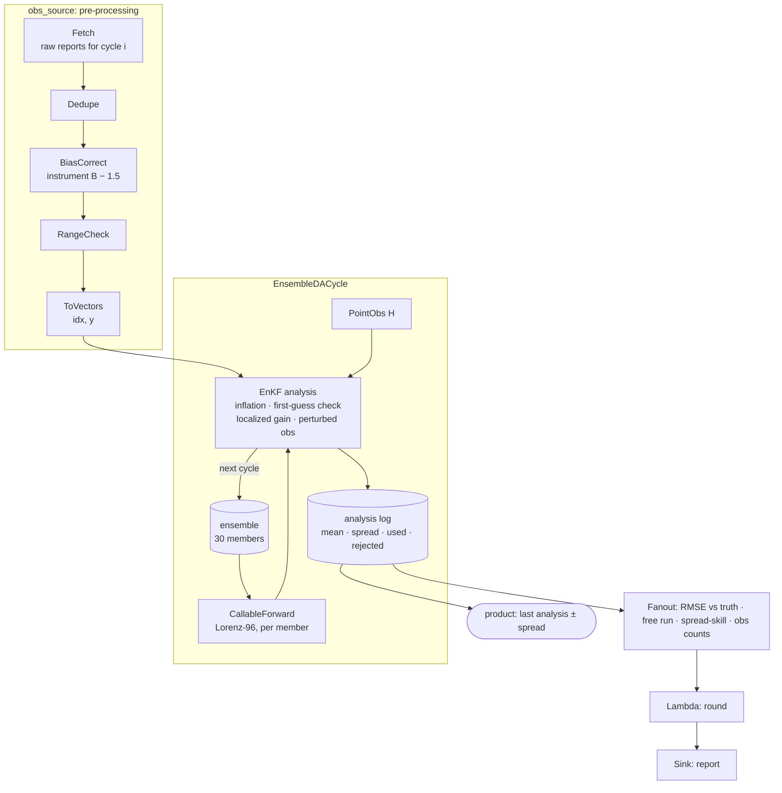

# Tutorial — Ensemble data assimilation

Runs an ensemble Kalman filter on a chaotic system for 200 cycles, with
the work real assimilation systems spend most of their code on: an
observation pre-processing chain (deduplication, bias correction, range
checks), quality control inside the analysis (a first-guess check), and
post-processing into verification scores and a product with its
uncertainty.

pipekit owns none of the science here. `EnsembleDACycle` runs the cycle;
the forward model, the observation operator and the analysis step are
plain classes that satisfy its protocols, so the same structure takes a
weather model, an ocean model or an epidemic model, and an analysis from
any library.

**Time:** ~15 minutes (the script runs in a few seconds).

**Prerequisites:**

```bash
uv add pipekit pipekit-cycle numpy
```



```python
from __future__ import annotations

import json

import numpy as np
from numpy.typing import NDArray
from pipekit import Fanout, Lambda, Operator, Sink
from pipekit_cycle import CallableForward, DAState, EnsembleDACycle


Array = NDArray[np.float64]
N, F, DT = 40, 8.0, 0.01  # variables, forcing, model step
SUBSTEPS = 5  # one cycle = 5 model steps = 0.05 time units (~6 h)
CYCLES, MEMBERS = 200, 30
SIGMA_O = 1.0  # observation-error standard deviation
```

## Step 1 — The model, a truth run and its raw observations

Lorenz-96 with 40 variables stands in for the system; one cycle is five
model steps (about six hours in atmospheric terms). A truth run makes the
observations: every other variable, from two instruments. Instrument B
reads 1.5 too high, a report is now and then off by 25, and the first two
reports of every cycle arrive twice.

```python
def tendency(x: Array) -> Array:
    """dx_i/dt = (x_{i+1} − x_{i−2}) x_{i−1} − x_i + F."""
    return (np.roll(x, -1) - np.roll(x, 2)) * np.roll(x, 1) - x + F


def cycle_step(x: Array, dt: float) -> Array:
    """Advance one cycle with ``SUBSTEPS`` RK4 steps of ``DT``."""
    for _ in range(SUBSTEPS):
        k1 = tendency(x)
        k2 = tendency(x + 0.5 * DT * k1)
        k3 = tendency(x + 0.5 * DT * k2)
        k4 = tendency(x + DT * k3)
        x = x + DT * (k1 + 2 * k2 + 2 * k3 + k4) / 6
    return x


rng = np.random.default_rng(0)
x = F + rng.normal(0.0, 1.0, N)
for _ in range(200):
    x = cycle_step(x, DT * SUBSTEPS)  # spin-up
truth = [x]
for _ in range(CYCLES):
    x = cycle_step(x, DT * SUBSTEPS)
    truth.append(x)
truth = np.stack(truth)  # truth[0] is the start, truth[k] after cycle k  (K + 1, N)


def raw_observations(k: int) -> list[dict]:
    """What two instruments report for cycle k, defects included."""
    r = np.random.default_rng(1000 + k)
    out = []
    for i in range(0, N, 2):  # every other variable
        inst = "A" if i % 4 == 0 else "B"
        y = truth[k, i] + r.normal(0.0, SIGMA_O) + (1.5 if inst == "B" else 0.0)
        out.append({"cycle": k, "site": i, "instrument": inst, "value": float(y)})
    if r.random() < 0.3:  # a gross error now and then
        out[r.integers(len(out))]["value"] += 25.0
    out += out[:2]  # duplicated delivery
    return out
```

## Step 2 — Pre-process the observations

`EnsembleDACycle` asks its `obs_source` for the observations of each
cycle, and any operator will do, so the whole pre-processing chain is one
`Sequential`: fetch, deduplicate, correct the known instrument bias from
a calibration table, drop physically impossible values, and pack what is
left into vectors of sites and values.

```python
class Fetch(Operator):
    """Cycle index i ↦ the raw reports valid after cycle i + offset."""

    def __init__(self, *, offset: int) -> None:
        self.offset = offset

    def _apply(self, i: int) -> list[dict]:
        return raw_observations(self.offset + i)


class Dedupe(Operator):
    """One report per (instrument, site)."""

    def _apply(self, reports: list[dict]) -> list[dict]:
        return list({(r["instrument"], r["site"]): r for r in reports}.values())


class BiasCorrect(Operator):
    """y ↦ y − b_instrument, from a calibration table."""

    def __init__(self, *, bias: dict[str, float]) -> None:
        self.bias = bias

    def _apply(self, reports: list[dict]) -> list[dict]:
        return [
            {**r, "value": r["value"] - self.bias.get(r["instrument"], 0.0)}
            for r in reports
        ]


class RangeCheck(Operator):
    """Drop reports outside the physically plausible range."""

    def __init__(self, *, lo: float, hi: float) -> None:
        self.lo, self.hi = lo, hi

    def _apply(self, reports: list[dict]) -> list[dict]:
        return [r for r in reports if self.lo <= r["value"] <= self.hi]


class ToVectors(Operator):
    """Reports ↦ {"idx": sites (M,), "y": values (M,)}, sorted by site."""

    def _apply(self, reports: list[dict]) -> dict[str, Array]:
        reports = sorted(reports, key=lambda r: r["site"])
        return {
            "idx": np.array([r["site"] for r in reports]),
            "y": np.array([r["value"] for r in reports]),
        }


observations = (
    Fetch(offset=1)  # the first analysis comes after one forecast
    | Dedupe()
    | BiasCorrect(bias={"A": 0.0, "B": 1.5})
    | RangeCheck(lo=-20.0, hi=25.0)
    | ToVectors()
)
```

## Step 3 — The ensemble analysis, with its own quality control

`PointObs` is the observation operator; `EnKF` is the analysis step.
Neither imports pipekit: they satisfy `ObservationOperator` and
`AnalysisStep` by having the right methods. Before it updates, the
analysis inflates the ensemble a little (the filter otherwise grows
overconfident) and rejects observations too far from the forecast for
their combined error, the first-guess check that catches the gross
errors the range check let through. The Gaspari–Cohn taper `ρ` stops
distant, spuriously correlated variables from updating each other.
`EnsembleDACycle` returns only the final ensemble, so the analysis keeps a
log for the post-processing.

```python
class PointObs:
    """H: the state sampled at the observed sites (an ObservationOperator)."""

    def __call__(self, state: Array, idx: Array | None = None) -> Array:
        return state if idx is None else state[idx]

    def linearize(self, state: Array):
        raise NotImplementedError


def gaspari_cohn(d: Array, c: float) -> Array:
    """The Gaspari–Cohn taper ρ(d) with half-width c: 1 at d = 0, 0 beyond 2c."""
    r = np.abs(d) / c
    out = np.zeros_like(r)
    a, b = r <= 1, (r > 1) & (r <= 2)
    out[a] = (((-0.25 * r[a] + 0.5) * r[a] + 0.625) * r[a] - 5 / 3) * r[a] ** 2 + 1
    out[b] = (
        ((((r[b] / 12 - 0.5) * r[b] + 0.625) * r[b] + 5 / 3) * r[b] - 5) * r[b]
        + 4
        - 2 / (3 * r[b])
    )
    return out


class EnKF:
    """Stochastic EnKF with a first-guess check, localization and inflation.

    x_aᵐ = x_fᵐ + K (yᵐ − H x_fᵐ),  K = (ρ ∘ P_f) Hᵀ (H (ρ ∘ P_f) Hᵀ + R)⁻¹,
    with yᵐ = y + εᵐ, εᵐ ~ N(0, R). An AnalysisStep.
    """

    def __init__(self, *, inflation: float, radius: float, check: float, seed: int):
        self.inflation, self.check = inflation, check
        i = np.arange(N)
        d = np.abs(i[:, None] - i[None, :])
        self.rho = gaspari_cohn(np.minimum(d, N - d), radius)  # periodic  (N, N)
        self.rng = np.random.default_rng(seed)
        self.log: list[dict] = []

    def __call__(self, forecast, obs, *, obs_op, obs_err_cov):
        X = np.stack(forecast)  #                                         (M_e, N)
        mean = X.mean(0)
        X = mean + self.inflation * (X - mean)  # multiplicative inflation
        idx, y = obs["idx"], obs["y"]
        # first-guess check: |y − H x̄| ≤ c √(σ_o² + σ_b²)
        hx = obs_op(mean, idx)
        sb2 = X[:, idx].var(0, ddof=1)
        keep = np.abs(y - hx) <= self.check * np.sqrt(obs_err_cov + sb2)
        idx, y = idx[keep], y[keep]
        A = X - X.mean(0)
        P = self.rho * (A.T @ A) / (len(X) - 1)  # localized P_f           (N, N)
        R = obs_err_cov * np.eye(len(idx))
        K = P[:, idx] @ np.linalg.inv(P[np.ix_(idx, idx)] + R)  #           (N, M)
        Y = y + self.rng.normal(0.0, np.sqrt(obs_err_cov), (len(X), len(idx)))
        Xa = X + (Y - X[:, idx]) @ K.T
        self.log.append(
            {
                "mean": Xa.mean(0),
                "spread": Xa.std(0, ddof=1),
                "used": int(keep.sum()),
                "rejected": int((~keep).sum()),
            }
        )
        return list(Xa)
```

## Step 4 — Cycle

The ensemble starts far from the truth (a spread of 3 around it). A free
run from the same start, with no observations, is the baseline.

```python
enkf = EnKF(inflation=1.04, radius=4.0, check=4.0, seed=2)
da = EnsembleDACycle(
    forward_model=CallableForward(cycle_step, dt=DT * SUBSTEPS),
    obs_op=PointObs(),
    analysis_step=enkf,
    obs_source=observations,
    n_steps=CYCLES,
    n_members=MEMBERS,
)
r0 = np.random.default_rng(3)
members = [truth[0] + r0.normal(0.0, 3.0, N) for _ in range(MEMBERS)]  # a poor start
final_members, final_state = da(members, DAState(obs_err_cov=SIGMA_O**2))

free = np.stack(members).mean(0)  # the same start, no observations
free_run = []
for _ in range(CYCLES):
    free = cycle_step(free, DT * SUBSTEPS)
    free_run.append(free)
free_run = np.stack(free_run)
```

## Step 5 — Post-process into products and a report

Scores are computed once the filter has settled: the analysis error
against the truth, the free run's, and the spread-skill ratio (close to 1
when the ensemble's spread is an honest estimate of its error). The last
analysis, with its spread, is the product that goes on to forecasters or
the next system.

```python
log = enkf.log
analysis = np.stack([e["mean"] for e in log])  # valid at truth[1:]       (K, N)
spread = np.stack([e["spread"] for e in log])  #                          (K, N)
settled = slice(50, None)  # skip the first 50 cycles while the filter converges


def rmse(a: Array, b: Array) -> float:
    return float(np.sqrt(np.mean((a - b) ** 2)))


report = (
    Fanout(
        {
            "analysis_rmse": Lambda(
                lambda _: rmse(analysis[settled], truth[1:][settled])
            ),
            "free_run_rmse": Lambda(
                lambda _: rmse(free_run[settled], truth[1:][settled])
            ),
            "obs_error": Lambda(lambda _: SIGMA_O),
            "spread_skill": Lambda(
                lambda _: (
                    float(np.sqrt(np.mean(spread[settled] ** 2)))
                    / rmse(analysis[settled], truth[1:][settled])
                )
            ),
            "obs_used": Lambda(lambda _: sum(e["used"] for e in log)),
            "obs_rejected": Lambda(lambda _: sum(e["rejected"] for e in log)),
        }
    )
    | Lambda(
        lambda r: {k: round(v, 3) if isinstance(v, float) else v for k, v in r.items()}
    )
    | Sink(lambda r: print(json.dumps(r)))
)(None)

product = {  # the last analysis, with its uncertainty, ready to hand on
    "cycle": int(final_state.cycle_count),
    "mean": analysis[-1].round(2).tolist(),
    "spread": spread[-1].round(2).tolist(),
}
```

```text
{"analysis_rmse": 0.411, "free_run_rmse": 5.098, "obs_error": 1.0, "spread_skill": 1.133, "obs_used": 3941, "obs_rejected": 18}
```

The analysis error (0.41) is well below the observation error (1.0), and
far below the free run's (5.1): combining the model with the observations
beats either alone. The spread is about right (a ratio of 1.13), and the
first-guess check rejected 18 observations the range check had let in.

## Make it yours

- **Your model.** Anything with `step(state, dt)` and `dt` is a forward
  model; a trained emulator from the registry works through
  `NeuralForward` (see [Train, register, forecast](train-register-forecast.md)).
- **Your analysis.** Swap `EnKF` for an analysis from an algorithm
  library: it only has to be callable as
  `analysis(forecast, obs, obs_op=..., obs_err_cov=...)`.
- **Your observations.** Replace `Fetch` with a reader for your archive;
  the rest of the chain is unchanged.

## Where next

- [Run a DA cycle](da-cycle.md): the shorter introduction to the cycle
  types.
- [ETL over many regions](etl-regions.md): the pre-processing ideas at
  batch scale.
