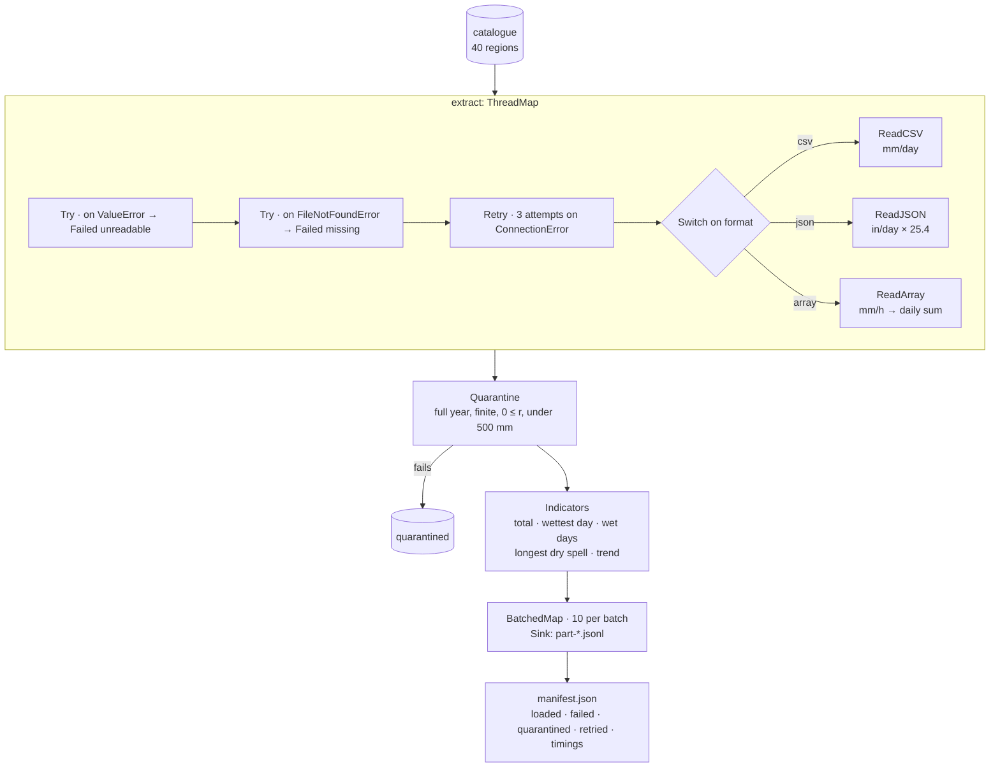

# Tutorial — ETL over many regions

An extract–transform–load batch: forty regional rainfall exports from
three agencies, each in its own format and units, read in parallel,
cleaned, turned into a year's climate indicators per region, and written
out in partitioned batches with a manifest of what happened. One region's
file never arrived, one was truncated, one is physically impossible, and
three reads time out the first time; the run finishes anyway and says
which.

Rainfall is the example; the same batch fits any catalogue of files to
harmonise (assay plates, survey tiles, instrument logs).

**Time:** ~15 minutes.

**Prerequisites:**

```bash
uv add pipekit numpy
```



```python
from __future__ import annotations

import io
import json
import tempfile
from pathlib import Path

import numpy as np
from numpy.typing import NDArray
from pipekit import (
    BatchedMap,
    Lambda,
    Operator,
    Profile,
    Quarantine,
    Retry,
    Sink,
    Switch,
    ThreadMap,
    Try,
)


Array = NDArray[np.float64]
DAYS = 365
WET_MM = 1.0  # a wet day has at least 1 mm
```

## Step 1 — Forty regions, three agencies, the usual mess

An in-memory object store stands in for a bucket. Agency A sends CSV in
mm per day, agency B JSON in inches per day, agency C a NumPy array of
hourly rates in mm/h. Then the usual mess: one file never arrived, one
upload was truncated, one region reports negative rain, and three reads
time out on the first try.

```python
def make_store(n_regions: int = 40) -> tuple[list[dict], dict[str, bytes]]:
    """A catalogue of regional rainfall exports and the bytes behind it."""
    rng = np.random.default_rng(0)
    catalogue, store = [], {}
    for k in range(n_regions):
        region = f"R{k:02d}"
        wet = rng.random(DAYS) < 0.35
        daily = np.where(wet, rng.gamma(0.8, 8.0 + k / 4, DAYS), 0.0)  # mm/day
        fmt = ("csv", "json", "array")[k % 3]
        path = f"exports/{region}.{fmt}"
        if fmt == "csv":  # agency A: CSV, millimetres per day
            body = "day,rain_mm\n" + "".join(
                f"{d},{v:.2f}\n" for d, v in enumerate(daily)
            )
            store[path] = body.encode()
        elif fmt == "json":  # agency B: JSON records, inches per day
            store[path] = json.dumps(
                [{"day": d, "rain_in": round(v / 25.4, 4)} for d, v in enumerate(daily)]
            ).encode()
        else:  # agency C: hourly rates in mm/h, as a NumPy array
            hourly = np.repeat(daily / 24.0, 24)
            buf = io.BytesIO()
            np.save(buf, hourly)
            store[path] = buf.getvalue()
        catalogue.append({"region": region, "format": fmt, "path": path})
    del store["exports/R07.json"]  # never delivered
    store["exports/R10.json"] = b'[{"day": 0, "rain_in": '  # truncated upload
    store["exports/R19.json"] = json.dumps([{"day": 0, "rain_in": -3}] * DAYS).encode()
    return catalogue, store


catalogue, store = make_store()
flaky = {"exports/R02.array", "exports/R14.array", "exports/R27.csv"}
attempts: dict[str, int] = {}


def get_bytes(path: str) -> bytes:
    """Object-store read: some paths fail the first time, as networks do."""
    attempts[path] = attempts.get(path, 0) + 1
    if path in flaky and attempts[path] == 1:
        raise ConnectionError(f"timeout reading {path}")
    if path not in store:
        raise FileNotFoundError(path)
    return store[path]
```

## Step 2 — Extract, whatever the format

`Switch` sends each catalogue entry to the reader for its format, and
each reader harmonises as it reads: every region comes out as daily rain
in mm. The wrappers handle failure where it happens: `Retry` re-reads
after a timeout, the inner `Try` turns a missing file into a marked
record instead of an exception, and the outer one does the same for a
file that will not parse. `ThreadMap` runs the whole thing over the
catalogue on eight threads.

```python
class ReadCSV(Operator):
    """day,rain_mm ↦ daily rainfall (DAYS,) in mm."""

    def _apply(self, item: dict) -> dict:
        rows = get_bytes(item["path"]).decode().strip().splitlines()[1:]
        return {**item, "rain_mm": np.array([float(r.split(",")[1]) for r in rows])}


class ReadJSON(Operator):
    """[{day, rain_in}] ↦ daily rainfall in mm (1 in = 25.4 mm)."""

    def _apply(self, item: dict) -> dict:
        rows = json.loads(get_bytes(item["path"]))
        return {**item, "rain_mm": 25.4 * np.array([r["rain_in"] for r in rows])}


class ReadArray(Operator):
    """Hourly mm/h ↦ daily totals in mm (sum of 24 hourly rates × 1 h)."""

    def _apply(self, item: dict) -> dict:
        hourly = np.load(io.BytesIO(get_bytes(item["path"])))
        return {**item, "rain_mm": hourly.reshape(-1, 24).sum(axis=1)}


class Failed(Operator):
    """The fallback: keep the item, mark why it has no data."""

    def __init__(self, *, reason: str) -> None:
        self.reason = reason

    def _apply(self, item: dict) -> dict:
        return {**item, "rain_mm": None, "error": self.reason}


read_any = Switch(
    key=lambda item: item["format"],
    cases={"csv": ReadCSV(), "json": ReadJSON(), "array": ReadArray()},
)
extract = ThreadMap(
    Try(
        primary=Try(
            primary=Retry(read_any, attempts=3, base_delay=0.01, on=(ConnectionError,)),
            fallback=Failed(reason="missing"),
            on=(FileNotFoundError,),
        ),
        fallback=Failed(reason="unreadable"),
        on=(ValueError,),  # json.JSONDecodeError is a ValueError
    ),
    n_workers=8,
)
```

## Step 3 — Transform, region by region

`Quarantine` keeps anything that is not a full year of plausible rain
aside, with the failed reads, and the run goes on. `Indicators` computes
what users of the data want: the annual total, the wettest day, the
number of wet days, the longest dry spell, and a trend over the year.

```python
def plausible(item: dict) -> bool:
    """A region passes QC if it has a full year of non-negative, finite rain."""
    r = item.get("rain_mm")
    return (
        r is not None
        and r.shape == (DAYS,)
        and np.isfinite(r).all()
        and (r >= 0).all()
        and r.max() < 500.0
    )


quarantined: list[dict] = []
qc = Quarantine(check=plausible, sentinel=None, on_quarantine=quarantined.append)


class Indicators(Operator):
    """Daily rain ↦ annual total, wettest day, wet days, longest dry spell, trend."""

    def _apply(self, item: dict) -> dict:
        r = item["rain_mm"]
        wet = r >= WET_MM
        dry_runs = np.diff(np.flatnonzero(np.r_[True, wet, True])) - 1
        months = r[:360].reshape(12, 30).sum(axis=1)  # twelve 30-day blocks
        slope = np.polyfit(np.arange(12), months, 1)[0]  # mm per block, per block
        return {
            "region": item["region"],
            "source": item["format"],
            "total_mm": round(float(r.sum()), 1),
            "max_day_mm": round(float(r.max()), 1),
            "wet_days": int(wet.sum()),
            "longest_dry_spell_days": int(dry_runs.max()),
            "trend_mm_per_month": round(float(slope), 2),
        }


transform = qc | Lambda(lambda item: None if item is None else Indicators()(item))
```

## Step 4 — Load, in batches, with a manifest

`BatchedMap` hands the rows to the loader ten at a time, and a `Sink`
writes each batch as one partitioned file.

```python
out_dir = Path(tempfile.mkdtemp())


def write_batch(rows: list[dict]) -> None:
    """One file per batch, one line per region (partitioned output)."""
    name = f"part-{rows[0]['region']}-{rows[-1]['region']}.jsonl"
    (out_dir / name).write_text("".join(json.dumps(r) + "\n" for r in rows))


load = BatchedMap(Sink(write_batch), batch_size=10)
```

## Step 5 — Run it, timed, and write the manifest

`Profile` times the extract and the load. The manifest records what
arrived, what was loaded, what failed and why, what was quarantined,
what had to be retried, which files were written, and how long it took:
the run's receipt.

```python
prof = Profile()
pipeline = (
    prof.wrap(extract)
    | Lambda(lambda items: [transform(i) for i in items])
    | Lambda(lambda rows: [r for r in rows if r is not None])
    | prof.wrap(load)
)
rows = pipeline(catalogue)

failed = [i for i in quarantined if i.get("error")]
manifest = {
    "regions": len(catalogue),
    "loaded": len(rows),
    "failed": {i["region"]: i["error"] for i in failed},
    "quarantined": [i["region"] for i in quarantined if not i.get("error")],
    "retried": sorted(p for p, n in attempts.items() if n > 1),
    "files": sorted(p.name for p in out_dir.glob("*.jsonl")),
    "seconds": {k: round(v["total"], 3) for k, v in prof.report().items()},
}
(out_dir / "manifest.json").write_text(json.dumps(manifest, indent=1))
print(json.dumps({k: v for k, v in manifest.items() if k != "seconds"}))
print(rows[0])
```

```text
{"regions": 40, "loaded": 37, "failed": {"R07": "missing", "R10": "unreadable"}, "quarantined": ["R19"], "retried": ["exports/R02.array", "exports/R14.array", "exports/R27.csv"], "files": ["part-R00-R11.jsonl", "part-R12-R22.jsonl", "part-R23-R32.jsonl", "part-R33-R39.jsonl"]}
{'region': 'R00', 'source': 'csv', 'total_mm': 586.9, 'max_day_mm': 38.3, 'wet_days': 93, 'longest_dry_spell_days': 18, 'trend_mm_per_month': 1.2}
```

Thirty-seven of forty regions are loaded. The missing and truncated
files are reported as such, the region with negative rain is
quarantined, and the three timeouts succeeded on their retry.

## Make it yours

- **A new format.** Add a reader and a `Switch` case; nothing else
  changes.
- **A real bucket.** Replace `get_bytes` with your object-store client; the
  `Retry` and `Try` around it already handle its failures.
- **More regions.** `ThreadMap` takes `n_workers`; for CPU-heavy
  transforms, `ProcessMap` has the same interface.

## Where next

- [Run inference](inference.md): the same cleaning ideas around a model.
- [Build a bigger graph](anomaly-graph.md): named inputs and outputs with
  `Graph`.
