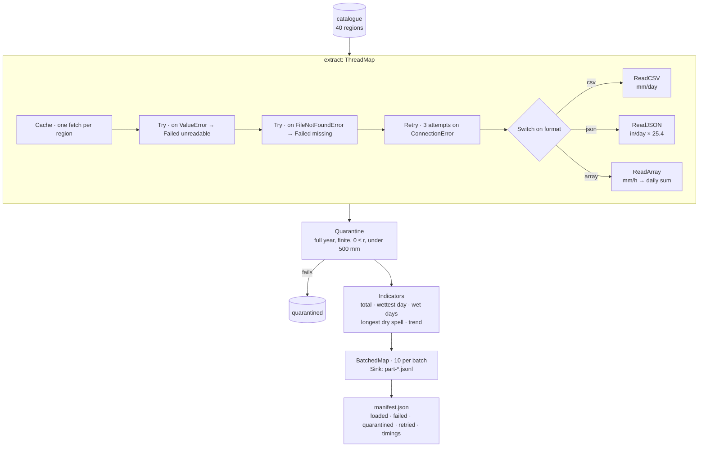

# Tutorial — ETL over many regions

An extract–transform–load batch: forty regional rainfall exports from
three agencies, each in its own format and units, read in parallel,
cleaned, turned into a year's climate indicators per region, and written
out in partitioned batches with a manifest of what happened. One region's
file never arrived, one was truncated, one is physically impossible, and
three reads time out the first time; the run finishes anyway and says
which.

Rainfall is the example; the same batch fits any catalogue of files to
harmonise (assay plates, survey tiles, instrument logs).

**Time:** ~15 minutes.

**Prerequisites:**

```bash
uv add pipekit numpy jaxtyping
```



```python
from __future__ import annotations

import io
import json
import tempfile
from pathlib import Path
from typing import Any

import numpy as np
from jaxtyping import Bool, Float, Int
from pipekit import (
    BatchedMap,
    Cache,
    Operator,
    Profile,
    Quarantine,
    Retry,
    Sequential,
    Sink,
    Switch,
    ThreadMap,
    Try,
)


# ── shapes ───────────────────────────────────────────────────────────────────
# D  days in the year (365)
# H  hours in the year (D · 24 = 8760)
# M  30-day blocks in the year, "months" (12)
# W  wet days, plus one padding day at each end of the year
# R  dry spells: the runs of dry days between consecutive wet days (W − 1)
Item = dict[str, Any]
Row = dict[str, Any]
DailyRain = Float[np.ndarray, " D"]
HourlyRate = Float[np.ndarray, " H"]
HourlyByDay = Float[np.ndarray, "D 24"]
DayBlocks = Float[np.ndarray, "M 30"]
BlockTotals = Float[np.ndarray, " M"]
WetMask = Bool[np.ndarray, " D"]
WetDays = Int[np.ndarray, " W"]
DrySpells = Int[np.ndarray, " R"]

DAYS: int = 365
# a wet day has r_d ≥ 1 mm, where r_d is the rain on day d
WET_MM: float = 1.0
FORMATS: list[str] = ["csv", "json", "array"]
```

## Step 1 — Forty regions, three agencies, the usual mess

An in-memory object store stands in for a bucket. Agency A sends CSV in
mm per day, agency B JSON in inches per day, agency C a NumPy array of
hourly rates in mm/h. Then the usual mess: one file never arrived, one
upload was truncated, one region reports negative rain, and three reads
time out on the first try.

```python
def make_catalogue(n_regions: int = 40) -> list[Item]:
    """Region k exports in format k mod 3: CSV, JSON, array, CSV, …"""
    catalogue: list[Item] = []
    for k in range(n_regions):
        region = f"R{k:02d}"
        fmt = FORMATS[k % 3]
        path = f"exports/{region}.{fmt}"
        catalogue.append({"region": region, "format": fmt, "path": path})
    return catalogue


def csv_bytes(daily: DailyRain) -> bytes:
    """Agency A: CSV, millimetres per day."""
    lines = ["day,rain_mm\n"]
    for day, value in enumerate(daily):
        lines.append(f"{day},{value:.2f}\n")
    return "".join(lines).encode()


def json_bytes(daily: DailyRain) -> bytes:
    """Agency B: JSON records, inches per day (1 in = 25.4 mm)."""
    records: list[dict[str, float]] = []
    for day, value in enumerate(daily):
        records.append({"day": day, "rain_in": round(value / 25.4, 4)})
    return json.dumps(records).encode()


def array_bytes(daily: DailyRain) -> bytes:
    """Agency C: hourly rates in mm/h, as a NumPy array."""
    # q_h = r_d / 24 for every hour h of day d
    hourly: HourlyRate = np.repeat(daily / 24.0, 24)
    buffer = io.BytesIO()
    np.save(buffer, hourly)
    return buffer.getvalue()


def make_store(catalogue: list[Item]) -> dict[str, bytes]:
    """The bytes behind the catalogue, as an in-memory object store."""
    rng = np.random.default_rng(0)
    store: dict[str, bytes] = {}
    for k, item in enumerate(catalogue):
        # a day is wet with probability 0.35
        wet: WetMask = rng.random(DAYS) < 0.35
        # r_d ~ Gamma(0.8, 8 + k/4) mm on a wet day, 0 on a dry one
        amounts: DailyRain = rng.gamma(0.8, 8.0 + k / 4, DAYS)
        daily: DailyRain = np.where(wet, amounts, 0.0)
        if item["format"] == "csv":
            store[item["path"]] = csv_bytes(daily)
        elif item["format"] == "json":
            store[item["path"]] = json_bytes(daily)
        else:
            store[item["path"]] = array_bytes(daily)
    # never delivered
    del store["exports/R07.json"]
    # a truncated upload
    store["exports/R10.json"] = b'[{"day": 0, "rain_in": '
    # negative rain, every day
    store["exports/R19.json"] = json.dumps([{"day": 0, "rain_in": -3}] * DAYS).encode()
    return store


catalogue: list[Item] = make_catalogue()
store: dict[str, bytes] = make_store(catalogue)
flaky: set[str] = {"exports/R02.array", "exports/R14.array", "exports/R27.csv"}
attempts: dict[str, int] = {}


def get_bytes(path: str) -> bytes:
    """Object-store read: some paths fail the first time, as networks do."""
    attempts[path] = attempts.get(path, 0) + 1
    if path in flaky and attempts[path] == 1:
        raise ConnectionError(f"timeout reading {path}")
    if path not in store:
        raise FileNotFoundError(path)
    return store[path]
```

## Step 2 — Extract, whatever the format

`Switch` sends each catalogue entry to the reader for its format, and
each reader harmonises as it reads: every region comes out as daily rain
in mm. The wrappers handle failure where it happens: `Retry` re-reads
after a timeout, the inner `Try` turns a missing file into a marked
record instead of an exception, and the outer one does the same for a
file that will not parse. `Cache` makes each region a single fetch, so
the one region read here to see what comes out is not fetched again;
then `ThreadMap` runs the whole thing over the catalogue on eight
threads.

```python
class ReadCSV(Operator):
    """day,rain_mm ↦ daily rainfall r ∈ ℝ^D in mm."""

    def _parse(self, body: bytes) -> DailyRain:
        lines = body.decode().strip().splitlines()
        values: list[float] = []
        for line in lines[1:]:
            values.append(float(line.split(",")[1]))
        return np.array(values)

    def _apply(self, item: Item) -> Item:
        rain = self._parse(get_bytes(item["path"]))
        return {**item, "rain_mm": rain}


class ReadJSON(Operator):
    """[{day, rain_in}] ↦ daily rainfall r ∈ ℝ^D in mm."""

    def _parse(self, body: bytes) -> DailyRain:
        records = json.loads(body)
        inches: list[float] = []
        for record in records:
            inches.append(record["rain_in"])
        # r_d = 25.4 · i_d, with i_d the rain on day d in inches
        return 25.4 * np.array(inches)

    def _apply(self, item: Item) -> Item:
        rain = self._parse(get_bytes(item["path"]))
        return {**item, "rain_mm": rain}


class ReadArray(Operator):
    """Hourly q ∈ ℝ^H in mm/h ↦ daily totals r ∈ ℝ^D in mm."""

    def _parse(self, body: bytes) -> DailyRain:
        hourly: HourlyRate = np.load(io.BytesIO(body))
        by_day: HourlyByDay = hourly.reshape(-1, 24)
        # r_d = ∑_{h ∈ day d} q_h · 1 h
        return by_day.sum(axis=1)

    def _apply(self, item: Item) -> Item:
        rain = self._parse(get_bytes(item["path"]))
        return {**item, "rain_mm": rain}


class Failed(Operator):
    """The fallback: keep the item, mark why it has no data."""

    def __init__(self, *, reason: str) -> None:
        self.reason = reason

    def _apply(self, item: Item) -> Item:
        return {**item, "rain_mm": None, "error": self.reason}


def format_of(item: Item) -> str:
    return item["format"]


# the steps

# one reader per format, each harmonising to daily mm as it reads
read_csv = ReadCSV()
read_json = ReadJSON()
read_array = ReadArray()
# item ↦ the reader for item["format"]
read_any = Switch(
    key=format_of,
    cases={"csv": read_csv, "json": read_json, "array": read_array},
)
# a timeout is read again, up to 3 attempts
retry_timeouts = Retry(read_any, attempts=3, base_delay=0.01, on=(ConnectionError,))
# the two ways a region can end up with no data
mark_missing = Failed(reason="missing")
mark_unreadable = Failed(reason="unreadable")

# the bundles: failure handling wrapped around the reader

# a missing file ↦ a record marked "missing"
read_or_missing = Try(
    primary=retry_timeouts,
    fallback=mark_missing,
    on=(FileNotFoundError,),
)
# a file that will not parse ↦ a record marked "unreadable"
# (json.JSONDecodeError is a ValueError)
read_one = Try(
    primary=read_or_missing,
    fallback=mark_unreadable,
    on=(ValueError,),
)
# each region is fetched once; asking again returns the same record
read_once = Cache(read_one)
# over all regions, on eight threads
extract = ThreadMap(read_once, n_workers=8)

# run it once, on one region (the full extract later gets R00 from the cache)

one: Item = read_once(catalogue[0])
# R00, a CSV: one value per day, in mm
one_rain: DailyRain = one["rain_mm"]
```

## Step 3 — Transform, region by region

`Quarantine` keeps anything that is not a full year of plausible rain
aside, with the failed reads, and the run goes on. `Indicators` computes
what users of the data want: the annual total, the wettest day, the
number of wet days, the longest dry spell, and a trend over the year.
Both run once on the region read in Step 2, then over every region.

```python
def plausible(item: Item) -> bool:
    """A full year of finite rain r ∈ ℝ^D with 0 ≤ r_d < 500 mm on every day."""
    rain = item.get("rain_mm")
    if rain is None:
        return False
    if rain.shape != (DAYS,):
        return False
    finite = bool(np.isfinite(rain).all())
    non_negative = bool((rain >= 0).all())
    below_max = bool(rain.max() < 500.0)
    return finite and non_negative and below_max


def longest_dry_spell(wet: WetMask) -> int:
    """The longest run of consecutive dry days."""
    # pad the year with a wet day at each end, so every dry run lies between two
    padded = np.r_[True, wet, True]
    wet_at: WetDays = np.flatnonzero(padded)
    # dry spell j = (day of wet day j+1) − (day of wet day j) − 1
    spells: DrySpells = np.diff(wet_at) - 1
    return int(spells.max())


def monthly_trend(rain: DailyRain) -> float:
    """Least-squares slope of the twelve 30-day totals, in mm per block per block."""
    blocks: DayBlocks = rain[:360].reshape(12, 30)
    # R_m = ∑_{d ∈ block m} r_d
    totals: BlockTotals = blocks.sum(axis=1)
    # R_m ≈ a + b·m, fitted by least squares over m = 0 … 11; b is the trend
    coefficients = np.polyfit(np.arange(12), totals, 1)
    return float(coefficients[0])


class Indicators(Operator):
    """Daily rain ↦ annual total, wettest day, wet days, longest dry spell, trend."""

    def _apply(self, item: Item) -> Row:
        rain: DailyRain = item["rain_mm"]
        # wet_d = 1[r_d ≥ 1 mm]
        wet: WetMask = rain >= WET_MM
        return {
            "region": item["region"],
            "source": item["format"],
            "total_mm": round(float(rain.sum()), 1),
            "max_day_mm": round(float(rain.max()), 1),
            "wet_days": int(wet.sum()),
            "longest_dry_spell_days": longest_dry_spell(wet),
            "trend_mm_per_month": round(monthly_trend(rain), 2),
        }


class DropQuarantined(Operator):
    """Run a Quarantine over every region and keep the ones it passes."""

    def __init__(self, qc: Operator) -> None:
        self.qc = qc

    def _apply(self, items: list[Item]) -> list[Item]:
        kept: list[Item] = []
        for item in items:
            checked = self.qc(item)
            if checked is not None:
                kept.append(checked)
        return kept


class ForEach(Operator):
    """Apply an operator to every region, in order."""

    def __init__(self, op: Operator) -> None:
        self.op = op

    def _apply(self, items: list[Item]) -> list[Row]:
        out: list[Row] = []
        for item in items:
            out.append(self.op(item))
        return out


quarantined: list[Item] = []

# the steps

# not plausible (or never read) ↦ None, and the item goes to `quarantined`
qc = Quarantine(check=plausible, sentinel=None, on_quarantine=quarantined.append)
# r ↦ ∑ r_d, max r_d, ∑ wet_d, longest dry spell, trend b
indicators = Indicators()
# over all regions: keep the ones QC passes
drop_quarantined = DropQuarantined(qc)
# over all regions: their indicators, in order
each_indicators = ForEach(indicators)

# the bundle

transform: Sequential = drop_quarantined | each_indicators

# run it once, on the region read in Step 2

# R00 passes QC: the same item comes back
passed: Item | None = qc(one)
one_row: Row = indicators(one)
```

## Step 4 — Load, in batches, with a manifest

`BatchedMap` hands the rows to the loader ten at a time, and a `Sink`
writes each batch as one partitioned file.

```python
out_dir: Path = Path(tempfile.mkdtemp())


def write_batch(rows: list[Row]) -> None:
    """One file per batch, one line per region (partitioned output)."""
    name = f"part-{rows[0]['region']}-{rows[-1]['region']}.jsonl"
    lines: list[str] = []
    for row in rows:
        lines.append(json.dumps(row) + "\n")
    (out_dir / name).write_text("".join(lines))


# the steps

# a batch of rows ↦ one part-*.jsonl file; the rows pass through
write_partition = Sink(write_batch)

# over all rows: ten per batch, so ten per file
load = BatchedMap(write_partition, batch_size=10)
```

## Step 5 — Run it, timed, and write the manifest

`Profile` times the extract and the load. The manifest records what
arrived, what was loaded, what failed and why, what was quarantined,
what had to be retried, which files were written, and how long it took:
the run's receipt.

```python
prof = Profile()

# the bundle: extract, transform, load, with the extract and the load timed

pipeline: Sequential = prof.wrap(extract) | transform | prof.wrap(load)
rows: list[Row] = pipeline(catalogue)

# the receipt

failed: dict[str, str] = {}
held_back: list[str] = []
for item in quarantined:
    if item.get("error"):
        failed[item["region"]] = item["error"]
    else:
        held_back.append(item["region"])

retried: list[str] = []
for path, count in attempts.items():
    if count > 1:
        retried.append(path)

files: list[str] = []
for part in out_dir.glob("*.jsonl"):
    files.append(part.name)

seconds: dict[str, float] = {}
for name, timing in prof.report().items():
    seconds[name] = round(timing["total"], 3)

receipt: dict[str, Any] = {
    "regions": len(catalogue),
    "loaded": len(rows),
    "failed": failed,
    "quarantined": held_back,
    "retried": sorted(retried),
    "files": sorted(files),
}
manifest: dict[str, Any] = {**receipt, "seconds": seconds}
(out_dir / "manifest.json").write_text(json.dumps(manifest, indent=1))
print(json.dumps(receipt))
print(rows[0])
```

```text
{"regions": 40, "loaded": 37, "failed": {"R07": "missing", "R10": "unreadable"}, "quarantined": ["R19"], "retried": ["exports/R02.array", "exports/R14.array", "exports/R27.csv"], "files": ["part-R00-R11.jsonl", "part-R12-R22.jsonl", "part-R23-R32.jsonl", "part-R33-R39.jsonl"]}
{'region': 'R00', 'source': 'csv', 'total_mm': 586.9, 'max_day_mm': 38.3, 'wet_days': 93, 'longest_dry_spell_days': 18, 'trend_mm_per_month': 1.2}
```

Thirty-seven of forty regions are loaded. The missing and truncated
files are reported as such, the region with negative rain is
quarantined, and the three timeouts succeeded on their retry.

## Make it yours

- **A new format.** Add a reader and a `Switch` case; nothing else
  changes.
- **A real bucket.** Replace `get_bytes` with your object-store client; the
  `Retry` and `Try` around it already handle its failures.
- **More regions.** `ThreadMap` takes `n_workers`; for CPU-heavy
  transforms, `ProcessMap` has the same interface.

## Where next

- [Run inference](inference.md): the same cleaning ideas around a model.
- [Build a bigger graph](anomaly-graph.md): named inputs and outputs with
  `Graph`.
