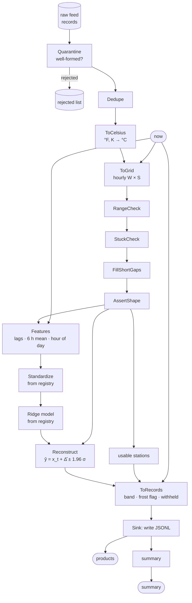

# Tutorial — Run inference

A model is rarely the hard part of inference; the chain around it is.
This tutorial takes raw temperature records from a small sensor network
as they arrive (mixed units, duplicates, malformed rows, a stuck
sensor, gaps), turns them into features, runs a model loaded from the
registry, and turns its output back into products people can use: a
value with an uncertainty band, a frost flag, and a reason whenever a
station gets no forecast.

The same shape fits any "readings in, decisions out" service: a lab
instrument, a clinical monitor, a telescope's housekeeping data.

**Time:** ~15 minutes.

**Prerequisites:**

```bash
uv add pipekit pipekit-experiment numpy
```



```python
from __future__ import annotations

import json
import tempfile
from datetime import UTC, datetime, timedelta
from pathlib import Path

import numpy as np
from numpy.typing import NDArray
from pipekit import AssertShape, Graph, Input, Lambda, Operator, Quarantine, Sink
from pipekit_experiment import LocalModelRegistry


Array = NDArray[np.float64]
STATIONS = [f"st-{i}" for i in range(6)]
UNITS = {
    "st-0": "degC",
    "st-1": "degC",
    "st-2": "degF",
    "st-3": "degC",
    "st-4": "K",
    "st-5": "degC",
}
NOW = datetime(2026, 10, 16, 6, 0, tzinfo=UTC)  # predicting 07:00
WINDOW = 24  # hours of history per prediction


def true_temperature(hours: Array, station: int, seed: int) -> Array:
    """A diurnal cycle plus weather: what the stations measure, in °C."""
    rng = np.random.default_rng(seed + station)
    diurnal = 6.0 * np.sin(2 * np.pi * (hours % 24 - 9) / 24)
    weather = np.cumsum(rng.normal(0.0, 0.3, hours.size))
    return 4.0 + 1.5 * station + diurnal + weather - weather.mean()
```

## Step 1 — A model trained elsewhere, in the registry

In production this happened in another job (see
[Train, register, forecast](train-register-forecast.md)); here it takes a
second. The point to notice: the feature builder `Features` and the
scaler are operators, and the scaler goes into the registry beside the
model, so inference uses exactly the preprocessing training used.

```python
class Features(Operator):
    """(W, S) hourly °C, ending at hour h ↦ (S, 6) features per station.

    [x_t, x_{t−1}, x_{t−2}, mean of the last 6 h, sin 2πh/24, cos 2πh/24].
    """

    def _apply(self, window: tuple[Array, int]) -> Array:
        x, hour = window
        phase = 2 * np.pi * hour / 24
        s = x.shape[1]
        return np.stack(
            [
                x[-1],
                x[-2],
                x[-3],
                x[-6:].mean(axis=0),
                np.full(s, np.sin(phase)),
                np.full(s, np.cos(phase)),
            ],
            axis=1,
        )  #                                                              (S, 6)


class Standardize(Operator):
    """z = (f − μ) / σ, per feature; μ and σ are its configuration."""

    def __init__(self, *, mean: list[float], std: list[float]) -> None:
        self.mean, self.std = mean, std

    def _apply(self, f: Array) -> Array:
        return (f - np.asarray(self.mean)) / np.asarray(self.std)


class Ridge(Operator):
    """Δ̂ = z · w + b: the next hour's change, in °C; σ_res is its error."""

    def __init__(self, *, w: list[float], b: float, sigma_res: float) -> None:
        self.w, self.b, self.sigma_res = w, b, sigma_res

    def _apply(self, z: Array) -> Array:
        return z @ np.asarray(self.w) + self.b  #                      (S, 6) → (S,)


def train_and_register(registry: LocalModelRegistry) -> None:
    hours = np.arange(60 * 24)  # 60 days of clean history
    grid = np.stack([true_temperature(hours, i, seed=100) for i in range(6)], axis=1)
    feats = Features()
    X = np.concatenate(
        [
            feats((grid[t - WINDOW : t], int(hours[t - 1])))
            for t in range(WINDOW, len(hours) - 1)
        ]
    )
    y = np.concatenate([grid[t] - grid[t - 1] for t in range(WINDOW, len(hours) - 1)])
    scaler = Standardize(mean=X.mean(0).tolist(), std=X.std(0).tolist())
    Z = scaler(X)
    A = np.c_[Z, np.ones(len(Z))]
    coef = np.linalg.solve(A.T @ A + 1e-3 * np.eye(A.shape[1]), A.T @ y)  # ridge
    sigma = float(np.std(A @ coef - y))
    model = Ridge(w=coef[:-1].tolist(), b=float(coef[-1]), sigma_res=sigma)
    h = registry.store(scaler, name="temp-scaler")
    registry.store(model, name="temp-nowcast", tags={"scaler": h, "window_h": WINDOW})


registry = LocalModelRegistry(tempfile.mkdtemp())
train_and_register(registry)
```

## Step 2 — The raw feed, as it arrives

Six stations, the last 30 hours. Station 2 reports in °F and station 4 in
kelvin; about 5 % of the hours never arrive; station 5 has been stuck at
9.3 °C for eight hours; four records were delivered twice; two are
malformed.

```python
def raw_feed() -> list[dict]:
    """Last 30 h of records from six stations, with real-world defects."""
    rng = np.random.default_rng(7)
    out = []
    hours = np.arange(-30, 0)
    for i, st in enumerate(STATIONS):
        temp = true_temperature(hours + 6.0 + 60 * 24, i, seed=100)
        for h, c in zip(hours, temp, strict=True):
            if rng.random() < 0.05:
                continue  # dropout
            if st == "st-5" and h >= -8:
                c = 9.3  # a stuck sensor
            value = {"degC": c, "degF": c * 9 / 5 + 32, "K": c + 273.15}[UNITS[st]]
            t = (NOW + timedelta(hours=int(h) + 1)).strftime("%Y-%m-%dT%H:%MZ")
            out.append(
                {"station": st, "time": t, "value": round(value, 2), "unit": UNITS[st]}
            )
    out += out[10:14]  # duplicated delivery
    out += [
        {"station": "st-1", "time": "not-a-time", "value": 3.0, "unit": "degC"},
        {"station": "st-3", "time": "2026-10-16T02:00Z", "value": None, "unit": "degC"},
    ]  # malformed
    return out


feed = raw_feed()
```

## Step 3 — Pre-process, from records to features

The graph starts from two named inputs, the raw feed and the time
`now`. Records are validated one by one with `Quarantine`, which keeps
the bad ones aside instead of failing the run; then deduplicated and
converted to °C. `ToGrid` puts them on an hourly grid; the QC chain blanks
out-of-range values and stuck sensors, fills gaps of up to two hours and
leaves longer ones missing. A station is usable only if its last six
hours are complete.

```python
rejected: list[dict] = []


def well_formed(r: dict) -> bool:
    try:
        datetime.strptime(r["time"], "%Y-%m-%dT%H:%MZ")
        return r["station"] in UNITS and isinstance(r["value"], int | float)
    except (KeyError, ValueError):
        return False


validate = Quarantine(check=well_formed, sentinel=None, on_quarantine=rejected.append)


class Dedupe(Operator):
    """Keep the first record per (station, time)."""

    def _apply(self, records: list[dict]) -> list[dict]:
        seen, out = set(), []
        for r in records:
            if (key := (r["station"], r["time"])) not in seen:
                seen.add(key)
                out.append(r)
        return out


class ToCelsius(Operator):
    """°F ↦ (v − 32) · 5/9, K ↦ v − 273.15."""

    def _apply(self, records: list[dict]) -> list[dict]:
        conv = {
            "degC": lambda v: v,
            "degF": lambda v: (v - 32) * 5 / 9,
            "K": lambda v: v - 273.15,
        }
        return [
            {**r, "value": conv[r["unit"]](r["value"]), "unit": "degC"} for r in records
        ]


class ToGrid(Operator):
    """Records ↦ (W, S) hourly grid ending at ``now``; missing hours are NaN."""

    def __init__(self, *, hours: int) -> None:
        self.hours = hours

    def _apply(self, records: list[dict], now: datetime) -> Array:
        grid = np.full((self.hours, len(STATIONS)), np.nan)
        for r in records:
            t = datetime.strptime(r["time"], "%Y-%m-%dT%H:%MZ").replace(tzinfo=UTC)
            row = self.hours - 1 - int((now - t).total_seconds() // 3600)
            if 0 <= row < self.hours:
                grid[row, STATIONS.index(r["station"])] = r["value"]
        return grid


class RangeCheck(Operator):
    """Values outside [lo, hi] °C become missing."""

    def __init__(self, *, lo: float, hi: float) -> None:
        self.lo, self.hi = lo, hi

    def _apply(self, x: Array) -> Array:
        return np.where((x < self.lo) | (x > self.hi), np.nan, x)


class StuckCheck(Operator):
    """A station whose last ``hours`` readings never change is stuck: drop them."""

    def __init__(self, *, hours: int) -> None:
        self.hours = hours

    def _apply(self, x: Array) -> Array:
        out = x.copy()
        tail = x[-self.hours :]
        stuck = np.nanstd(tail, axis=0) < 1e-6
        out[-self.hours :, stuck] = np.nan
        return out


class FillShortGaps(Operator):
    """Interpolate gaps of at most ``max_gap`` hours; longer gaps stay missing."""

    def __init__(self, *, max_gap: int) -> None:
        self.max_gap = max_gap

    def _apply(self, x: Array) -> Array:
        out, t = x.copy(), np.arange(len(x))
        for s in range(x.shape[1]):
            ok = np.isfinite(x[:, s])
            if ok.sum() < 2:
                continue
            filled = np.interp(t, t[ok], x[ok, s])
            gap = ~ok
            run = np.zeros(len(x), int)  # length of the gap each hour sits in
            i = 0
            while i < len(x):
                if gap[i]:
                    j = i
                    while j < len(x) and gap[j]:
                        j += 1
                    run[i:j] = j - i
                    i = j
                else:
                    i += 1
            short = gap & (run <= self.max_gap) & (t > t[ok][0]) & (t < t[ok][-1])
            out[short, s] = filled[short]
        return out


raw, now = Input("raw"), Input("now")
records = (
    Lambda(lambda rs: [r for r in map(validate, rs) if r is not None])
    | Dedupe()
    | ToCelsius()
)(raw)
grid = ToGrid(hours=WINDOW)(records, now)
clean = (
    RangeCheck(lo=-60.0, hi=60.0)
    | StuckCheck(hours=6)
    | FillShortGaps(max_gap=2)
    | AssertShape((WINDOW, len(STATIONS)))
)(grid)  #                                                                (W, S)
usable = Lambda(lambda x: np.isfinite(x[-6:]).all(axis=0))(clean)  #       (S,)
features = Lambda(lambda x, t: Features()((np.nan_to_num(x), t.hour)))(clean, now)
```

## Step 4 — The model, from the registry

Both operators come back by name. `scaler | model` is an ordinary
`Sequential`.

```python
scaler = registry.load("temp-scaler")
model = registry.load("temp-nowcast")
delta = (scaler | model)(features)  # Δ̂, °C                                  (S,)
```

## Step 5 — Post-process, from predictions to records

The model predicts the next hour's change; `Reconstruct` adds it to the
last reading and puts a 95 % band around it from the model's residual
error. `ToRecords` writes one record per station: the value, the band and
a frost flag when the band reaches below 0 °C, or, for a station that
failed QC, `withheld` with the reason. A `Sink` writes them as JSON lines,
and a summary counts what happened.

```python
class Reconstruct(Operator):
    """ŷ = x_t + Δ̂, with a 95 % band ŷ ± 1.96 σ_res."""

    def __init__(self, *, sigma: float) -> None:
        self.sigma = sigma

    def _apply(self, x: Array, d: Array) -> dict[str, Array]:
        y = x[-1] + d
        return {"value": y, "lo": y - 1.96 * self.sigma, "hi": y + 1.96 * self.sigma}


class ToRecords(Operator):
    """One record per station: a value with its band and a frost flag, or why not."""

    def _apply(self, pred: dict[str, Array], ok: Array, now: datetime) -> list[dict]:
        valid = (now + timedelta(hours=1)).strftime("%Y-%m-%dT%H:%MZ")
        out = []
        for i, st in enumerate(STATIONS):
            if not ok[i]:
                out.append(
                    {
                        "station": st,
                        "valid_time": valid,
                        "status": "withheld",
                        "reason": "failed QC in the last 6 h",
                    }
                )
                continue
            lo, v, hi = (round(float(pred[k][i]), 1) for k in ("lo", "value", "hi"))
            out.append(
                {
                    "station": st,
                    "valid_time": valid,
                    "status": "ok",
                    "temp_c": v,
                    "band_c": [lo, hi],
                    "frost_risk": lo < 0.0,
                }
            )
        return out


out_path = Path(tempfile.mkdtemp()) / "nowcast.jsonl"


def write_jsonl(rows: list[dict]) -> None:
    out_path.write_text("".join(json.dumps(r) + "\n" for r in rows))


forecast = Reconstruct(sigma=model.sigma_res)(clean, delta)
products = Sink(write_jsonl)(ToRecords()(forecast, usable, now))
summary = Lambda(
    lambda rows, recs: {
        "received": len(feed),
        "rejected": len(rejected),
        "kept": len(recs),
        "issued": sum(r["status"] == "ok" for r in rows),
        "withheld": [r["station"] for r in rows if r["status"] != "ok"],
        "frost_risk": [r["station"] for r in rows if r.get("frost_risk")],
    }
)(products, records)
```

## Step 6 — One Graph, run on the feed

```python
nowcast = Graph(
    inputs={"raw": raw, "now": now},
    outputs={"products": products, "summary": summary},
)
out = nowcast(raw=feed, now=NOW)
print(json.dumps(out["summary"]))
print(out_path.read_text().splitlines()[2])
```

```text
{"received": 176, "rejected": 2, "kept": 170, "issued": 5, "withheld": ["st-5"], "frost_risk": ["st-0"]}
{"station": "st-2", "valid_time": "2026-10-16T07:00Z", "status": "ok", "temp_c": 2.9, "band_c": [2.3, 3.5], "frost_risk": false}
```

Two malformed records were rejected and four duplicates dropped; the
stuck station is withheld rather than forecast from bad data; station 0's
band reaches below freezing, so it carries a frost risk. Station 2's
forecast is in °C although it reports in °F.

## Make it yours

- **Another instrument.** Change `well_formed`, the unit table and the QC
  limits; the graph does not change.
- **Another model.** Anything stored in the registry that maps features to
  a prediction slots in where `scaler | model` is.
- **Run it on a schedule.** `nowcast` is one operator: call it every hour
  with the new feed and `now`.

## Where next

- [ETL over many regions](etl-regions.md): the same ideas at batch scale.
- [Train, register, forecast](train-register-forecast.md): where the model
  in the registry comes from.
