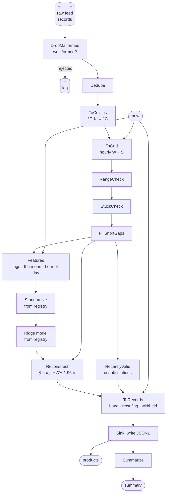

# Tutorial — Run inference

A model is rarely the hard part of inference; the chain around it is.
This tutorial takes raw temperature records from a small sensor network
as they arrive (mixed units, duplicates, malformed rows, a stuck
sensor, gaps), turns them into features, runs a model loaded from the
registry, and turns its output back into products people can use: a
value with an uncertainty band, a frost flag, and a reason whenever a
station gets no forecast.

The same shape fits any "readings in, decisions out" service: a lab
instrument, a clinical monitor, a telescope's housekeeping data.

**Time:** ~15 minutes.

**Prerequisites:**

```bash
uv add pipekit pipekit-experiment numpy jaxtyping
```



```python
from __future__ import annotations

import json
import logging
import tempfile
from datetime import UTC, datetime, timedelta
from pathlib import Path
from typing import Any

import numpy as np
from jaxtyping import Bool, Float, Real
from pipekit import Graph, Input, Operator, Sequential, Sink
from pipekit_experiment import LocalModelRegistry


# ── shapes ───────────────────────────────────────────────────────────────────
# H  hours in a series (60 days of training history, or 30 h of feed)
# W  hours in the window (24)
# S  stations (6)
# F  features per station (6)
# N  rows of features (S at inference, every station-hour in training)
Record = dict[str, Any]
Hours = Real[np.ndarray, " H"]
Series = Float[np.ndarray, " H"]
History = Float[np.ndarray, "H S"]
Grid = Float[np.ndarray, "W S"]
Usable = Bool[np.ndarray, " S"]
StationValues = Float[np.ndarray, " S"]
FeatureMatrix = Float[np.ndarray, "S F"]
FeatureRows = Float[np.ndarray, "N F"]
Changes = Float[np.ndarray, " N"]

STATIONS: list[str] = [f"st-{i}" for i in range(6)]
UNITS: dict[str, str] = {
    "st-0": "degC",
    "st-1": "degC",
    "st-2": "degF",
    "st-3": "degC",
    "st-4": "K",
    "st-5": "degC",
}
# predicting 07:00
NOW: datetime = datetime(2026, 10, 16, 6, 0, tzinfo=UTC)
# hours of history per prediction
WINDOW: int = 24
TIME_FORMAT: str = "%Y-%m-%dT%H:%MZ"
# the fields every record must carry, and the units we can convert
FIELDS: tuple[str, ...] = ("station", "time", "value", "unit")
KNOWN_UNITS: set[str] = {"degC", "degF", "K"}


def parse_time(stamp: str) -> datetime:
    return datetime.strptime(stamp, TIME_FORMAT).replace(tzinfo=UTC)


def true_temperature(hours: Hours, station: int, seed: int) -> Series:
    """A diurnal cycle plus weather: what the stations measure, in °C."""
    rng = np.random.default_rng(seed + station)
    # d(h) = 6 sin(2π (h mod 24 − 9) / 24): coldest at 03:00, warmest at 15:00
    diurnal = 6.0 * np.sin(2 * np.pi * (hours % 24 - 9) / 24)
    # w(h) = ∑_{k ≤ h} ε_k,  ε_k ~ 𝒩(0, 0.3²): a random walk of weather
    weather = np.cumsum(rng.normal(0.0, 0.3, hours.size))
    # T_s(h) = 3 + 1.5 s + d(h) + w(h) − w̄,  s the station index
    return 3.0 + 1.5 * station + diurnal + weather - weather.mean()
```

## Step 1 — A model trained elsewhere, in the registry

In production this happened in another job (see
[Train, register, forecast](train-register-forecast.md)); here it takes a
second. The point to notice: the feature builder `Features` and the
scaler are operators, and the scaler goes into the registry beside the
model, so inference uses exactly the preprocessing training used.

```python
class Features(Operator):
    """Six features per station from the window and the hour of day."""

    def _apply(self, x: Grid, now: datetime) -> FeatureMatrix:
        x = np.nan_to_num(x)
        # φ = 2π h / 24,  h the hour of day of `now`
        phase = 2 * np.pi * now.hour / 24
        n_stations = x.shape[1]
        columns = [
            x[-1],  # x_t
            x[-2],  # x_{t−1}
            x[-3],  # x_{t−2}
            x[-6:].mean(axis=0),  # mean of the last 6 h
            np.full(n_stations, np.sin(phase)),  # sin φ
            np.full(n_stations, np.cos(phase)),  # cos φ
        ]
        return np.stack(columns, axis=1)


class Standardize(Operator):
    """Standardise each feature; μ and σ are its configuration."""

    def __init__(self, *, mean: list[float], std: list[float]) -> None:
        self.mean = mean
        self.std = std

    def _apply(self, f: FeatureRows) -> FeatureRows:
        # z = (f − μ) / σ, per feature
        return (f - np.asarray(self.mean)) / np.asarray(self.std)


class Ridge(Operator):
    """The next hour's change in °C; σ_res is its residual error."""

    def __init__(self, *, w: list[float], b: float, sigma_res: float) -> None:
        self.w = w
        self.b = b
        self.sigma_res = sigma_res

    def _apply(self, z: FeatureRows) -> Changes:
        # Δ̂ = z · w + b
        return z @ np.asarray(self.w) + self.b


def train_and_register(registry: LocalModelRegistry) -> None:
    """Fit Standardize and Ridge on 60 days of clean history; store both."""
    # 60 days of clean, hourly history
    hours: Hours = np.arange(60 * 24)
    # hour 0 of the history is midnight, 60 days before today
    start: datetime = NOW - timedelta(days=60, hours=6)
    series: list[Series] = []
    for i in range(len(STATIONS)):
        series.append(true_temperature(hours, i, seed=100))
    history: History = np.stack(series, axis=1)

    features = Features()
    feature_blocks: list[FeatureMatrix] = []
    change_blocks: list[StationValues] = []
    for t in range(WINDOW, len(hours) - 1):
        # the window x_{t−W}, …, x_{t−1} ends at hour t − 1
        window: Grid = history[t - WINDOW : t]
        window_end = start + timedelta(hours=int(hours[t - 1]))
        feature_blocks.append(features(window, window_end))
        # Δ_t = x_t − x_{t−1}
        change_blocks.append(history[t] - history[t - 1])
    X: FeatureRows = np.concatenate(feature_blocks)
    y: Changes = np.concatenate(change_blocks)

    scaler = Standardize(mean=X.mean(0).tolist(), std=X.std(0).tolist())
    Z: FeatureRows = scaler(X)
    # A = [Z  1]
    A = np.c_[Z, np.ones(len(Z))]
    # [w; b] = (AᵀA + λI)⁻¹ Aᵀy,  λ = 10⁻³: ridge regression
    ridge = A.T @ A + 1e-3 * np.eye(A.shape[1])
    coef = np.linalg.solve(ridge, A.T @ y)
    # σ_res = std(A [w; b] − y)
    sigma = float(np.std(A @ coef - y))
    model = Ridge(w=coef[:-1].tolist(), b=float(coef[-1]), sigma_res=sigma)

    scaler_ref = registry.store(scaler, name="temp-scaler")
    tags = {"scaler": scaler_ref, "window_h": WINDOW}
    registry.store(model, name="temp-nowcast", tags=tags)


registry = LocalModelRegistry(tempfile.mkdtemp())
train_and_register(registry)
```

## Step 2 — The raw feed, as it arrives

Six stations, the last 30 hours. Station 2 reports in °F and station 4 in
kelvin; about 5 % of the hours never arrive; station 5 has been stuck at
9.3 °C for eight hours; four records were delivered twice; two are
malformed.

```python
def raw_feed() -> list[Record]:
    """Last 30 h of records from six stations, with real-world defects."""
    rng = np.random.default_rng(7)
    out: list[Record] = []
    # hours relative to `now`: −29, …, 0
    hours: Hours = np.arange(-29, 1)
    for i, station in enumerate(STATIONS):
        # `now` is hour 60 · 24 + 6 of the training history: 06:00, 60 days on
        temperature: Series = true_temperature(hours + 6.0 + 60 * 24, i, seed=100)
        for h, celsius in zip(hours, temperature, strict=True):
            # about 5 % of the hours never arrive
            if rng.random() < 0.05:
                continue
            # a stuck sensor
            if station == "st-5" and h >= -7:
                celsius = 9.3
            unit = UNITS[station]
            # °C ↦ °F: c · 9/5 + 32,  °C ↦ K: c + 273.15
            as_unit = {
                "degC": celsius,
                "degF": celsius * 9 / 5 + 32,
                "K": celsius + 273.15,
            }
            # a record stamped T carries the temperature at T
            stamp = (NOW + timedelta(hours=int(h))).strftime(TIME_FORMAT)
            record = {
                "station": station,
                "time": stamp,
                "value": round(as_unit[unit], 2),
                "unit": unit,
            }
            out.append(record)
    # a duplicated delivery
    out += out[10:14]
    # two malformed records
    out.append({"station": "st-1", "time": "not-a-time", "value": 3.0, "unit": "degC"})
    out.append(
        {"station": "st-3", "time": "2026-10-16T02:00Z", "value": None, "unit": "degC"}
    )
    return out


feed: list[Record] = raw_feed()
```

## Step 3 — Pre-process, from records to features

Each step is a named operator; the steps are bundled with `|` and run
once on today's feed, step by step, so every intermediate can be looked
at. Records are validated one by one with `DropMalformed`, which logs
the bad ones (a missing field, a bad time, an unknown station or unit,
no value) instead of failing the run; then deduplicated and
converted to °C. `ToGrid` puts them on an hourly grid; the QC chain blanks
out-of-range values and stuck sensors, fills gaps of up to two hours and
leaves longer ones missing. A station is usable only if its last six
hours are complete (`RecentlyValid`).

```python
class DropMalformed(Operator):
    """Keep complete records: known station and unit, valid time, numeric value."""

    def __init__(self, *, on_reject=None) -> None:
        self.on_reject = on_reject

    def _is_valid(self, record: Record) -> bool:
        for field in FIELDS:
            if field not in record:
                return False
        try:
            parse_time(record["time"])
        except ValueError:
            return False
        known_station = record["station"] in UNITS
        known_unit = record["unit"] in KNOWN_UNITS
        numeric_value = isinstance(record["value"], int | float)
        return known_station and known_unit and numeric_value

    def _apply(self, records: list[Record]) -> list[Record]:
        kept: list[Record] = []
        for record in records:
            if self._is_valid(record):
                kept.append(record)
            elif self.on_reject is not None:
                self.on_reject(record)
        return kept


class Dedupe(Operator):
    """Keep the first record per (station, time)."""

    def _apply(self, records: list[Record]) -> list[Record]:
        seen: set[tuple[str, str]] = set()
        kept: list[Record] = []
        for record in records:
            key = (record["station"], record["time"])
            if key in seen:
                continue
            seen.add(key)
            kept.append(record)
        return kept


class ToCelsius(Operator):
    """Convert every value to °C."""

    def _apply(self, records: list[Record]) -> list[Record]:
        converted: list[Record] = []
        for record in records:
            value = record["value"]
            unit = record["unit"]
            # °F ↦ (v − 32) · 5/9
            if unit == "degF":
                value = (value - 32) * 5 / 9
            # K ↦ v − 273.15
            elif unit == "K":
                value = value - 273.15
            # never relabel a unit we cannot convert
            elif unit != "degC":
                raise ValueError(f"cannot convert unit {unit!r} to °C")
            converted.append({**record, "value": value, "unit": "degC"})
        return converted


class ToGrid(Operator):
    """Place records on an hourly (W, S) grid ending at ``now``; gaps are NaN."""

    def __init__(self, *, hours: int) -> None:
        self.hours = hours

    def _apply(self, records: list[Record], now: datetime) -> Grid:
        grid = np.full((self.hours, len(STATIONS)), np.nan)
        for record in records:
            hours_ago = int((now - parse_time(record["time"])).total_seconds() // 3600)
            row = self.hours - 1 - hours_ago
            if 0 <= row < self.hours:
                column = STATIONS.index(record["station"])
                grid[row, column] = record["value"]
        return grid


class RangeCheck(Operator):
    """Values outside [lo, hi] °C become missing."""

    def __init__(self, *, lo: float, hi: float) -> None:
        self.lo = lo
        self.hi = hi

    def _apply(self, x: Grid) -> Grid:
        # x ∉ [lo, hi] ↦ NaN
        outside = (x < self.lo) | (x > self.hi)
        return np.where(outside, np.nan, x)


class StuckCheck(Operator):
    """A station whose last ``hours`` readings never change is stuck: drop them."""

    def __init__(self, *, hours: int) -> None:
        self.hours = hours

    def _apply(self, x: Grid) -> Grid:
        # stuck_s = 1[ σ(x_{t−h+1:t, s}) = 0 ]
        tail = x[-self.hours :]
        stuck = np.nanstd(tail, axis=0) < 1e-6
        out = x.copy()
        out[-self.hours :, stuck] = np.nan
        return out


class FillShortGaps(Operator):
    """Interpolate interior gaps of at most ``max_gap`` hours, per station."""

    def __init__(self, *, max_gap: int) -> None:
        self.max_gap = max_gap

    def _gap_lengths(self, missing: np.ndarray) -> np.ndarray:
        lengths = np.zeros(len(missing), dtype=int)
        start = 0
        while start < len(missing):
            if not missing[start]:
                start += 1
                continue
            end = start
            while end < len(missing) and missing[end]:
                end += 1
            lengths[start:end] = end - start
            start = end
        return lengths

    def _apply(self, x: Grid) -> Grid:
        out = x.copy()
        t = np.arange(len(x))
        for s in range(x.shape[1]):
            valid = np.isfinite(x[:, s])
            if valid.sum() < 2:
                continue
            interior = (t > t[valid][0]) & (t < t[valid][-1])
            short = ~valid & (self._gap_lengths(~valid) <= self.max_gap) & interior
            out[short, s] = np.interp(t[short], t[valid], x[valid, s])
        return out


class RecentlyValid(Operator):
    """A station is usable when its last ``hours`` readings are all present."""

    def __init__(self, *, hours: int) -> None:
        self.hours = hours

    def _apply(self, x: Grid) -> Usable:
        # usable_s = ∀ t ∈ last h hours : x_{t, s} ≠ NaN
        tail = x[-self.hours :]
        return np.isfinite(tail).all(axis=0)


log = logging.getLogger("nowcast")


def log_rejected(record: Record) -> None:
    log.info("rejected malformed record %s", record)


# the steps

# drop records with a missing field, a bad time, an unknown station or unit,
# or no value; log each one
drop_malformed = DropMalformed(on_reject=log_rejected)
# keep the first record per (station, time)
dedupe = Dedupe()
# °F ↦ (v − 32) · 5/9,  K ↦ v − 273.15
to_celsius = ToCelsius()
# records ↦ x ∈ ℝ^{W×S}, one row per hour ending at `now`, NaN where missing
to_grid = ToGrid(hours=WINDOW)
# x ∉ [−60, 60] °C ↦ NaN
range_check = RangeCheck(lo=-60.0, hi=60.0)
# σ(x over the last 6 h) = 0 ↦ NaN: a stuck sensor
stuck_check = StuckCheck(hours=6)
# linear interpolation across interior gaps of at most 2 h
fill_gaps = FillShortGaps(max_gap=2)
# usable_s = ∀ t in the last 6 h : x_{t, s} ≠ NaN
recent_ok = RecentlyValid(hours=6)
# [x_t, x_{t−1}, x_{t−2}, x̄_{6h}, sin φ, cos φ],  φ = 2π h / 24
features = Features()

# the bundles

tidy: Sequential = dedupe | to_celsius
qc: Sequential = range_check | stuck_check | fill_gaps

# run it once, step by step, on today's feed

# 176 raw records → 174: two malformed
valid: list[Record] = drop_malformed(feed)
# 174 → 170: four duplicated, all in °C
records: list[Record] = tidy(valid)
# NaN where missing
grid: Grid = to_grid(records, NOW)
# stuck and out-of-range values removed, short gaps filled
clean: Grid = qc(grid)
# True where the last 6 h are complete
usable: Usable = recent_ok(clean)
# [x_t, x_{t−1}, x_{t−2}, x̄_{6h}, sin φ, cos φ] per station
feats: FeatureMatrix = features(clean, NOW)
```

## Step 4 — The model, from the registry

Both operators come back by name. `scaler | model` is an ordinary
`Sequential`.

```python
# the steps

# z = (f − μ) / σ, with the μ and σ from training
scaler = registry.load("temp-scaler")
# Δ̂ = z · w + b: the next hour's change, °C
model = registry.load("temp-nowcast")

# the bundle

predict: Sequential = scaler | model

# run it once

# Δ̂ per station, °C
delta: StationValues = predict(feats)
```

## Step 5 — Post-process, from predictions to records

The model predicts the next hour's change; `Reconstruct` adds it to the
last reading and puts a 95 % band around it from the model's residual
error. `ToRecords` writes one record per station: the value, the band and
a frost flag when the band reaches below 0 °C, or, for a station that
failed QC, `withheld` with the reason. A `Sink` writes them as JSON lines,
and `Summarize` counts what happened.

```python
class Reconstruct(Operator):
    """The next hour's temperature with a 95 % band."""

    def __init__(self, *, sigma: float) -> None:
        self.sigma = sigma

    def _apply(self, x: Grid, delta: StationValues) -> dict[str, StationValues]:
        # ŷ = x_t + Δ̂
        y = x[-1] + delta
        # ŷ ± 1.96 σ_res
        lo = y - 1.96 * self.sigma
        hi = y + 1.96 * self.sigma
        return {"value": y, "lo": lo, "hi": hi}


class ToRecords(Operator):
    """One record per station: a value with its band and a frost flag, or why not."""

    def _apply(
        self, forecast: dict[str, StationValues], usable: Usable, now: datetime
    ) -> list[Record]:
        valid_time = (now + timedelta(hours=1)).strftime(TIME_FORMAT)
        rows: list[Record] = []
        for i, station in enumerate(STATIONS):
            if not usable[i]:
                withheld = {
                    "station": station,
                    "valid_time": valid_time,
                    "status": "withheld",
                    "reason": "failed QC in the last 6 h",
                }
                rows.append(withheld)
                continue
            lo = round(float(forecast["lo"][i]), 1)
            value = round(float(forecast["value"][i]), 1)
            hi = round(float(forecast["hi"][i]), 1)
            issued = {
                "station": station,
                "valid_time": valid_time,
                "status": "ok",
                "temp_c": value,
                "band_c": [lo, hi],
                # frost risk: the band reaches below 0 °C
                "frost_risk": lo < 0.0,
            }
            rows.append(issued)
        return rows


class Summarize(Operator):
    """Count what happened to the feed, from raw records to products."""

    def _apply(
        self,
        raw: list[Record],
        valid: list[Record],
        records: list[Record],
        rows: list[Record],
    ) -> dict[str, Any]:
        issued = 0
        withheld: list[str] = []
        frost_risk: list[str] = []
        for row in rows:
            if row["status"] == "ok":
                issued += 1
            else:
                withheld.append(row["station"])
            if row.get("frost_risk"):
                frost_risk.append(row["station"])
        return {
            "received": len(raw),
            "rejected": len(raw) - len(valid),
            "kept": len(records),
            "issued": issued,
            "withheld": withheld,
            "frost_risk": frost_risk,
        }


out_path = Path(tempfile.mkdtemp()) / "nowcast.jsonl"


def write_jsonl(rows: list[Record]) -> None:
    lines: list[str] = []
    for row in rows:
        lines.append(json.dumps(row) + "\n")
    out_path.write_text("".join(lines))


# the steps

# ŷ = x_t + Δ̂,  band ŷ ± 1.96 σ_res
reconstruct = Reconstruct(sigma=model.sigma_res)
# one record per station: issued with a band and a frost flag, or withheld
to_records = ToRecords()
# write the records as JSON lines, pass them on unchanged
write = Sink(write_jsonl)
# received, rejected, kept, issued, withheld, frost risk
summarize = Summarize()

# run it once

# ŷ, its lower and upper bounds, per station
forecast: dict[str, StationValues] = reconstruct(clean, delta)
# six records, one per station
rows: list[Record] = to_records(forecast, usable, NOW)
products: list[Record] = write(rows)
summary: dict[str, Any] = summarize(feed, valid, records, products)
```

## Step 6 — One Graph, run on the feed

```python
# the same steps, wired once as a graph for every later run

raw_in = Input("raw")
now_in = Input("now")
valid_node = drop_malformed(raw_in)
records_node = tidy(valid_node)
grid_node = to_grid(records_node, now_in)
clean_node = qc(grid_node)
usable_node = recent_ok(clean_node)
feats_node = features(clean_node, now_in)
delta_node = predict(feats_node)
forecast_node = reconstruct(clean_node, delta_node)
rows_node = to_records(forecast_node, usable_node, now_in)
products_node = write(rows_node)
summary_node = summarize(raw_in, valid_node, records_node, products_node)
nowcast = Graph(
    inputs={"raw": raw_in, "now": now_in},
    outputs={"products": products_node, "summary": summary_node},
)

out = nowcast(raw=feed, now=NOW)
print(json.dumps(out["summary"]))
print(out_path.read_text().splitlines()[2])
```

```text
{"received": 176, "rejected": 2, "kept": 170, "issued": 5, "withheld": ["st-5"], "frost_risk": ["st-0"]}
{"station": "st-2", "valid_time": "2026-10-16T07:00Z", "status": "ok", "temp_c": 2.8, "band_c": [2.2, 3.4], "frost_risk": false}
```

Two malformed records were rejected and four duplicates dropped; the
stuck station is withheld rather than forecast from bad data; station 0's
forecast is 0.1 °C with a band from −0.5 to 0.7 °C, which reaches below
freezing, so it carries a frost risk. Station 2's
forecast is in °C although it reports in °F.

## Make it yours

- **Another instrument.** Change `DropMalformed`, the unit table and the QC
  limits; the graph does not change.
- **Another model.** Anything stored in the registry that maps features to
  a prediction slots in where `scaler | model` is.
- **Run it on a schedule.** `nowcast` is one operator: call it every hour
  with the new feed and `now`.

## Where next

- [ETL over many regions](etl-regions.md): the same ideas at batch scale.
- [Train, register, forecast](train-register-forecast.md): where the model
  in the registry comes from.
