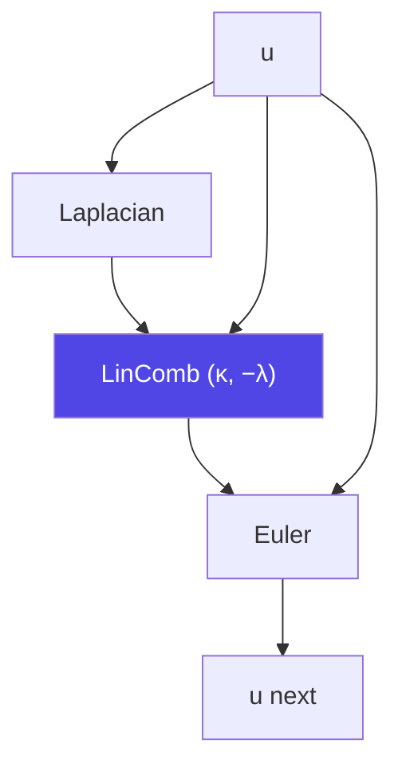

# Tutorial — Run pipekit pipelines under `jit`

pipekit composes operators as plain Python objects. Under `jax.jit` that
is free: `Graph` topology and `Sequential` dispatch are traced away and
the compiled program is the same as hand-written JAX. Three things need
`pipekit-jax` to work: gradients w.r.t. parameters held *inside* a
pipeline, operators whose config is JSON *and* whose fields are pytree
leaves, and time loops that don't unroll.

This tutorial builds a tiny PDE model as a pipekit graph, rolls it out
with a scan, recovers its two physical parameters by gradient-based
optimisation, and runs a 32-member ensemble in one compiled call.

**Time:** ~10 minutes.

**Prerequisites:**

```bash
uv add pipekit-jax
```

Every code block on this page runs as written, top to bottom (the test
suite executes them).

## The model

A periodic 1-D field $u(x, t)$ that diffuses and decays,

$$
\partial_t u = \kappa\, \partial_{xx} u - \lambda\, u ,
$$

with diffusivity $\kappa$ and decay rate $\lambda$, discretised on $N$
cells of width $\Delta x$ with a second-order Laplacian and explicit
Euler steps of $\Delta t$:

$$
u^{n+1}_i = u^n_i + \Delta t \left( \kappa\,
\frac{u^n_{i+1} - 2u^n_i + u^n_{i-1}}{\Delta x^2} - \lambda\, u^n_i \right).
$$

## 1. Operators that are also pytrees

A `JaxOperator` is a pipekit `Operator` and an `eqx.Module` at once:
fields declared as on any Equinox module, config derived from them.
Mark config-only fields `static`; give learnable fields
`converter=jnp.asarray` so they stay arrays after a JSON round trip.

```python
from typing import Any

import equinox as eqx
import jax
import jax.numpy as jnp
import pipekit_jax  # registers Sequential / Graph as pytrees
from jax.flatten_util import ravel_pytree
from jax.scipy.optimize import minimize
from pipekit import Graph, Input, Operator, Sequential, StatefulOperator
from pipekit_jax import EnsembleScanCycle, JaxOperator, Rollout, ScanCycle
from pipekit_jax.testing import check_jax_operator

N = 64
DX, DT = 1.0 / N, 2e-4          # explicit-diffusion limit: κ·Δt/Δx² ≤ ½
x = jnp.arange(N) * DX           # [N]


class Laplacian(JaxOperator):
    """∂ₓₓu, second order, periodic.   u[N] → [N]"""

    dx: float = eqx.field(static=True)

    def _apply(self, u):
        return (jnp.roll(u, -1) - 2 * u + jnp.roll(u, 1)) / self.dx**2


class LinComb(JaxOperator):
    """∑ᵢ cᵢ xᵢ with learnable coefficients."""

    coeffs: jax.Array = eqx.field(converter=jnp.asarray)

    def _apply(self, *xs):
        return sum(c * x for c, x in zip(self.coeffs, xs, strict=True))


class Euler(JaxOperator):
    """u + Δt·du."""

    dt: float = eqx.field(static=True)

    def _apply(self, u, du):
        return u + self.dt * du


class Pick(Operator):
    """Select one output of a graph (a plain, non-pytree operator)."""

    def __init__(self, key: str) -> None:
        self.key = key

    def _apply(self, d):
        return d[self.key]


# The contract every JAX operator should meet: eager ≡ jit, vmap,
# visible leaves, and a config round trip that keeps leaves learnable.
check_jax_operator(Laplacian(dx=DX), jnp.sin(2 * jnp.pi * x))
check_jax_operator(LinComb(coeffs=[0.1, -1.0]), x, x**2)
```

!!! note "Compile with `eqx.filter_jit`"
    `jax.jit(op)` hashes the callable, and an `eqx.Module` with array
    fields is unhashable. Use `eqx.filter_jit(op)`, or `jax.jit` on a
    function that takes the operator as an argument.

## 2. One step as a graph

The tendency $\kappa\,\partial_{xx}u - \lambda u$ is a `LinComb` of the
Laplacian and the field; the step is an Euler update. The coefficients
$(\kappa, -\lambda)$ live on one node of the graph.



```python
def make_step(kappa, lam):
    u = Input("u")
    tendency = LinComb(coeffs=[kappa, -lam])(Laplacian(dx=DX)(u), u)
    graph = Graph(inputs={"u": u}, outputs={"u": Euler(dt=DT)(u, tendency)})
    return Sequential([graph, Pick("u")])        # u[N] → u[N]
```

Because `pipekit_jax` registers `Sequential` and `Graph` as pytrees,
`jax.tree.leaves(make_step(0.05, 2.0))` is the one coefficient array of
the `LinComb` node, plus the `Pick` instance as an opaque leaf that
Equinox's filters treat as static.

## 3. Roll out with a scan

`Rollout` advances a carrier `n_steps` times inside one `jax.lax.scan`
and returns the trajectory every `save_every` steps. Compile time does
not grow with `n_steps`.

```python
u0 = jnp.exp(-((x - 0.5) ** 2) / 0.005)                      # [N]
truth = Rollout(step=make_step(0.05, 2.0), n_steps=500, save_every=50)
obs = eqx.filter_jit(truth)(u0)                               # [11, N]
assert obs.shape == (11, N)
```

## 4. Recover κ and λ by gradient descent through the whole pipeline

Start from a wrong guess $(\kappa, \lambda) = (0.02, 0.5)$ and minimise
the trajectory misfit

$$
J(\theta) = \frac{1}{T N} \sum_{t} \lVert u_t(\theta) - u^{\text{obs}}_t \rVert^2 .
$$

`eqx.partition` splits the *entire* rollout — `Rollout` → `Sequential`
→ `Graph` → node operators — into its learnable leaves and the static
rest, so any optimiser over flat vectors applies.
With `checkpoint=True` the backward pass stores the carry only at the
save points and recomputes each 50-step block: O(n / save_every +
save_every) carries instead of O(n). That is O(√n) only when
`save_every` is about √n; with `save_every=1` nothing is saved, because
the trajectory itself holds every step.

```python
model = Rollout(step=make_step(0.02, 0.5), n_steps=500, save_every=50, checkpoint=True)
params, static = eqx.partition(model, eqx.is_inexact_array)
theta0, unravel = ravel_pytree(params)                         # [κ, −λ]


def misfit(theta):
    rollout = eqx.combine(unravel(theta), static)
    return jnp.mean((rollout(u0) - obs) ** 2)


result = minimize(misfit, theta0, method="BFGS")
kappa, minus_lam = result.x
print(f"κ = {kappa:.4f}, λ = {-minus_lam:.4f}")              # κ = 0.0500, λ = 2.0000
assert abs(kappa - 0.05) < 1e-3 and abs(-minus_lam - 2.0) < 1e-2
```

## 5. Cycles: `ScanCycle` instead of `Cycle` under `jit`

`pipekit_cycle.Cycle` is carrier-agnostic and steps in a Python loop —
right for host-side runs, but under `jit` the loop unrolls.
`pipekit_jax.ScanCycle` keeps `Cycle`'s `(carrier, state)` contract and
history convention in one scan. Measured on a 2-vCPU CPU VM with a
5-point diffusion step on a 128² grid:

| steps | compile `Cycle` | compile `ScanCycle` | compile grad, `Cycle` | compile grad, `ScanCycle` |
|---:|---:|---:|---:|---:|
| 10 | 0.19 s | 0.12 s | 2.9 s | 0.26 s |
| 50 | — | — | 356 s | 0.28 s |
| 1000 | 19.0 s | 0.13 s | did not finish in 10 min | — |

With `checkpoint=True`, the gradient memory of a 1000-step `ScanCycle`
call (√n-step chunks) falls from 62.9 MiB to 4.4 MiB, and at 4000
steps from 250 MiB to 8.3 MiB.

## 6. An ensemble in one compiled call

`EnsembleScanCycle` `vmap`s a `ScanCycle` over a leading member axis.
The state is either shared and read-only (`state_axis=None`, the
default) or per member (`state_axis=0`). Unlike
`pipekit_cycle.EnsembleCycle`, which threads one state through the
members in turn, a `vmap` cannot let members write a shared state.

```python
class Advance(StatefulOperator, JaxOperator):
    """Lift a carrier-only step to the (carrier, state) contract."""

    step: Any

    def _apply(self, u, s):
        return self.step(u), s


fitted = eqx.combine(unravel(result.x), static)
cycle = ScanCycle(step_op=Advance(step=fitted.step), n_steps=500)
ensemble = EnsembleScanCycle(cycle=cycle)

centres = jnp.linspace(0.3, 0.7, 32)                                    # [M]
members = jnp.exp(-((x[None, :] - centres[:, None]) ** 2) / 0.005)      # [M, N]
forecast, _ = eqx.filter_jit(ensemble)(members, None)                   # [M, N]
assert forecast.shape == (32, N)
```

## What is traced away, and what is not

| piece | under `jit` |
|---|---|
| `Graph` topology, `Sequential` dispatch, `Operator.__call__` | traced away — zero runtime cost |
| operator fields (`JaxOperator`) | leaves (arrays) or static config |
| plain `pipekit.Operator` instances | opaque leaves — static under `eqx.filter_*` |
| `pipekit_cycle.Cycle` loop | **unrolled** — use `ScanCycle` / `Rollout` |
| `Cycle.history` list | side effect in traced code — use `ScanCycle.run` |
| `Fanout`, `Branch`, `Switch`, `Cache`, parallel maps | not registered as pytrees yet |
