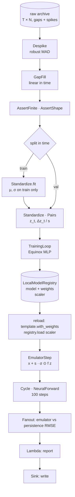

# Tutorial — Train, register, forecast

Takes a raw simulation archive with gaps and spikes, cleans it, trains a
neural emulator on it, stores the model **and its preprocessing** in a
model registry, reloads both, runs the emulator as the forward model of
a `Cycle`, and post-processes the forecasts into a verification report
against the truth and a persistence baseline.

The system is Lorenz-96, the small chaotic model used across climate
science and data assimilation as a stand-in for the atmosphere; swap in
your own archive and nothing else changes.

**Time:** ~20 minutes (the script trains for about 30 seconds on a CPU).

**Prerequisites:**

```bash
uv add 'pipekit-train[equinox,experiment,cycle]' pipekit-jax numpy
```



```python
from __future__ import annotations

import json
import tempfile

import equinox as eqx
import jax
import numpy as np
from numpy.typing import NDArray
from pipekit import AssertShape, Fanout, Lambda, Operator, Sink
from pipekit_cycle import Cycle, NeuralForward
from pipekit_experiment import LocalModelRegistry
from pipekit_jax import JaxModelOp
from pipekit_train import MSE, IterableDataset, TrainingLoop
from pipekit_train.adapters.equinox import EquinoxModelOp


Array = NDArray[np.float64]
N, F, DT = 8, 8.0, 0.01  # variables, forcing, time step
```

## Step 1 — An archive with real defects

A long run of the model stands in for your archive. Like real records,
it has dropouts (1 % of values missing) and spikes (0.3 % off by ±40).
`truth` is kept aside to verify the forecasts at the end.

```python
def lorenz96(x: Array) -> Array:
    """dx_i/dt = (x_{i+1} − x_{i−2}) x_{i−1} − x_i + F."""
    return (np.roll(x, -1) - np.roll(x, 2)) * np.roll(x, 1) - x + F


def rk4(x: Array, dt: float) -> Array:
    k1 = lorenz96(x)
    k2 = lorenz96(x + 0.5 * dt * k1)
    k3 = lorenz96(x + 0.5 * dt * k2)
    k4 = lorenz96(x + dt * k3)
    return x + dt * (k1 + 2 * k2 + 2 * k3 + k4) / 6


def simulate(n_steps: int, seed: int) -> Array:
    rng = np.random.default_rng(seed)
    x = F + rng.normal(0.0, 1.0, N)
    for _ in range(1000):  # spin-up onto the attractor
        x = rk4(x, DT)
    out = np.empty((n_steps, N))
    for t in range(n_steps):
        x = rk4(x, DT)
        out[t] = x
    return out  #                                                         (T, N)


truth = simulate(8000, seed=0)
archive = truth.copy()
rng = np.random.default_rng(1)
archive[rng.random(archive.shape) < 0.01] = np.nan  # 1 % dropouts
spikes = rng.random(archive.shape) < 0.003
archive[spikes] += rng.choice([-40.0, 40.0], spikes.sum())  # 0.3 % spikes
```

## Step 2 — Clean it

Each cleaning step is an operator, so the whole chain is one
`Sequential`: mark spikes as missing with a robust z-score, fill every
gap by interpolation in time, then fail loudly if anything is still
missing or the shape is wrong. Splitting by time (not at random) keeps
the validation period truly unseen.

```python
class Despike(Operator):
    """Mark x as missing where |x − median| > k · 1.4826 · MAD, per variable."""

    def __init__(self, *, k: float) -> None:
        self.k = k

    def _apply(self, x: Array) -> Array:
        med = np.nanmedian(x, axis=0)  #                                    (N,)
        mad = 1.4826 * np.nanmedian(np.abs(x - med), axis=0)  #             (N,)
        return np.where(np.abs(x - med) > self.k * mad, np.nan, x)  #     (T, N)


class GapFill(Operator):
    """Fill missing values by linear interpolation in time, per variable."""

    def _apply(self, x: Array) -> Array:
        t = np.arange(x.shape[0])
        out = x.copy()
        for i in range(x.shape[1]):
            ok = np.isfinite(x[:, i])
            out[:, i] = np.interp(t, t[ok], x[ok, i])
        return out  #                                                     (T, N)


class AssertFinite(Operator):
    """Fail loudly if anything is still missing."""

    def _apply(self, x: Array) -> Array:
        if not np.isfinite(x).all():
            raise ValueError(f"{int((~np.isfinite(x)).sum())} values still missing")
        return x


clean = Despike(k=6.0) | GapFill() | AssertFinite() | AssertShape((None, N))
series = clean(archive)  #                                                (T, N)
split = int(0.8 * len(series))
train_series, val_series = series[:split], series[split:]  # in time, no leakage
```

## Step 3 — Fit the normalisation on the training split only

`Standardize` keeps its statistics as plain configuration, so a fitted
scaler is an operator that can be saved, versioned and reloaded like any
other. It is fitted on the training split only, so no information from
the validation period leaks into training. `Pairs` turns the series into
the emulator's training examples: the standardized state and its
one-step increment, scaled by `s` so the targets are of order one.

```python
class Standardize(Operator):
    """z = (x − μ) / σ, per variable; μ and σ are its configuration."""

    def __init__(self, *, mean: list[float], std: list[float]) -> None:
        self.mean = mean
        self.std = std

    @classmethod
    def fit(cls, x: Array) -> Standardize:
        return cls(mean=x.mean(axis=0).tolist(), std=x.std(axis=0).tolist())

    def _apply(self, x: Array) -> Array:
        return (x - np.asarray(self.mean)) / np.asarray(self.std)

    def inverse(self, z: Array) -> Array:
        return z * np.asarray(self.std) + np.asarray(self.mean)


class Pairs(Operator):
    """(T, N) ↦ [(z_t, Δz_t / s)]: inputs and scaled one-step increments."""

    def __init__(self, *, step_scale: float) -> None:
        self.step_scale = step_scale  # s

    def _apply(self, z: Array) -> list[tuple[Array, Array]]:
        dz = (z[1:] - z[:-1]) / self.step_scale  #                     (T − 1, N)
        return [
            (a.astype(np.float32), b.astype(np.float32))
            for a, b in zip(z[:-1], dz, strict=True)
        ]


scaler = Standardize.fit(train_series)
step_scale = float(np.std(np.diff(scaler(train_series), axis=0)))
to_pairs = scaler | Pairs(step_scale=step_scale)
train_pairs, val_pairs = to_pairs(train_series), to_pairs(val_series)
```

## Step 4 — Train

`TrainingLoop` is itself an operator: a model goes in, a trained model
comes out. The dataset's content hash records exactly which cleaned
data it saw. Validation is the increment error on the held-out period.

```python
mlp = eqx.nn.MLP(in_size=N, out_size=N, width_size=64, depth=2, key=jax.random.key(0))
loop = TrainingLoop(
    model_op=EquinoxModelOp(mlp),
    dataset=IterableDataset(source=train_pairs, content_hash="l96-n8-seed0-clean-v1"),
    loss=MSE(),
    optimizer_config={"name": "adam", "lr": 3e-3},
    max_steps=1500,
    batch_size=64,
    backend="equinox",
    seed=0,
)
trained, artifact = loop.run()
model = JaxModelOp(trained.module)

# validation: the increment error on held-out time, in units of s
zv = np.stack([a for a, _ in val_pairs])
dv = np.stack([b for _, b in val_pairs])
val_rmse = float(np.sqrt(np.mean((np.asarray(jax.vmap(model.module)(zv)) - dv) ** 2)))
```

## Step 5 — Register the model and its preprocessing together

The scaler goes in under its own name; the model goes in with its
weights and with tags pointing at the scaler's hash, the increment scale
and the validation score. Anyone who loads `l96-emulator` can find the
exact preprocessing it was trained with.

```python
registry = LocalModelRegistry(tempfile.mkdtemp())
scaler_hash = registry.store(scaler, name="l96-scaler")
model_hash = registry.store(
    model,
    name="l96-emulator",
    weights=model.serialize_weights(),
    tags={
        "scaler": scaler_hash,
        "step_scale": step_scale,
        "dt": DT,
        "val_rmse": val_rmse,
    },
)
```

## Step 6 — Reload and forecast

A fresh process would start here. The weights go back into a skeleton
of the same architecture, the scaler comes back as an operator, and
`EmulatorStep` wraps the three into a step in physical units.
`NeuralForward` makes it a forward model, and `Cycle` runs it.

```python
template = JaxModelOp(
    eqx.nn.MLP(in_size=N, out_size=N, width_size=64, depth=2, key=jax.random.key(0))
)
model = template.with_weights(registry.load_weights("l96-emulator"))
scaler = registry.load("l96-scaler")


class EmulatorStep(Operator):
    """x_{t+1} = x_t + s · σ ⊙ f((x_t − μ) / σ): the emulator in physical units."""

    def __init__(self, *, model: Operator, scaler: Standardize, step_scale: float):
        self.model, self.scaler, self.step_scale = model, scaler, step_scale

    def _apply(self, x: Array) -> Array:
        dz = np.asarray(self.model(self.scaler(x).astype(np.float32)))  #      (N,)
        return x + self.step_scale * dz * np.asarray(self.scaler.std)  #      (N,)


forecast = Cycle(
    step_op=NeuralForward(
        EmulatorStep(model=model, scaler=scaler, step_scale=step_scale), dt=DT
    ),
    n_steps=100,  # one model time unit
    save_history=True,
)
```

## Step 7 — Post-process into a verification report

Fourteen forecasts from the validation period are compared with the
truth at every lead time, beside persistence (tomorrow equals today), the
baseline every forecast has to beat. A `Fanout` computes both scores, a
`Lambda` shapes them into a report with the skill horizon (the first
lead at which the error passes half the climatological spread) and the
hashes that produced it, and a `Sink` writes it out (here, to the
screen).

```python
def run_forecasts(starts: list[int]) -> Array:
    """One forecast per start index in the validation period: (K, L, N)."""
    out = []
    for s in starts:
        forecast(val_series[s], None)
        out.append(np.stack([np.asarray(c) for c, _ in forecast.history]))
    return np.stack(out)


starts = list(range(0, 1400, 100))  # K = 14 forecasts
pred = run_forecasts(starts)  #                                       (K, L, N)
obs = np.stack([truth[split + s + 1 : split + s + 1 + 100] for s in starts])
persist = np.stack([np.repeat(val_series[s][None], 100, axis=0) for s in starts])


class RMSEByLead(Operator):
    """RMSE_ℓ = √(mean_{k,i} (ŷ_kℓi − y_kℓi)²), per lead ℓ."""

    def _apply(self, pair: tuple[Array, Array]) -> Array:
        p, o = pair
        return np.sqrt(np.mean((p - o) ** 2, axis=(0, 2)))  #                 (L,)


rmse = RMSEByLead()
clim = float(truth.std())
verify = (
    Fanout(
        {
            "emulator_rmse": rmse,
            "persistence_rmse": Lambda(lambda pair: rmse((persist, pair[1]))),
        }
    )
    | Lambda(
        lambda r: {
            **{k: [round(float(v), 4) for v in r[k][9::10]] for k in r},
            "lead_times": [round((i + 1) * DT, 2) for i in range(9, 100, 10)],
            "skill_horizon": round(
                DT * int(np.argmax(r["emulator_rmse"] > 0.5 * clim)), 2
            ),
            "model": model_hash[:12],
            "scaler": scaler_hash[:12],
        }
    )
    | Sink(lambda report: print(json.dumps(report)))
)

report = verify((pred, obs))
print("val increment RMSE (units of s):", round(val_rmse, 3))
```

```text
{"emulator_rmse": [0.4163, 0.8103, 1.1508, 1.5231, 2.017, 2.5526, 2.9611, 3.2017, 3.4882, 3.9208], "persistence_rmse": [1.8212, 3.3447, 4.502, 5.1949, 5.481, 5.6322, 5.6912, 5.6105, 5.5665, 5.5287], "lead_times": [0.1, 0.2, 0.3, 0.4, 0.5, 0.6, 0.7, 0.8, 0.9, 1.0], "skill_horizon": 0.46, "model": "…", "scaler": "…"}
val increment RMSE (units of s): 0.218
```

The emulator beats persistence at every lead and stays useful for about
half a model time unit, a few "days" in Lorenz-96 terms. (Exact numbers
vary slightly with your JAX version and hardware.)

## Make it yours

- **Your archive.** Replace `simulate` with your reader; the cleaning
  chain only assumes an array of shape `(time, variables)`.
- **Your model.** Any `eqx.Module` works; keep the same constructor
  arguments for the reload template.
- **Your registry.** `S3ModelRegistry` has the same `store` / `load` /
  `load_weights` API.

## Where next

- [Run inference](inference.md): the same registry, a model in the middle
  of a longer pre- and post-processing chain.
- [Ensemble data assimilation](ensemble-da.md): the forward model plus
  observations.
