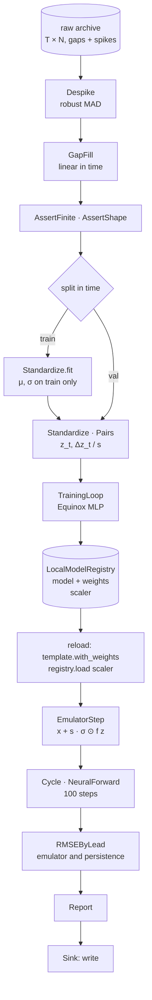

# Tutorial — Train, register, forecast

Takes a raw simulation archive with gaps and spikes, cleans it, trains a
neural emulator on it, stores the model **and its preprocessing** in a
model registry, reloads both, runs the emulator as the forward model of
a `Cycle`, and post-processes the forecasts into a verification report
against the truth and a persistence baseline.

The system is Lorenz-96, the small chaotic model used across climate
science and data assimilation as a stand-in for the atmosphere; swap in
your own archive and nothing else changes.

**Time:** ~20 minutes (the script trains for about 30 seconds on a CPU).

**Prerequisites:**

```bash
uv add 'pipekit-train[equinox,experiment,cycle]' pipekit-jax numpy jaxtyping
```



```python
from __future__ import annotations

import json
import tempfile
from typing import Any

import equinox as eqx
import jax
import numpy as np
from jaxtyping import Bool, Float, Float32
from pipekit import AssertShape, Operator, Sequential, Sink
from pipekit_cycle import Cycle, NeuralForward
from pipekit_experiment import LocalModelRegistry
from pipekit_jax import JaxModelOp
from pipekit_train import MSE, IterableDataset, TrainingLoop
from pipekit_train.adapters.equinox import EquinoxModelOp


# ── shapes ───────────────────────────────────────────────────────────────────
# T  time steps of a series
# *batch  any leading axes (none for one state, T for a series)
# N  model variables (8)
# K  forecasts in the verification set (14)
# L  lead times of one forecast (100)
State = Float[np.ndarray, " N"]
Series = Float[np.ndarray, "T N"]
States = Float[np.ndarray, "*batch N"]
Mask = Bool[np.ndarray, "T N"]
State32 = Float32[np.ndarray, " N"]
Example = tuple[State32, State32]
Batch = Float32[np.ndarray, "T N"]
BatchOut = Float32[jax.Array, "T N"]
StepOut = Float32[jax.Array, " N"]
Trajectory = Float[np.ndarray, "L N"]
Forecasts = Float[np.ndarray, "K L N"]
ByLead = Float[np.ndarray, " L"]

# N  variables
N: int = 8
# F  forcing
F: float = 8.0
# Δt  time step
DT: float = 0.01
```

## Step 1 — An archive with real defects

A long run of the model stands in for your archive. Like real records,
it has dropouts (1 % of values missing) and spikes (0.3 % off by ±40).
`truth` is kept aside to verify the forecasts at the end.

```python
def lorenz96(x: State) -> State:
    """dx_i/dt = (x_{i+1} − x_{i−2}) x_{i−1} − x_i + F."""
    return (np.roll(x, -1) - np.roll(x, 2)) * np.roll(x, 1) - x + F


def rk4(x: State, dt: float) -> State:
    k1 = lorenz96(x)
    k2 = lorenz96(x + 0.5 * dt * k1)
    k3 = lorenz96(x + 0.5 * dt * k2)
    k4 = lorenz96(x + dt * k3)
    return x + dt * (k1 + 2 * k2 + 2 * k3 + k4) / 6


def simulate(n_steps: int, seed: int) -> Series:
    rng = np.random.default_rng(seed)
    x = F + rng.normal(0.0, 1.0, N)
    # spin-up onto the attractor
    for _ in range(1000):
        x = rk4(x, DT)
    out = np.empty((n_steps, N))
    for t in range(n_steps):
        x = rk4(x, DT)
        out[t] = x
    return out


truth: Series = simulate(8000, seed=0)
archive: Series = truth.copy()
rng = np.random.default_rng(1)
# 1 % dropouts
dropouts: Mask = rng.random(archive.shape) < 0.01
archive[dropouts] = np.nan
# 0.3 % spikes of ±40
spikes: Mask = rng.random(archive.shape) < 0.003
archive[spikes] += rng.choice([-40.0, 40.0], spikes.sum())
```

## Step 2 — Clean it

Each cleaning step is an operator, so the whole chain is one
`Sequential`: mark spikes as missing with a robust z-score, fill every
gap by interpolation in time, then fail loudly if anything is still
missing or the shape is wrong. Splitting by time (not at random) keeps
the validation period truly unseen.

```python
class Despike(Operator):
    """Mark x as missing where |x − median| > k · 1.4826 · MAD, per variable."""

    def __init__(self, *, k: float) -> None:
        self.k = k

    def _apply(self, x: Series) -> Series:
        # m_i = median_t x_{t,i}
        med = np.nanmedian(x, axis=0)
        # σ̂_i = 1.4826 · median_t |x_{t,i} − m_i|, a robust σ
        mad = 1.4826 * np.nanmedian(np.abs(x - med), axis=0)
        # |x_{t,i} − m_i| > k σ̂_i ↦ NaN
        return np.where(np.abs(x - med) > self.k * mad, np.nan, x)


class GapFill(Operator):
    """Fill missing values by linear interpolation in time, per variable."""

    def _apply(self, x: Series) -> Series:
        t = np.arange(x.shape[0])
        out = x.copy()
        for i in range(x.shape[1]):
            ok = np.isfinite(x[:, i])
            out[:, i] = np.interp(t, t[ok], x[ok, i])
        return out


class AssertFinite(Operator):
    """Fail loudly if anything is still missing."""

    def _apply(self, x: Series) -> Series:
        if not np.isfinite(x).all():
            raise ValueError(f"{int((~np.isfinite(x)).sum())} values still missing")
        return x


# the steps

# |x − median| > 6 σ̂ ↦ NaN, σ̂ = 1.4826 · MAD
despike = Despike(k=6.0)
# NaN ↦ linear interpolation in time
gap_fill = GapFill()
# x ∈ ℝ^{T×N} with no NaN left, or an error
assert_finite = AssertFinite()
assert_shape = AssertShape((None, N))

# the bundles

clean: Sequential = despike | gap_fill | assert_finite | assert_shape

# run it once

series: Series = clean(archive)
# split in time, no leakage: the first 80 % trains, the rest validates
split: int = int(0.8 * len(series))
train_series: Series = series[:split]
val_series: Series = series[split:]
```

## Step 3 — Fit the normalisation on the training split only

`Standardize` keeps its statistics as plain configuration, so a fitted
scaler is an operator that can be saved, versioned and reloaded like any
other. It is fitted on the training split only, so no information from
the validation period leaks into training. `Pairs` turns the series into
the emulator's training examples: the standardized state and its
one-step increment, scaled by `s` so the targets are of order one.

```python
class Standardize(Operator):
    """z = (x − μ) / σ, per variable; μ and σ are its configuration."""

    def __init__(self, *, mean: list[float], std: list[float]) -> None:
        self.mean = mean
        self.std = std

    @classmethod
    def fit(cls, x: Series) -> Standardize:
        return cls(mean=x.mean(axis=0).tolist(), std=x.std(axis=0).tolist())

    def _apply(self, x: States) -> States:
        return (x - np.asarray(self.mean)) / np.asarray(self.std)

    def inverse(self, z: States) -> States:
        return z * np.asarray(self.std) + np.asarray(self.mean)


class Pairs(Operator):
    """(T, N) ↦ [(z_t, Δz_t / s)]: inputs and scaled one-step increments."""

    def __init__(self, *, step_scale: float) -> None:
        # s
        self.step_scale = step_scale

    def _apply(self, z: Series) -> list[Example]:
        # Δz_t / s = (z_{t+1} − z_t) / s
        dz = (z[1:] - z[:-1]) / self.step_scale
        examples: list[Example] = []
        for t in range(len(dz)):
            inputs = z[t].astype(np.float32)
            target = dz[t].astype(np.float32)
            examples.append((inputs, target))
        return examples


# the steps

# μ, σ ∈ ℝ^N fitted on the training split only
scaler = Standardize.fit(train_series)
# s = std(z_{t+1} − z_t) over the training split
step_scale: float = float(np.std(np.diff(scaler(train_series), axis=0)))
# z ↦ [(z_t, Δz_t / s)]
pairs = Pairs(step_scale=step_scale)

# the bundles

to_pairs: Sequential = scaler | pairs

# run it once

train_pairs: list[Example] = to_pairs(train_series)
val_pairs: list[Example] = to_pairs(val_series)
```

## Step 4 — Train

`TrainingLoop` is itself an operator: a model goes in, a trained model
comes out. The dataset's content hash records exactly which cleaned
data it saw. Validation is the increment error on the held-out period.

```python
# the steps

# f : ℝ^N → ℝ^N, an MLP with two hidden layers of 64
mlp = eqx.nn.MLP(in_size=N, out_size=N, width_size=64, depth=2, key=jax.random.key(0))
# minimise (1/n) ∑_t ‖f(z_t) − Δz_t / s‖² with Adam
loop = TrainingLoop(
    model_op=EquinoxModelOp(mlp),
    dataset=IterableDataset(source=train_pairs, content_hash="l96-n8-seed0-clean-v1"),
    loss=MSE(),
    optimizer_config={"name": "adam", "lr": 3e-3},
    max_steps=1500,
    batch_size=64,
    backend="equinox",
    seed=0,
)

# run it once

trained, artifact = loop.run()
model = JaxModelOp(trained.module)

# validation: the increment error on held-out time, in units of s
val_inputs: Batch = np.stack([example[0] for example in val_pairs])
val_targets: Batch = np.stack([example[1] for example in val_pairs])
val_predicted: BatchOut = jax.vmap(model.module)(val_inputs)
# RMSE = √(mean_{t,i} (f(z_t)_i − Δz_{t,i} / s)²)
val_error: Batch = np.asarray(val_predicted) - val_targets
val_rmse: float = float(np.sqrt(np.mean(val_error**2)))
```

## Step 5 — Register the model and its preprocessing together

The scaler goes in under its own name; the model goes in with its
weights and with tags pointing at the scaler's hash, the increment scale
and the validation score. Anyone who loads `l96-emulator` can find the
exact preprocessing it was trained with.

```python
registry = LocalModelRegistry(tempfile.mkdtemp())
scaler_hash: str = registry.store(scaler, name="l96-scaler")
model_hash: str = registry.store(
    model,
    name="l96-emulator",
    weights=model.serialize_weights(),
    tags={
        "scaler": scaler_hash,
        "step_scale": step_scale,
        "dt": DT,
        "val_rmse": val_rmse,
    },
)
```

## Step 6 — Reload and forecast

A fresh process would start here. The weights go back into a skeleton
of the same architecture, the scaler comes back as an operator, and
`EmulatorStep` wraps the three into a step in physical units.
`NeuralForward` makes it a forward model, and `Cycle` runs it.

```python
class EmulatorStep(Operator):
    """x_{t+1} = x_t + s · σ ⊙ f((x_t − μ) / σ): the emulator in physical units."""

    def __init__(self, *, model: Operator, scaler: Standardize, step_scale: float):
        self.model = model
        self.scaler = scaler
        self.step_scale = step_scale

    def _apply(self, x: State) -> State:
        # z_t = (x_t − μ) / σ
        z = self.scaler(x).astype(np.float32)
        # f(z_t), the scaled increment
        dz = np.asarray(self.model(z))
        # x_{t+1} = x_t + s · σ ⊙ f(z_t)
        return x + self.step_scale * dz * np.asarray(self.scaler.std)


# the steps

# a skeleton of the same architecture, to receive the stored weights
template = JaxModelOp(
    eqx.nn.MLP(in_size=N, out_size=N, width_size=64, depth=2, key=jax.random.key(0))
)
model = template.with_weights(registry.load_weights("l96-emulator"))
scaler = registry.load("l96-scaler")
# x_t ↦ x_{t+1}, in physical units
emulator_step = EmulatorStep(model=model, scaler=scaler, step_scale=step_scale)
# x_0 ↦ x_1, …, x_100: one model time unit
forecast = Cycle(
    step_op=NeuralForward(emulator_step, dt=DT),
    n_steps=100,
    save_history=True,
)
```

## Step 7 — Post-process into a verification report

Fourteen forecasts from the validation period are compared with the
truth at every lead time, beside persistence (tomorrow equals today), the
baseline every forecast has to beat. `RMSEByLead` scores each against
the truth, `Report` shapes the two scores into a report with the skill
horizon (the first lead at which the error passes half the
climatological spread) and the hashes that produced it, and a `Sink`
writes it out (here, to the screen).

```python
def run_forecasts(starts: list[int]) -> Forecasts:
    """One forecast per start index in the validation period: (K, L, N)."""
    out: list[Trajectory] = []
    for s in starts:
        forecast(val_series[s], None)
        trajectory: list[State] = []
        for entry in forecast.history:
            trajectory.append(np.asarray(entry[0]))
        out.append(np.stack(trajectory))
    return np.stack(out)


class RMSEByLead(Operator):
    """RMSE_ℓ = √(mean_{k,i} (ŷ_kℓi − y_kℓi)²), per lead ℓ."""

    def _apply(self, predicted: Forecasts, observed: Forecasts) -> ByLead:
        # mean over forecasts k and variables i, one value per lead ℓ
        return np.sqrt(np.mean((predicted - observed) ** 2, axis=(0, 2)))


class Report(Operator):
    """Every tenth lead of both scores, the skill horizon and the hashes."""

    def __init__(
        self, *, clim: float, every: int, model_hash: str, scaler_hash: str
    ) -> None:
        self.clim = clim
        self.every = every
        self.model_hash = model_hash
        self.scaler_hash = scaler_hash

    def _thin(self, rmse: ByLead) -> list[float]:
        # leads ℓ = every, 2·every, …
        thinned: list[float] = []
        for value in rmse[self.every - 1 :: self.every]:
            thinned.append(round(float(value), 4))
        return thinned

    def _apply(self, emulator_rmse: ByLead, persistence_rmse: ByLead) -> dict[str, Any]:
        lead_times: list[float] = []
        for i in range(self.every - 1, len(emulator_rmse), self.every):
            lead_times.append(round((i + 1) * DT, 2))
        # horizon = Δt · min{ℓ ∈ 1…L : RMSE_ℓ > ½ σ_clim}; index i is lead ℓ = i + 1
        first_past = int(np.argmax(emulator_rmse > 0.5 * self.clim)) + 1
        return {
            "emulator_rmse": self._thin(emulator_rmse),
            "persistence_rmse": self._thin(persistence_rmse),
            "lead_times": lead_times,
            "skill_horizon": round(DT * first_past, 2),
            "model": self.model_hash[:12],
            "scaler": self.scaler_hash[:12],
        }


def print_report(report: dict[str, Any]) -> None:
    print(json.dumps(report))


# K = 14 forecasts, 100 steps apart
starts: list[int] = list(range(0, 1400, 100))
predicted: Forecasts = run_forecasts(starts)

# the truth over each forecast, and persistence: x_{t+ℓ} = x_t for every lead
observed_list: list[Trajectory] = []
persist_list: list[Trajectory] = []
for s in starts:
    observed_list.append(truth[split + s + 1 : split + s + 1 + 100])
    persist_list.append(np.repeat(val_series[s][None], 100, axis=0))
observed: Forecasts = np.stack(observed_list)
persist: Forecasts = np.stack(persist_list)
# σ_clim, the climatological spread
clim: float = float(truth.std())

# the steps

# RMSE_ℓ, per lead ℓ
rmse = RMSEByLead()
# scores ↦ a report every 10 leads, with the skill horizon and the hashes
report_of = Report(clim=clim, every=10, model_hash=model_hash, scaler_hash=scaler_hash)
# write the report (here, to the screen)
write = Sink(print_report)

# run it once, step by step

emulator_rmse: ByLead = rmse(predicted, observed)
persistence_rmse: ByLead = rmse(persist, observed)
report: dict[str, Any] = report_of(emulator_rmse, persistence_rmse)
write(report)
print("val increment RMSE (units of s):", round(val_rmse, 3))
```

```text
{"emulator_rmse": [0.4163, 0.8103, 1.1508, 1.5231, 2.017, 2.5526, 2.9611, 3.2017, 3.4882, 3.9208], "persistence_rmse": [1.8212, 3.3447, 4.502, 5.1949, 5.481, 5.6322, 5.6912, 5.6105, 5.5665, 5.5287], "lead_times": [0.1, 0.2, 0.3, 0.4, 0.5, 0.6, 0.7, 0.8, 0.9, 1.0], "skill_horizon": 0.47, "model": "…", "scaler": "…"}
val increment RMSE (units of s): 0.218
```

The emulator beats persistence at every lead and stays useful for about
half a model time unit, a few "days" in Lorenz-96 terms. (Exact numbers
vary slightly with your JAX version and hardware.)

## Make it yours

- **Your archive.** Replace `simulate` with your reader; the cleaning
  chain only assumes an array of shape `(time, variables)`.
- **Your model.** Any `eqx.Module` works; keep the same constructor
  arguments for the reload template.
- **Your registry.** `S3ModelRegistry` has the same `store` / `load` /
  `load_weights` API.

## Where next

- [Run inference](inference.md): the same registry, a model in the middle
  of a longer pre- and post-processing chain.
- [Ensemble data assimilation](ensemble-da.md): the forward model plus
  observations.
