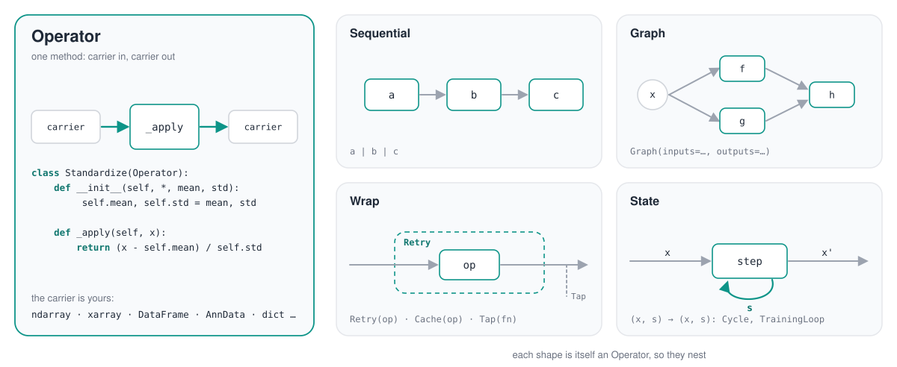
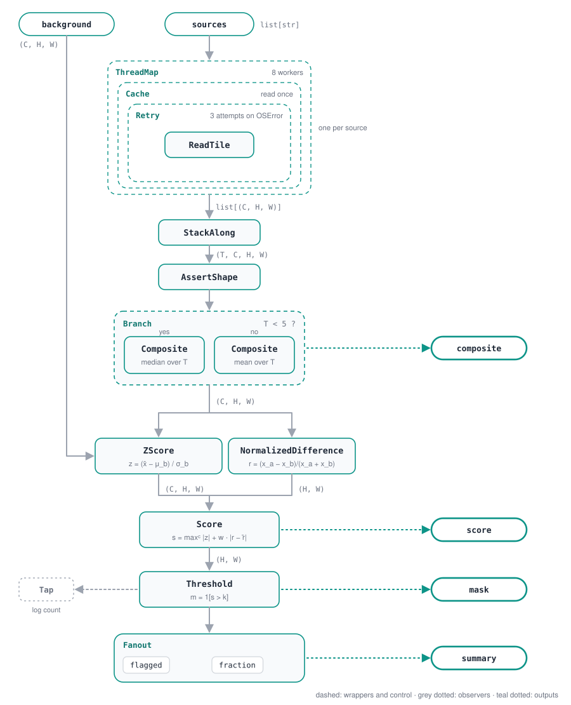

<p align="center">
  <picture>
    <source media="(prefers-color-scheme: dark)" srcset="https://raw.githubusercontent.com/jejjohnson/pipekit/main/docs/assets/packages/pipekit-ops/logo-dark.svg">
    
  </picture>
</p>

**pipekit-ops is a zero-dependency operator graph for any carrier: one `Operator` class, composed with `|` and `Graph`, wrapped, mapped, observed and saved as JSON.**

<p align="center">
  <a href="https://jejjohnson.github.io/pipekit/core-tour/"><b>Core tour</b></a> ·
  <a href="https://jejjohnson.github.io/pipekit/api/pipekit-ops/"><b>API</b></a> ·
  <a href="https://github.com/jejjohnson/pipekit/tree/main/packages/pipekit-ops/docs/design"><b>Design</b></a> ·
  <a href="https://github.com/jejjohnson/pipekit"><b>pipekit family</b></a>
</p>

Version 0.2.1, imported as `pipekit_ops`.
Until 0.2.0 this package was called `pipekit`; see [Moving from `pipekit` < 0.2](#moving-from-pipekit--02).

## Why it exists

Consider a season of Sentinel-2 scenes over one tile.
A STAC search gives a list of scene records, so we drop the cloudy ones, read each scene from object storage (which fails now and then), cache what we read, composite, check the shapes and write the result.
In practice this ends up as a script of loops, `try` blocks and a hand-rolled cache, which works once but is hard to rerun on another tile, to parallelise, or to describe in a config file.

pipekit-ops makes every one of those steps an `Operator`, and every way of combining them (a chain, a graph, a retry, a cache, a parallel map, an observer) is itself an `Operator`.
So the whole chain is one object that you can call, inspect, hash and write to JSON.
It never looks inside the carrier: the same machinery runs on a NumPy array, an xarray Dataset, a dict of scene records or your own class.

## Use it on its own

You get real value from this package without the rest of pipekit.
It is pure Python with no third-party dependencies (`dependencies = []`), so a library can depend on it without pulling in NumPy, JAX or anything else.
If your science has its own carrier (AnnData, astropy tables, a `GeoTensor`), you write operators for it and get composition, control flow, caching, parallel maps, QC and a JSON round-trip for free.

Who builds on it today:

- the other pipekit packages, every one of which depends on it;
- in the [GeoStack](https://github.com/jejjohnson/geostack), [geotoolz](https://github.com/jejjohnson/geotoolz) and [xrtoolz](https://github.com/jejjohnson/xrtoolz) narrow the carrier to a `GeoTensor` and an xarray object, and [radtrax](https://github.com/jejjohnson/radtrax) ships its retrievals as operators behind its `[geo]` extra.

## Where it sits

```
              your pipeline
                    │
   pipekit-cycle       time steps, DA cycles
   pipekit-train       training loops
   pipekit-experiment  registry, trackers
   pipekit-evaluate    benchmarks, scorers
   pipekit-jax         JAX / Equinox models
                    │
                    ▼  build on
   ┌─────────────────────────────────┐
   │ pipekit-array                   │
   │ named dims, any Array API       │
   │ backend                         │
   ├─────────────────────────────────┤
   │ pipekit-ops       ◀ this package│
   │ Operator, Sequential, Graph;    │
   │ pure Python, no dependencies    │
   └─────────────────────────────────┘
     two foundations, each usable
     on its own
```

Every pipekit package depends on pipekit-ops, and pipekit-ops depends on nothing.
The full picture, with each package's hard dependencies, is in the [top-level README](https://github.com/jejjohnson/pipekit#the-layering).

## Install

Until the packages are on PyPI, install from the repository:

```bash
uv add "pipekit-ops @ git+https://github.com/jejjohnson/pipekit.git#subdirectory=packages/pipekit-ops"
```

Once published:

```bash
uv add pipekit-ops
```

There are no extras.
The examples below also use NumPy and jaxtyping for the arrays and their type hints (`uv add numpy jaxtyping`); pipekit-ops itself never imports them.

## Quickstart

### 1. Operators, `|`, `Graph`, observers and the JSON round-trip

We standardise a row of reflectance values from two dates and take their difference.
The shapes header names the one dimension, and each maths line has its equation above it.

```python
import numpy as np
from jaxtyping import Float

from pipekit_ops import Graph, Input, Operator, Sequential, Tap, dumps, loads

# Shapes: N samples
Vector = Float[np.ndarray, " N"]


class Standardize(Operator):
    """Centre and scale by a fixed mean μ and spread σ."""

    def __init__(self, *, mean: float, std: float) -> None:
        # μ
        self.mean = mean
        # σ
        self.std = std

    def _apply(self, x: Vector) -> Vector:
        # z = (x − μ) / σ
        return (x - self.mean) / self.std


class Clip(Operator):
    """Clip to the interval [lo, hi]."""

    def __init__(self, *, lo: float, hi: float) -> None:
        self.lo = lo
        self.hi = hi

    def _apply(self, z: Vector) -> Vector:
        # z̃ = min(max(z, lo), hi)
        return np.clip(z, self.lo, self.hi)


class Difference(Operator):
    """Subtract the second input from the first."""

    def _apply(self, a: Vector, b: Vector) -> Vector:
        # d = a − b
        return a - b


def show(v: Vector) -> None:
    print("clean:", v)


# 1 · compose with |: a Sequential, itself an Operator

# user
# z = (x − 10) / 2
standardize = Standardize(mean=10.0, std=2.0)
# user
# z̃ = min(max(z, −3), 3)
clip = Clip(lo=-3.0, hi=3.0)
# today (pipekit-ops)
clean: Sequential = standardize | clip

x: Vector = np.array([4.0, 10.0, 30.0])
# [-3., 0., 3.]
z: Vector = clean(x)                                   # (N,) → (N,)

# 2 · wire a Graph: named inputs, shared operators, named outputs

# user
difference = Difference()
# today (pipekit-ops)
a = Input("a")
b = Input("b")
a_clean = clean(a)
b_clean = clean(b)
anomaly = difference(a_clean, b_clean)
graph = Graph(inputs={"a": a, "b": b}, outputs={"anomaly": anomaly})

# {"anomaly": d}, one value per sample
out: dict[str, Vector] = graph(a=x, b=x + 2.0)         # (N,), (N,) → (N,)

# 3 · observe without changing the flow

# today (pipekit-ops)
traced: Sequential = clean | Tap(show)

# 4 · configuration is data: an operator round-trips through JSON

# today (pipekit-ops)
text: str = dumps(standardize)
# Standardize(mean=10.0, std=2.0)
same: Operator = loads(text)
```

### 2. Scene records: filter, retry, cache, map, count, hash

The carrier here is a list of dicts, as a STAC search returns.
There are no arrays, so there is no shapes header.

```python
import pipekit_ops as pk


class CloudBelow(pk.Operator):
    """True when a scene's cloud cover is under a limit, in percent."""

    def __init__(self, limit: float) -> None:
        self.limit = limit

    def _apply(self, item: dict) -> bool:
        return item["cloud"] < self.limit


class ReadScene(pk.Operator):
    """Stand-in reader: a real one opens the scene's COG from object storage."""

    def _apply(self, item: dict) -> dict:
        return {**item, "path": f"s3://scenes/{item['id']}.tif"}


scenes = [
    {"id": "S2A_0601", "tile": "30SYJ", "cloud": 4.0},
    {"id": "S2B_0604", "tile": "30SYJ", "cloud": 63.0},
    {"id": "S2A_0611", "tile": "30SYJ", "cloud": 11.0},
    {"id": "S2B_0614", "tile": "30SXJ", "cloud": 2.0},
]

# user
# keep a scene when its cloud cover is under 20 %
cloud_free = pk.Filter(CloudBelow(20.0))
# today (pipekit-ops); ReadScene is user
# on OSError, read again: up to 3 attempts
read = pk.Retry(ReadScene(), attempts=3, base_delay=0.5, on=(OSError,))
# today (pipekit-ops)
# one entry per scene id, in the store bound as "scenes"
cached = pk.Cache(read, store="scenes", key=pk.Get("id"))
# today (pipekit-ops)
pipeline = (
    cloud_free
    | pk.Map(cached, executor="thread", n_workers=4)
    | pk.Log("read {type} of scenes", level="INFO")
    | pk.CountBy(pk.Get("tile"))
)

with pk.store_scope(scenes=pk.MemoryStore()):
    # {"30SYJ": 2, "30SXJ": 1}
    per_tile = pipeline(scenes)

# today (pipekit-ops)
again = pk.loads(pk.dumps(pipeline))
# True: the same configuration gives the same key
same_key = pk.pipeline_hash(again) == pk.pipeline_hash(pipeline)
```

Every step in that chain round-trips, so `pipeline_hash` gives one key for "this pipeline, configured this way".
We used `Log` rather than `Tap` because `Tap` holds a function, which cannot be written to JSON.

## What ships

The public surface is the 105 names of `pipekit_ops.__all__`, from 21 modules.

| Module | Public names | Purpose |
|---|---|---|
| `_base` | `Operator`, `ConfigMixin`, `Carrier`, `Sequential`, `Graph`, `Input`, `Node` | write a step, chain steps, wire a graph |
| `compose` | `pipe`, `compose`, `compose_left`, `juxt`, `complement` | the `toolz` function surface over operators |
| `blocks` | `Identity`, `Const`, `Lambda`, `Sink` | a no-op, a constant, a quick function, a side-effect write |
| `control` | `Branch`, `Switch`, `Try`, `Coalesce`, `Retry` | a decision or a failure inside the pipeline |
| `flow` | `Timeout`, `RateLimit`, `Until` | a call that may hang, a service with a quota, a step repeated until done |
| `observe` | `Tap`, `Snapshot`, `ShapeTrace`, `Profile`, `Histogram`, `Log` | look without changing the flow |
| `combine` | `Fanout` | one input, several named outputs |
| `dicts` | `Get`, `GetIn`, `Pick`, `Dissoc`, `Rename`, `Merge`, `Assoc`, `UpdateIn`, `ValMap` | reshape the dicts a `Graph`, a `Fanout` or a STAC item carries, without a `Lambda` |
| `seq` | `Not`, `Filter`, `Remove`, `Reduce`, `PartitionAll`, `Concat`, `Zip`, `GroupBy`, `CountBy`, `Count`, `Unique`, `Take`, `SortBy` | filter, group and count a list of items; predicates and keys are operators |
| `cache` | `Cache`, `Memoize` | the same expensive call twice, in memory or in a named store |
| `store` | `Store`, `MemoryStore`, `DirectoryStore`, `store_scope` | where a `Cache` keeps its entries; a `DirectoryStore` survives a restart |
| `qc` | `Quarantine`, `AssertShape`, `AssertDType`, `AssertHasAttribute`, `AssertCallable`, `AssertThat`, `AssertSignature`, `QCError` | guards that fail loudly, or set bad inputs aside |
| `signature` | `Signature`, `compute_output_signature` | named-dimension shape inference before running |
| `execution` | `Map`, `executor_scope`, `MapError`, `Failed`, `Prefetch`, `Fold` | one operator over many items, on any executor, with a bounded window |
| `parallel` | `ThreadMap`, `ProcessMap`, `AsyncMap`, `BatchedMap`, `check_pickleable` | presets of `Map`, and the pickling lint |
| `serial` | `dumps`, `loads`, `register`, `unregister`, `allowed`, `loads_sandboxed`, `from_state_sandboxed`, `upgrade_state` | configuration as JSON; untrusted pipelines through an allowlist |
| `hashing` | `pipeline_hash` | the content hash of a whole pipeline |
| `state` | `StatefulOperator`, `CarryState` | state carried from call to call (the base of `pipekit-cycle` and `pipekit-train`) |
| `protocols` | `Predictor`, `FittableTransformer` | accept a model without importing its library |
| `adapters` | `NamedArrayAdapter`, `LabelledAdapter`, `register_adapter`, `register_lazy_adapter`, `unregister_adapter`, `get_adapter`, `signature_of`, `MissingAdapterError`, `backend_of`, `backend_name`, `BackendError` | read a carrier's named dims or its array backend without importing its library |
| `imports` | `on_import` | run code once a module is imported, without importing it |

`pipekit_ops.testing` (`assert_round_trip`) is a 22nd module; you import it on its own, and it adds nothing to `__all__`.

Not built yet, by design:

- there is no automatic parallelism: `Sequential` runs in order and `Graph` evaluates in one process;
- there is no graph scheduler: `Map(executor="scope")` can send the items of one step to a Dask or Ray executor, but scheduling whole pipelines across machines is left to Dask, Ray, Beam and orchestrators.

The open design questions are in the [roadmap](https://github.com/jejjohnson/pipekit/blob/main/packages/pipekit-ops/docs/design/roadmap.md).

## How it works

### The operator model

<p align="center">
  <picture>
    <source media="(prefers-color-scheme: dark)" srcset="https://raw.githubusercontent.com/jejjohnson/pipekit/main/docs/assets/operator-dark.svg">
    
  </picture>
</p>

1. **An `Operator` has one method**, `_apply(self, carrier) -> carrier`.
   pipekit never inspects the carrier; domain packages narrow it.
2. **Composition is `|`.** `a | b | c` is a `Sequential`, flattened, so `(a | b) | c` and `a | (b | c)` are the same three steps.
   Flows that branch and merge are a `Graph`, built by calling operators on `Input`s; it rejects cycles and evaluates in topological order.
3. **Wrappers are operators too.** `Retry`, `Timeout`, `Try`, `Cache`, `Map` and the QC asserts take an operator and return one, so they nest anywhere.
4. **State is explicit.** A `StatefulOperator` maps `(carrier, state) → (carrier, state)`, and a `Sequential` or `Graph` threads the state through its stateful steps; `Cycle`, `DACycle` and `TrainingLoop` are built on it.
5. **Configuration is data.** An operator's constructor arguments, stored under their own names, are its config; `dumps` writes it as JSON and `loads` rebuilds the operator.
6. **Libraries plug in by protocol.** `Predictor`, `FittableTransformer` and the named-array adapters are runtime-checkable seams, so a library satisfies them without importing pipekit ([Protocols](https://github.com/jejjohnson/pipekit/blob/main/docs/protocols.md)).

The long form is [Concepts](https://github.com/jejjohnson/pipekit/blob/main/docs/concepts.md).
A single operator also carries `backends` (the array backends it accepts) and `compute_output_signature` (how it changes a `Signature`), so `Sequential.summary` and `Graph.summary` can print shapes before anything runs.

### Wrappers: control, flow, cache and store, observe, QC

- **Control** puts decisions and failures inside the pipeline: `Branch`, `Switch`, `Try`, `Coalesce` and `Retry`.
  `Try` and `Retry` need their exception list, so neither is ever a silent catch-all.
- **Flow limits** bound a step: `Timeout` gives up after a number of seconds (the thread is abandoned, not killed), `RateLimit` caps calls per period across the threads of one process, and `Until` repeats a step until a predicate holds.
- **Cache and store.** `Cache(op)` keys on a SHA-256 of the input and the inner operator's `pipeline_hash`.
  `Cache(op, store="scenes", key=Get("id"))` keeps its entries in a named store bound with `store_scope`, so the store is not in the config and the pipeline hashes the same on a laptop and on a cluster.
  A `DirectoryStore` writes one pickle per key, atomically; pickle loads run code, so point it only at a directory you control.
- **Observers** pass the carrier through unchanged: `Tap`, `Log`, `ShapeTrace`, and the controllers `Snapshot`, `Profile` and `Histogram`, whose `.at()` and `.wrap()` give the operators you place.
- **QC** turns "this won't break" into a permanent guard: `AssertShape`, `AssertDType`, `AssertThat` and `AssertSignature` raise `QCError`, while `Quarantine` returns a sentinel and keeps going.

Every wrapper is in the [core tour](https://github.com/jejjohnson/pipekit/blob/main/docs/core-tour.md), with a run output for each.

A bigger graph puts these together: an anomaly detector that reads a stack of multi-channel images in parallel with retries and a cache, checks the stack, picks a composite by the number of exposures, scores against a background input and summarises, with four named outputs.

<p align="center">
  <picture>
    <source media="(prefers-color-scheme: dark)" srcset="https://raw.githubusercontent.com/jejjohnson/pipekit/main/docs/assets/graph-dark.svg">
    
  </picture>
</p>

The wiring and the six domain operators, step by step and runnable, are in the tutorial [Build a bigger graph](https://github.com/jejjohnson/pipekit/blob/main/docs/tutorials/anomaly-graph.md).

### Execution: `Map`, executors, `Prefetch`, `Fold` and the presets

`Map(op, executor=...)` is the one engine for running an operator over many items.
`executor` is `"serial"`, `"thread"`, `"process"` (spawn by default), `"async"`, or `"scope"`, which borrows the `concurrent.futures.Executor` that an `executor_scope` binds (a Dask or Ray one included) and never shuts it down.
The executor is not in the config, so the pipeline hashes the same wherever it runs.
Input is pulled lazily, at most `max_in_flight` items are held at once, and `on_error` is `"raise"` (fail fast), `"collect"` (raise a `MapError` holding the partial results, with a `Failed` record per failure) or `"log_and_continue"`.

`Prefetch(op, depth)` reads up to `depth` items ahead of the consumer, and `Fold(op, initial, chunksize)` folds chunks in parallel through `Map` and then combines the partial results.
`ThreadMap`, `ProcessMap`, `AsyncMap` and `BatchedMap` are presets of `Map` with their own arguments (`n_workers`, `semaphore`, `batch_size`).
Process pools need every operator to pickle, so `check_pickleable(op)` walks a pipeline and returns the operators that hold a closure (they set `forbid_in_yaml = True`) before you fan out.
The details are in the [execution design](https://github.com/jejjohnson/pipekit/blob/main/packages/pipekit-ops/docs/design/api/execution.md).

### Dict and iterable plumbing

A `Graph` returns a dict, a `Fanout` returns a dict, and a STAC search returns a list of dicts.
The `dicts` operators (`Get`, `GetIn`, `Pick`, `Rename`, `Merge`, `Assoc`, `UpdateIn`, `ValMap`, `Dissoc`) reshape those without a `Lambda`, and the `seq` operators (`Filter`, `Remove`, `GroupBy`, `CountBy`, `Reduce`, `Take`, `SortBy`, …) work on a list of items inside the pipeline.
Their predicates and keys are operators too, so a chain built from them still round-trips through `dumps` and `loads`.

**Note**: `pipekit_ops.Reduce` is a left fold over a list of items; `pipekit_array.Reduce` reduces an array over named dims.
Import the packages under their own names (`pk.Reduce`, `pa.Reduce`) when you use both.

### Serialisation and hashing

`dumps(op)` writes `op.state` as JSON with sorted keys, nested operators included: a child operator appears in its parent's config as its own record, a `Graph` records every node and its wiring, and an exception class is written as `{"exception": "builtins.OSError"}`.
`loads` rebuilds the whole tree, as long as the modules that define the classes are imported.
`pipeline_hash` hashes that record, so two pipelines share a hash exactly when they are configured the same; the `pipekit-experiment` registries store models under it.

For pipelines you did not write (uploaded by users, read from a queue), `loads_sandboxed` builds only the classes you have `register`ed, at any depth, and checks every class before constructing anything.
Operators that hold a function (`Lambda`, `Tap`, `Branch` with a plain predicate, …) refuse to be written; use their operator-shaped alternatives (`Log`, an operator predicate) when the pipeline must round-trip.
`pipekit_ops.testing.assert_round_trip(op, *inputs)` checks the contract from your own test suite.

### The zero-dependency guarantee

pipekit-ops declares no dependencies, and we keep it that way: `import pipekit_ops` loads only the standard library.
The one exception is `pipekit_ops.testing`, which imports NumPy lazily when `assert_round_trip` compares two arrays.
Array-aware features find what they need through the carrier instead.
`AssertShape` reads `shape`, `Cache` keys an array by its bytes, dtype and shape, and the named-array adapters (`NamedArrayAdapter`, registered by pipekit-array, xarray or a geo library) give a carrier's dims to `AssertSignature` and `Signature`.
`on_import` runs a callback when a module such as `jax` is imported, without importing it, which is how the JAX pytree registrations stay optional.

## Learn more

- [Core tour](https://github.com/jejjohnson/pipekit/blob/main/docs/core-tour.md): every group of names, with a run output for each.
- [Concepts](https://github.com/jejjohnson/pipekit/blob/main/docs/concepts.md) and [Protocols](https://github.com/jejjohnson/pipekit/blob/main/docs/protocols.md).
- [Patterns](https://github.com/jejjohnson/pipekit/blob/main/docs/patterns.md) for batch jobs, services, orchestrators and audits.
- [Why operators are classes, not functions](https://github.com/jejjohnson/pipekit/blob/main/docs/background/toolz.md).
- The [design docs](https://github.com/jejjohnson/pipekit/tree/main/packages/pipekit-ops/docs/design) (vision, decisions, roadmap, per-module API specs) and the master plan, [Report 2](https://github.com/jejjohnson/research_journal_v2/blob/main/notes/geotoolz/master_plan/toolz_2_pipekit.md).
- The [API reference](https://jejjohnson.github.io/pipekit/api/pipekit-ops/).
- Tutorials: [a bigger graph](https://github.com/jejjohnson/pipekit/blob/main/docs/tutorials/anomaly-graph.md), [ETL over many regions](https://github.com/jejjohnson/pipekit/blob/main/docs/tutorials/etl-regions.md), [inference](https://github.com/jejjohnson/pipekit/blob/main/docs/tutorials/inference.md).
- The sibling foundation, [pipekit-array](https://github.com/jejjohnson/pipekit/tree/main/packages/pipekit-array), and the rest of the [family](https://github.com/jejjohnson/pipekit#the-packages).

## Moving from `pipekit` < 0.2

Change the import; every name and argument is unchanged.

```python
# before
from pipekit import Operator, Retry, Sequential

# after
from pipekit_ops import Operator, Retry, Sequential
```

Libraries should depend on `pipekit-ops`, not on `pipekit`: since 0.2.0 `pipekit` is the umbrella that installs the whole workspace, JAX included.
States saved before 0.2.0 (`dumps` output, registry entries) still load: a module saved as `pipekit.<name>` resolves to `pipekit_ops.<name>`.
Their `pipeline_hash` changes, because the hash covers each operator's module.

## License

MIT; see [LICENSE](https://github.com/jejjohnson/pipekit/blob/main/LICENSE).
