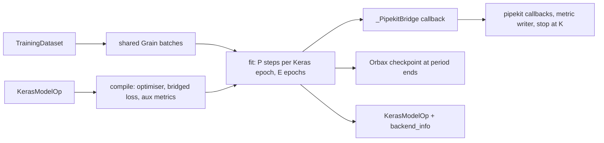

# Design: the Keras 3 backend (`backend="keras"`)

`backend="keras"` trains a Keras 3 model through the same `TrainingLoop` that trains Equinox models, and returns a `KerasModelOp` whose weights round-trip through a `ModelRegistry`. Keras's own `compile` and `fit` do the training (D1), on the JAX backend only (D19), and pipekit-train adds the parts Keras does not have: the step budget, the callbacks and metric writer, checkpoints that resume the data position, and the `TrainingArtifact`.

This page is the full design of the backend, a sibling of [`numpyro_adapter.md`](numpyro_adapter.md) and [`blackjax_adapter.md`](blackjax_adapter.md). Its decisions are D18, D19 and D20 in [`decisions.md`](decisions.md), and its build plan is §10. Every Keras fact the design relies on was measured on Keras 3.15.1 with JAX 0.12.1 on CPU, with the three scripts listed in §5; none of the names it proposes exists yet.

## 1. Motivation

`backend="keras"` has been a stub since v0.1: `pipekit_train.backends.keras.run` raises `NotImplementedError`, and epic [#147](https://github.com/jejjohnson/pipekit/issues/147) lists the backend and a model operator for Keras as its two unfiled issues. The Lightning backend was dropped (D15), so Keras is the one route into `TrainingLoop` for a model that is not written in Equinox.

The case for it is the models that already exist in Keras. keras-fairkl builds fairness-constrained models in Keras 3 (`FairModelWrapper` adds an HSIC or CKA penalty with `add_loss` and trains with `fit`), and a Keras user expects layers, dtype policies, Keras callbacks and Keras Tuner to keep working. Without the backend, such a model trains in a script outside pipekit and loses everything `TrainingLoop` gives an Equinox model: a dataset content hash, a step budget, `EarlyStopping` on validation metrics, checkpoints that resume, `HyperSweep` ranking, a registry entry and an operator that drops into a pipeline (D6, D7).

The backend should be thin. Keras 3 already has a training loop, so the design wraps `fit` rather than writing a second loop around `stateless_call` (D18), and it reuses the Grain batch pipeline and the Orbax checkpoints the Equinox backend already has.

## 2. User stories

- **The Keras modeller.** A researcher with a Keras model and a `TrainingDataset` of `(x, y)` pairs wants to train it with `TrainingLoop(..., backend="keras")`, log its metrics with the same `JSONLWriter`, stop early on validation loss, and get back an operator to put in a `Sequential` and in the registry.
- **The fairness researcher.** A keras-fairkl user trains a `FairModelWrapper` whose penalty is added inside `call` with `add_loss`. The batch input is the dict `{"x": X, "q": q}`. They need the backend to keep the model's own `compile` and to pass the dict through untouched.
- **The benchmark builder.** Someone comparing an Equinox emulator with a Keras one wants both under one `HyperSweep`, ranked on the same `final_eval_metrics`, with the same `optimizer_config` meaning the same optimiser on both backends.
- **The preempted job.** A long run on a shared machine is killed; restarting it with the same `checkpoint_dir` must continue from the last checkpoint and finish with the same weights an uninterrupted run would have.

## 3. Background maths

**One step.** With θ the trainable weights, B a minibatch of size N_B drawn from the dataset, f_θ the Keras model and ℓ the per-batch loss, step k applies the optimiser's update u to the gradient:

```math
\boldsymbol{\theta}_{k+1} = \boldsymbol{\theta}_k - \eta u\left(\nabla_{\boldsymbol{\theta}} \ell(f_{\boldsymbol{\theta}_k}(\mathbf{X}_B), \mathbf{Y}_B)\right)
```

Here η is the learning rate, $\mathbf{X}_ B$ is the stacked batch of inputs with shape (N_B, …) and $\mathbf{Y}_ B$ the stacked targets. A Keras model is batch-first, so a `pipekit_train.Loss` sees the whole batch of predictions. The Equinox backend instead writes the model per sample and maps it over the batch with `jax.vmap`; for a loss that averages over the batch, such as `MSE`, the two give the same scalar.

**The step budget.** `TrainingLoop` counts optimiser steps (D10), and Keras counts epochs of `steps_per_epoch` steps. The backend makes one Keras epoch one evaluation period of P = `eval_every_n_steps` steps, so with K = `max_steps` it calls `fit` for E Keras epochs and stops at step K:

```math
E = \left\lceil K / P \right\rceil
```

When P does not divide K, the last Keras epoch is cut short at step K by `stop_training`, and Keras still validates at the end of it, so validation runs at steps P, 2P, …, and K.

**What Keras logs per step.** Keras passes `on_train_batch_end` the running mean of the loss since the start of the epoch, not the loss of the batch. After j steps of an epoch it reports

```math
\bar{\ell}_ j = \frac{1}{j} \sum_{i=1}^{j} \ell_i
```

while the Equinox backend writes $\ell_ j$ itself. Resetting Keras's metrics after each step makes the reported value $\ell_ j$ again (§5).

**Validation.** The validation loss should be the per-sample mean over all N_val samples, with batches of size $n_ b$ and the last one ragged:

```math
\ell_{\text{val}} = \frac{\sum_b n_b \ell_b}{\sum_b n_b} \neq \frac{1}{N_{\text{batch}}} \sum_b \ell_b
```

Keras's loss tracker weights each batch by its size and gives the left side. A metric function that returns an already-averaged scalar gives the right side, which is biased whenever the last batch is ragged (§5), so auxiliary metrics need a metric that weights by batch size.

## 4. Background numerics: the Keras surface used

| Piece | Keras 3 name | Used for |
|---|---|---|
| Backend | `KERAS_BACKEND`, read once at the first `import keras`; `keras.config.backend()` reports it | D19: the backend runs on `"jax"` only |
| Training | `Model.compile(optimizer, loss, metrics)`, `Model.fit(x, steps_per_epoch, epochs, initial_epoch, validation_data, validation_steps, callbacks)` | the loop (D18) |
| Data | `fit` takes a Python generator of `(x, y)` batches; Keras 3.11 and later also read a Grain dataset directly | a generator over the loop's own Grain iterator, so its position can be saved |
| Loss | `keras.losses.Loss` with `call(y_true, y_pred)`, and `add_loss` inside a layer's `call` | the bridge from `pipekit_train.Loss` (argument order swaps) |
| Metrics | `keras.metrics.Metric` with `update_state(y_true, y_pred, sample_weight)`, `Model.reset_metrics()` | the auxiliary terms of a `Loss`, and per-step logs |
| Optimisers | `keras.optimizers.Adam`, `AdamW`, `SGD`, `RMSprop`; `optimizer.iterations`, `optimizer.variables` | `optimizer_config`, the step counter and checkpoints |
| Callbacks | `keras.callbacks.Callback`: `on_train_batch_end`, `on_test_end`, `on_epoch_end`; `self.model.stop_training = True` | the bridge to the pipekit callbacks |
| Weights | `Model.weights` (each with a `.path`, shape and dtype), `get_weights()`, `set_weights()` | the weight blob of `KerasModelOp` (D20) |
| Functional call | `Model.stateless_call(trainable, non_trainable, x)` | not used by `fit`; a later JAX-native export of the trained model |
| Distribution | `keras.distribution.DataParallel`, `ModelParallel`, `DeviceMesh` (JAX backend only) | not in the first release (§9) |
| Precision | `keras.config.set_dtype_policy` | left to the user, as boundaries.md Q3 decides for every backend |

Keras's own checkpointing does not fit the loop's contract. `BackupAndRestore` saves the weights and the epoch, but it cannot resume inside an epoch: it restarts the interrupted epoch from batch 0 with weights that were already updated, and it knows nothing of the data iterator. A `.keras` file is a zip whose `metadata.json` records the time it was saved, so two saves of the same weights differ in bytes and would give two registry hashes.

## 5. What was measured

Three scripts, run on Keras 3.15.1, JAX 0.12.1 and Grain on CPU, in a scratch environment outside the repo. They used an 8-unit dense model on toy data.

| Check | Result |
|---|---|
| Import with no backend set and no TensorFlow | `ModuleNotFoundError: No module named 'tensorflow'`: the default backend is TensorFlow |
| `fit` with P = 100, K = 250, a stop at step 250 | `optimizer.iterations` = 250; the generator was read 250 times, so it does not read ahead |
| Validation events in that run | at steps 100, 200 and 250 |
| `logs["loss"]` in `on_train_batch_end` | 6.2364, 5.7980, 5.8843: the running means of the per-batch losses 6.2364, 5.3597, 6.0567 |
| The same with `reset_metrics()` after each step | equal to `train_on_batch` per step, to every printed digit |
| Validation on 70 samples in batches of 32 | Keras's loss 3.234939, the exact per-sample mean 3.234939; a scalar metric function 3.289946, the mean of the batch means |
| A blob of `get_weights()` with a (path, shape, dtype) header | the same bytes on two calls; loaded into a skeleton built with another seed, the predictions differ by 0.0 |
| `model.save` twice, two seconds apart | different SHA-256 for the `.keras` files; the same for `.weights.h5` |
| Stop after 200 of 300 steps, save weights, optimiser variables and the Grain iterator state, restore into a fresh model, `fit` with `initial_epoch=2` | largest weight difference from the uninterrupted run 0.0, at 300 steps |
| `stateless_call` under `jax.jit` against `model(x)` | largest difference 2.4e-7 |
| Three one-period `fit` calls on one model | 1.06 s, 0.23 s and 0.26 s: the train function is compiled once |
| `optimizer_config` defaults | Keras `Adam` and `AdamW` take `epsilon=1e-7`, optax `eps=1e-8`; Keras `AdamW` takes `weight_decay=0.004`, optax `1e-4` |

The scripts are `keras_spike.py`, `keras_resume_spike.py` and `keras_metrics_spike.py`. They are not in the repo; the tests of §10 assert the same facts.

## 6. What it builds on

Most of what the backend needs exists in pipekit-train or in Keras. The gaps are all inside this repo.

| Need | Upstream name | State on `main` |
|---|---|---|
| Dispatch by backend name | `TrainingLoop`, `_BACKEND_MODULES["keras"]` (`pipekit_train.loop`) | today: points at `pipekit_train.backends.keras.run` |
| Callback dispatch, early stop | `dispatch`, `any_should_stop` (`pipekit_train.backends._common`) | today |
| Optimiser names | `OPTIMIZER_NAMES` (`pipekit_train.backends._common`) | today; `build_optimizer` returns optax, so Keras needs its own translation |
| Batches from an indexable or streaming dataset, with a saved position | `_BatchSource` (`pipekit_train.backends.equinox._batches`) | today, but private to the Equinox area and returns JAX arrays |
| Loss with auxiliary metrics | `Loss`, `call_loss`, `MSE`, `NLL`, `Composite` (`pipekit_train.losses`) | today |
| Checkpoint cadence and registry hand-off | `Checkpoint` (`pipekit_train.loop`) | today; `on_train_end` stores `serialize_weights()` when the model has it |
| Weight blob into a registry | `ModelRegistry.store(op, weights=...)`, `load_weights` (`pipekit_experiment`) | today |
| Model selection | `HyperSweep` reads `backend_info["final_metrics"]` and `["final_eval_metrics"]` | today |
| A generic trained-model operator | `pipekit_array.inference.ModelOp` | not built (pipekit-array phase D); D20 does not wait for it |

The gaps, each with its owner:

- **A shared batch pipeline.** The Grain chain in `_BatchSource` moves to `pipekit_train.backends._batches` and returns NumPy batches; the Equinox area keeps converting and placing them on devices. Owner: pipekit-train (step 1).
- **`KerasModelOp`** with a weight blob, in `pipekit_train.backends.keras` (D20). Owner: pipekit-train (step 2).
- **pipekit-array's design pages** (`api/inference.md`, A8) say the Keras backend returns `pipekit_array.ModelOp`. They change to point at `KerasModelOp` once D20 is accepted. Owner: pipekit-array, same repo (step 5).

What stays local to the backend: the loss bridge, the batch-weighted metric for auxiliary terms, the translation of `optimizer_config`, and the one Keras callback that drives the pipekit callbacks.

## 7. Decisions

Three choices had real alternatives. Each is a record in [`decisions.md`](decisions.md); this is the summary.

- **D18: wrap `compile` and `fit`.** The alternative was a stateless JAX loop that treats Keras only as a model definition and reuses the Equinox loop. That loop would match the Equinox backend step for step, but it would ignore the model's `compile`, skip Keras callbacks and Keras Tuner, and write a second training loop, which D1 rules out. `fit` gives exact step counts and exact resumes in the measurements of §5, so its cost is two semantics the design states: metrics are reset after each step, and checkpoints fall on period boundaries.
- **D19: the JAX backend only.** Keras also runs on TensorFlow and PyTorch, but D15 removed PyTorch training, the stack's arrays are JAX, `keras.distribution` is JAX-only, and every measurement above is on JAX. The backend sets `KERAS_BACKEND=jax` when Keras is not yet imported and raises when Keras was imported on another backend.
- **D20: `KerasModelOp` lives in the Keras area, with its own weight blob.** `pipekit_array.ModelOp` is not built, holds no weights by design (A8), and pipekit-array takes no backend dependency. The `.keras` file is not byte-stable. So the operator writes a blob of a signature header and the raw arrays, as `pipekit_jax.JaxModelOp` does for Equinox.

## 8. API proposal

### 8.1 Registration

The `[keras]` extra becomes `keras`, `jax`, `grain`, `orbax-checkpoint` and `numpy`, and `train-extras` in the root `pyproject.toml` gains it so CI runs the tests. The version floor of Keras is the lowest one CI passes on; it was measured at 3.15.1. `_BACKEND_MODULES["keras"]` is unchanged. The area keeps its rule that importing it imports no Keras, so `run` imports Keras on first call.

### 8.2 `KerasTask`, the per-backend task (D9)

D9 says the Keras task is the `(loss, metrics)` a model is compiled with. `KerasTask` holds those, the user's own Keras callbacks, and a switch to keep a model's own `compile`:

```python
# Shapes: N_B = batch_size samples per step

from dataclasses import dataclass, field
from typing import Any

import keras


# proposed (D18)
@dataclass
class KerasTask:
    """The Keras training target (loop.task for backend="keras")."""

    # a Keras loss, its name, or None to bridge loop.loss
    loss: keras.losses.Loss | str | None = None
    # Keras metrics passed to compile, beside the loss's auxiliary terms
    metrics: tuple[Any, ...] = ()
    # Keras callbacks run beside the bridge (Keras Tuner, TensorBoard, …)
    keras_callbacks: tuple[keras.callbacks.Callback, ...] = ()
    # True: keep the model's own compile (e.g. a FairModelWrapper with add_loss)
    keep_compile: bool = False
```

With no task, the backend synthesises one from `loop.loss`, as the Equinox backend does. A `Loss` that takes a `key` (the sample-based fallback of `KL`) is refused in the first release with a message naming the limit, because a Keras loss has no key argument (§9).

### 8.3 The loss bridge

A `pipekit_train.Loss` is called `(predicted, target)` and may return `(scalar, aux)`. The bridge swaps the arguments for Keras, and each auxiliary term becomes a metric weighted by batch size, so its validation value is the per-sample mean of §3:

```python
# proposed (D18)
class _LossBridge(keras.losses.Loss):
    """A pipekit_train.Loss as a Keras loss; the aux terms are dropped here."""

    def call(self, y_true, y_pred):
        # ℓ(f_θ(X_B), Y_B)
        # (N_B, …), (N_B, …) → ()
        result = self.loss(y_pred, y_true)
        return result[0] if isinstance(result, tuple) else result


# proposed (D18)
class _AuxMetric(keras.metrics.Metric):
    """One aux term of a Loss, averaged per sample: Σ_b n_b a_b / Σ_b n_b."""

    def update_state(self, y_true, y_pred, sample_weight=None):
        # a_b = aux[name] on batch b, weighted by its size n_b
        # (N_B, …), (N_B, …) → ()
        value = self.loss(y_pred, y_true)[1][self.aux_name]
        batch_size = keras.ops.shape(y_true)[0]
        self.total.assign_add(value * batch_size)
        self.count.assign_add(batch_size)
```

The auxiliary keys are read by calling the loss once on the first batch before `compile`.

### 8.4 `optimizer_config`

The backend translates `optimizer_config` with the same names as every other backend (`OPTIMIZER_NAMES`: `adam`, `adamw`, `sgd`, `rmsprop`). `lr` becomes `learning_rate`, optax's `b1`, `b2`, `eps` and `decay` become Keras's `beta_1`, `beta_2`, `epsilon` and `rho`, and a value the config leaves out takes optax's default (`eps=1e-8`; `weight_decay=1e-4` for `adamw`). One config therefore means one optimiser on both backends, where Keras's own defaults would differ (§5).

### 8.5 What `run(loop)` does



1. **Backend.** If Keras is not imported, set `KERAS_BACKEND=jax` unless it is set; import Keras; raise if `keras.config.backend()` is not `"jax"` (D19). Raise if `loop.sharding` is set (§9).
2. **Model.** `loop.model_op` must be a `KerasModelOp`; anything else raises `TypeError` naming it.
3. **Task.** Use `loop.task` if it is a `KerasTask`, else synthesise one from `loop.loss`; raise if neither is set.
4. **Compile.** Unless `keep_compile`, call `model.compile(optimizer, loss, metrics, steps_per_execution=1)`. One step per execution keeps `on_train_batch_end` firing every step.
5. **Data.** Build the shared batch source over `loop.dataset` with `loop.batch_size` and `loop.seed`, and pass `fit` a generator over it. The validation set is a finite generator of ragged batches, with `validation_steps` = ⌈N_val / N_B⌉.
6. **Resume.** If `checkpoint_dir` (or `Checkpoint.save_dir`) holds a checkpoint, restore the weights, the optimiser variables, the iterator state and the step k₀.
7. **Fit.** `model.fit(batches, steps_per_epoch=P, epochs=E, initial_epoch=k₀ // P, validation_data=…, callbacks=[bridge, checkpoint, *task.keras_callbacks], verbose=0)`.
8. **Wrap.** Return the trained model in a copy of the `KerasModelOp` the loop was given, fire `on_train_end`, and return `backend_info`.

The bridge is one Keras callback:

```python
# proposed (D18)
class _PipekitBridge(keras.callbacks.Callback):
    def on_train_batch_end(self, batch, logs=None):
        # k = optimizer.iterations, the global step
        step = int(self.model.optimizer.iterations)
        metrics = {name: float(value) for name, value in logs.items()}
        # ℓ_k itself rather than the running mean of §3
        self.model.reset_metrics()
        # write every log_every_n_steps; fire on_step_end (and on_epoch_end
        # every loop.steps_per_epoch steps) through _common.dispatch
        ...
        if step >= self.loop.max_steps or _common.any_should_stop(self.callbacks):
            self.model.stop_training = True

    def on_test_end(self, logs=None):
        # the validation logs of this period become final_eval_metrics, and
        # on_eval_end fires; EarlyStopping then stops fit at the epoch's end
        ...
```

Checkpoints are written by a second callback at the end of each Keras epoch whose step is a multiple of `Checkpoint.every_n_steps`, and always at the final step. They go through an Orbax `CheckpointManager` holding the weights, the optimiser variables, the step and the Grain iterator state, with `keep_last` as `max_to_keep`. `every_n_steps` must be a multiple of P, or `run` raises `ValueError` before training; this is the price of D18, and §5 shows that a resume on a period boundary is exact. The final checkpoint can fall off the period grid when P does not divide K; a later run from it with a larger `max_steps` first calls `fit` for one short epoch of P − (k₀ mod P) steps to return to the grid, which the repeated-`fit` measurement of §5 shows costs no recompilation of the step.

### 8.6 `KerasModelOp` (D20)

```python
# Shapes: N samples at serving time

# proposed (D20)
class KerasModelOp(Operator):
    """A Keras model as a pipekit operator, with a weight-blob round trip."""

    forbid_in_yaml: ClassVar[bool] = True

    def __init__(self, model: keras.Model) -> None: ...

    def _apply(self, x):
        # ŷ = f_θ(x)
        # (N, …) → (N, …)
        return self.model(x, training=False)

    def serialize_weights(self) -> bytes:
        """b"PKKRW1\\n" | header length | JSON [(path, shape, dtype)] | raw arrays."""

    def with_weights(self, blob: bytes) -> "KerasModelOp":
        """A copy with the blob's weights; self is the skeleton."""

    @classmethod
    def from_registry(cls, skeleton, registry, ref) -> "KerasModelOp": ...

    def get_config(self) -> dict[str, Any]:
        return {"model_class": type(self.model).__qualname__}
```

`with_weights` clones the skeleton with `keras.models.clone_model`, checks the header's paths, shapes and dtypes against it, and loads with `set_weights`, so a blob never lands in a model of another shape. Like `JaxModelOp`, the skeleton is needed because a model's architecture is Python, not bytes. A user who wants a portable file calls `model.save` on `op.model`; that file is not what the registry hashes.

### 8.7 `TrainingLoop` fields

| Field | Keras backend |
|---|---|
| `model_op` | a `KerasModelOp` |
| `task` | a `KerasTask`, or none to bridge `loss` |
| `loss` | bridged to a Keras loss; aux terms become batch-weighted metrics |
| `optimizer_config` | translated with optax's defaults (§8.4) |
| `max_steps` | exact, through `stop_training` |
| `eval_every_n_steps` | P, the length of one Keras epoch |
| `steps_per_epoch` | fires the pipekit `on_epoch_end`; independent of P |
| `batch_size` | the Grain batch; ragged last batch in validation |
| `log_every_n_steps` | per-step values, after `reset_metrics` |
| `callbacks` | driven by the bridge; `EarlyStopping` stops at the end of the period |
| `checkpoint_dir` | Orbax, at period ends, with the data position |
| `sharding` | must be `None` in the first release |
| `seed` | the Grain shuffle; Keras's seeded layers (open question 2) |

`backend_info` carries `backend`, `keras_version`, `keras_backend`, `jax_version`, `devices`, `total_seconds`, `final_step`, `final_metrics` and `final_eval_metrics`, so `HyperSweep` ranks Keras trials as it ranks Equinox ones.

## 9. Example API usage

The block uses only proposed names, so it has not been run; §5 is what was run.

```python
# Shapes: N = 512 samples; D_x = 3 inputs; D_y = 1 output; N_B = 32

import keras
from pipekit_train import MSE, EarlyStopping, IterableDataset, JSONLWriter, TrainingLoop

# proposed (D20)
from pipekit_train.backends.keras import KerasModelOp

# user
model = keras.Sequential(
    [keras.Input((3,)), keras.layers.Dense(64, activation="gelu"), keras.layers.Dense(1)]
)

# today (pipekit-train)
dataset = IterableDataset(source=pairs, content_hash="linreg-512")

# proposed (D18)
# θ_K after K = 2,000 steps of AdamW on ℓ = MSE
trained_op, artifact = TrainingLoop(
    model_op=KerasModelOp(model),
    dataset=dataset,
    val_dataset=val_dataset,
    loss=MSE(),
    optimizer_config={"name": "adamw", "lr": 1e-3},
    max_steps=2_000,
    eval_every_n_steps=200,
    batch_size=32,
    backend="keras",
    callbacks=(EarlyStopping(metric="mse", patience=3),),
    metric_writer=JSONLWriter("runs/keras.jsonl"),
    seed=0,
).run()

# proposed (D20)
# ŷ = f_θ_K(x)
# (N, D_x) → (N, D_y)
predictions = trained_op(x_test)
```

A keras-fairkl model keeps its own `compile`, because its penalty lives in `add_loss`, and its batches carry the sensitive attribute in the input dict:

```python
# not pinned (keras-fairkl)
fair_model = fairkl.FairModelWrapper(base_model, mu=1.0)
fair_model.compile(optimizer="adam", loss="mse")

# proposed (D18)
# each batch is ({"x": X_B, "q": Q_B}, Y_B)
TrainingLoop(
    model_op=KerasModelOp(fair_model),
    dataset=fair_dataset,
    task=KerasTask(keep_compile=True),
    backend="keras",
    max_steps=1_000,
).run()
```

With `keep_compile=True` the model's own optimiser stands and `optimizer_config` is not used; the backend says so in a warning when the config differs from the default.

## 10. Plan

Five PRs, stacked in this order, under epic [#147](https://github.com/jejjohnson/pipekit/issues/147). None depends on #16 (stateful Equinox layers), which touches `_state.py`, not `_batches.py`, so the two can proceed in either order.

1. **refactor(train): one batch pipeline for every backend.** Move the Grain chain of `_BatchSource` to `pipekit_train.backends._batches`, returning NumPy; the Equinox area keeps the conversion to JAX and the device placement. Test: the Equinox tests pass unchanged, and the shared source yields the same batches for the same seed.
2. **feat(train): `KerasModelOp` with a weight blob (D20).** The operator, `serialize_weights`, `with_weights` with the signature check, and `from_registry`; `[keras]` extra and `train-extras` updated. Test: the blob is byte-stable, the round trip is exact, a skeleton of another shape is refused, and a `LocalModelRegistry` stores and reloads it.
3. **feat(train): the Keras backend (D18, D19).** `KerasTask`, the loss bridge and `_AuxMetric`, the optimiser translation, the bridge callback, validation, and `backend_info`; the stub's tests are replaced. Test: the step count is exactly `max_steps` when P does not divide it, per-step logs equal `train_on_batch`, the validation loss equals the per-sample mean on a ragged set, `EarlyStopping` stops at a period's end, a non-JAX backend raises, and `HyperSweep` ranks two Keras trials.
4. **feat(train): Keras checkpoints that resume.** The Orbax checkpoint callback and the resume path. Test: a run stopped and resumed on a period boundary ends with the weights of an uninterrupted run, and an `every_n_steps` that is not a multiple of P raises.
5. **docs(train): the Keras backend.** A notebook in `docs/notebooks/`, the Keras rows of the README and of `api/adapters.md`, `installation.md`, and pipekit-array's `api/inference.md` and A8 pointed at `KerasModelOp`.

Left for later, each an issue once the five land: data-parallel training through `keras.distribution` behind `loop.sharding`; losses that take a `key`, through a `keras.random.SeedGenerator`; and other Keras backends, if D19 is ever revisited.

## 11. Open questions

1. **Resetting metrics each step.** It gives per-step logs, but a user's own Keras callback that reads the training logs at the end of an epoch then sees the last step's values, not the epoch's mean. The alternative is to log Keras's running means and say so. The proposal resets.
2. **The seed.** `keras.utils.set_random_seed(loop.seed)` would make dropout and other seeded layers reproducible, but it also reseeds Python's and NumPy's global generators in the caller's process. The proposal does not call it and documents that layers seed themselves; the alternative calls it and documents the side effect.
3. **Checkpoint cadence.** The proposal raises when `every_n_steps` is not a multiple of P. Rounding it up to the next multiple, with a warning, is the alternative.
4. **The version floor of Keras.** Keras 3.11 is the first release that reads Grain datasets in `fit`, but the backend passes a generator and does not need that. The floor is whatever CI passes on.

## 12. References

**Keras.**

- Keras 3 training APIs (`compile`, `fit`, `evaluate`): <https://keras.io/api/models/model_training_apis/>
- Getting started, backend selection: <https://keras.io/getting_started/>
- Callbacks: <https://keras.io/api/callbacks/>, and `BackupAndRestore`: <https://keras.io/api/callbacks/backup_and_restore/>
- Saving and loading: <https://keras.io/api/models/model_saving_apis/model_saving_and_loading/>
- Customising `train_step` on JAX (`stateless_call`, `compute_loss_and_updates`): <https://keras.io/guides/custom_train_step_in_jax/>
- Distribution API: <https://keras.io/guides/distribution/>
- Dtype policies: <https://keras.io/api/mixed_precision/policy/>
- Release notes (Grain support in 3.11.0): <https://github.com/keras-team/keras/releases>

**pipekit.**

- [`api/adapters.md`](api/adapters.md): the per-backend reference.
- [`decisions.md`](decisions.md): D1 (thin orchestration), D5 (extras), D7 (trained models are operators), D9 (per-backend task), D10 (per-step), D15 (no Lightning), D16 (padded evaluation), and D18 to D20 (this backend).
- pipekit-array `docs/design/api/inference.md` and A8: the generic `ModelOp` and why it holds no weights.
- pipekit-jax `weights.py`: the signature-header blob that `KerasModelOp` mirrors.
- keras-fairkl `models/fair_wrapper.py`: the `add_loss` model of the second user story.
